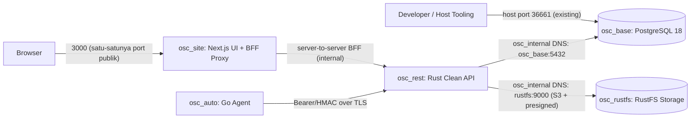

# System Blueprint & Execution Plan: omnisight — Bootstrap & Scaffolding

- **Date**: 2026-11-11
- **Author**: ai-main (PM, System Analyst & Docker DevOps Architect)
- **Source Target**: Local workspace `/home/usr/omnisight` (greenfield bootstrap)
- **Scope**: `Full-Stack Bootstrap | Infrastructure | Feature Rollout`
- **Delegated Skills**: `ai-base`, `ai-rest`, `ai-site`, `ai-auto`, `ai-test`

## 1. Executive Summary & Workspace Audit

omnisight adalah workspace multi-service full-stack yang dibangun dari nol dengan target arsitektur modern:

| Komponen | Teknologi | Workspace | Peran |
| :--- | :--- | :--- | :--- |
| `osc_base` | PostgreSQL 18 + Prisma ORM | `osc_base/` | Data layer (skema, migrasi, seed) |
| `osc_rest` | Rust Clean Architecture (axum/sqlx, RustFS, calamine/rust_xlsxwriter) | `osc_rest/` | Core REST API + storage + Excel import/export |
| `osc_site` | Next.js App Router + shadcn/ui + BFF Proxy | `osc_site/` | Frontend + secure API proxy (satu-satunya port publik) |
| `osc_auto` | Golang cross-platform agent (Linux/Windows) | `osc_auto/<nama_agent>/` | Background agent/otomasi — agent pertama: `agent_cs` (probe `/api/v1/health` osc_rest; lihat `osc_docs/auto/agent_cs/README.md`) |
| Test suites | Python pytest (QA + SOC) | `osc_docs/test/rest_qad|rest_soc/` | QA/regression + OWASP penetration testing |

### Audit kondisi workspace saat bootstrap

- `docker-compose.yml` existing hanya memuat PostgreSQL (`osc_base`) pada network eksternal `blackbox` (subnet `172.99.0.0/16`, static IP `172.99.66.1`, host port `36661`, volume `xbase`, healthcheck `pg_isready`). Konvensi ini **dipertahankan** dan diperluas, tidak dibuang.
- `/etc/docker/daemon.json` **belum ada** (catatan di `notes.txt` baru rencana); Docker Compose v5.5.1 terpasang. Karena `blackbox` mengklaim penuh `172.99.0.0/16`, semua network baru WAJIB di luar range tersebut (dipakai `172.30.0.0/24` & `172.30.1.0/24`).
- File placeholder **kosong (0 byte)** ditemukan: `osc_rest/Cargo.toml`, `osc_base/prisma/schema.prisma`, `osc_docs/test/rest_qad/pyproject.toml`, `osc_docs/test/rest_soc/pyproject.toml`.
- Pohon direktori kosong `osc_rest/src/{app/api/proxy, application, domain, infrastructure, presentation}` — struktur `src/app/api/proxy` adalah pola Next.js yang **salah tempat** di workspace Rust; ditandai untuk keputusan pembenahan di fase `ai-rest`.
- `notes.txt` berisi task tertunda untuk `ai-base`: modul manajemen transaksi & audit log pada schema + dokumentasi di `osc_docs/base`.
- `.gitignore` mengabaikan `*.env` (file `.env` nyata tidak ikut repo) — `.env.example` tetap ter-commit sebagai template.

## 2. Target End-to-End Architecture & Sequence Flow



Prinsip alur data:

1. Browser hanya pernah berbicara dengan `osc_site`; token JWT disimpan server-side (cookie `HttpOnly`) dan di-inject oleh BFF proxy menuju `osc_rest` — **tidak ada kredensial yang pernah sampai ke browser**.
2. `osc_rest` adalah satu-satunya komponen yang memegang koneksi PostgreSQL (Prisma/migrasi via job `ai-base`) dan RustFS (S3 API + presigned URL).
3. `osc_auto` (agent Golang) memanggil `osc_rest` dengan auth scoped (JWT/HMAC) — tidak pernah menyentuh database secara langsung.
4. `ai-test` menguji seluruh kontrak di atas dari luar (pytest httpx) dan dari dalam (unit/integration).

## 3. Bootstrap Work Breakdown Matrix

Eksekusi delegasi memakai urutan dependensi (dependency-first). Fase 0 dikerjakan `ai-main` saat ini; fase berikutnya didelegasikan berurutan sesuai permintaan.

| Phase | Target Skill | Workspace | Input Ref | Deliverables & Technical Doc Path | Acceptance Criteria | Status |
| :--- | :--- | :--- | :--- | :--- | :--- | :--- |
| 0 | `ai-main` | root | — | `osc_docs/architecture.md`, `docker-compose.yml`, `.env.example` | `docker compose config --quiet` lulus; isolasi network & healthcheck terpasang | ✅ Done |
| 1 | `ai-base` | `osc_base` | Task tertunda di `notes.txt` (transaksi & audit log) | Scaffold proyek Prisma (`package.json`, `schema.prisma`, migrasi awal) + `osc_docs/base/*.md` | `npx prisma format && npx prisma validate` lulus | ✅ Done |
| 2 | `ai-rest` | `osc_rest` | `osc_docs/base/*.md` | Scaffold Rust Clean Architecture (`Cargo.toml`, layer `domain/application/infrastructure/presentation`) + multi-stage `Dockerfile` + `osc_docs/rest/*.md` | `cargo check` / `cargo clippy` lulus; healthcheck `/api/v1/health` aktif | ✅ Done |
| 3 | `ai-site` | `osc_site` | `osc_docs/rest/*.md` | Scaffold Next.js App Router (layout `src/`, BFF proxy `/api/proxy/**`, Zod) + multi-stage `Dockerfile` + `osc_docs/site/*.md` | `tsc --noEmit` / `npm run build` lulus; CSP & cookie HttpOnly terkonfigurasi | ✅ Done |
| 4 | `ai-auto` | `osc_auto/agent_cs` | `osc_docs/rest/*.md` | Scaffold Go module `agent_cs` (Clean Architecture: `domain/usecase/infrastructure/delivery`, lifecycle `systemd` + Windows Service via `x/sys`, deploy `agent_cs.service` + `install-service.ps1`) + `osc_docs/auto/agent_cs/README.md` | `gofmt`/`go vet`/`go test -race` lulus; build Linux ELF & Windows PE32+ sukses; smoke test `--once` retry+jitter bekerja | ✅ Done |
| 5 | `ai-test` | `osc_docs/test/rest_qad`, `osc_docs/test/rest_soc` | `osc_docs/rest/*.md` | Kerangka pytest Clean Architecture keduanya (`src/{domain,application,infrastructure}` + `test/`, pydantic v2 + httpx) + rencana uji `qa-plan-core.md` / `soc-plan-core.md` | `pytest` lulus: 16 passed+4 skip (QA) & 14 passed+4 skip (SOC); gate sidik jari target anti layanan asing | ✅ Done |
| 6 | `ai-main` | root | Semua fase | Verifikasi end-to-end compose: build 4 image, `up --wait` healthy, uji health & BFF proxy — laporan `osc_docs/verification.md` (3 fix: pin builder bookworm, prefix `/api` proxy, Referrer-Policy koheren) | ✅ Semua container `healthy`; hanya port `osc_site:3000` + `36661` terekspos; proxy end-to-end lulus | ✅ Done |

### Pembenahan yang ditugaskan ke fase spesialis

- **`ai-rest` (fase 2)**: ~~bereskan pohon `osc_rest/src/app/api/proxy`~~ **selesai** — pohon placeholder salah tempat dihapus, digantikan layout Rust Clean Architecture; `Cargo.toml` terisi & tervalidasi (`osc_docs/rest/api-core-foundation.md`).
- **`ai-base` (fase 1)**: ~~isi `schema.prisma` kosong~~ **selesai** — core schema `users` + `audit_logs` tervalidasi (lihat `osc_docs/base/schema-core.md`); sisa task `notes.txt` (modul manajemen transaksi) menjadi delegasi `ai-base` berikutnya.
- **`ai-test` (fase 5)**: ~~isi kedua `pyproject.toml` kosong~~ **selesai** — kedua suite lulus `pytest` dengan gate sidik jari target (port host 8000 dipegang layanan asing → test live skip, bukan gagal); vektor serangan fase auth/excel sudah disiapkan sebagai data murni (`osc_docs/test/*/` plan docs).

## 4. Docker & Infrastructure Topology

### Networks

| Network | Tipe | Subnet | Anggota | Tujuan |
| :--- | :--- | :--- | :--- | :--- |
| `blackbox` (existing) | external bridge | `172.99.0.0/16` | `osc_base` (static `172.99.66.1`) | Legacy/host-side akses DB; konvensi existing dipertahankan |
| `omnisight_internal` | bridge, `internal: true` | `172.30.0.0/24` | `osc_base`, `osc_rustfs`, `osc_rest`, `osc_site` | Komunikasi antar-service; **tidak bisa** dijangkau host/internet |
| `omnisight_edge` | bridge publik | `172.30.1.0/24` | `osc_site` | Penanda zona publik; satu-satunya published port milik `osc_site` |

> Aturan isolasi: service internal (`postgres`, `rustfs`, `osc_rest`) TIDAK mempublikasikan port apa pun. Satu-satunya port publik stack adalah `${SITE_PORT:-3000}` (Next.js) ditambah port DB existing `36661` (warisan, lihat risiko §5).

### Volumes

| Volume | Mount | Service | Isi |
| :--- | :--- | :--- | :--- |
| `xbase` (existing) | `/var/lib/postgresql` | `osc_base` | Data PostgreSQL |
| `rustfs_data` | `/data` | `osc_rustfs` | Objek S3 (bucket Excel export/import, berkas) |

### Ports & Healthchecks

| Service | Published Port | Internal Port | Healthcheck | Ketergantungan |
| :--- | :--- | :--- | :--- | :--- |
| `osc_base` | `36661:5432` (existing) | `5432` | `pg_isready` (10s/5s/5x) — existing | — |
| `osc_rustfs` | *(tidak ada; console dev opsional loopback)* | `9000` (S3), `9001` (console) | `curl http://localhost:9000/health` (10s/5s/5x, start 15s) | — |
| `osc_rest` | *(tidak ada)* | `${REST_PORT:-8000}` | TODO fase `ai-rest` (`/api/v1/health`) | `osc_base: healthy`, `rustfs: healthy` |
| `osc_site` | `${SITE_PORT:-3000}:3000` | `3000` | TODO fase `ai-site` | `osc_rest: started` → di-upgrade ke `healthy` oleh `ai-rest` |

### Environment variables (`.env.example`)

| Variabel | Default (dev) | Dipakai oleh | Catatan |
| :--- | :--- | :--- | :--- |
| `TZ` | `Asia/Jakarta` | semua | existing |
| `PG_DATA` / `PG_USER` / `PG_PASS` | `osc` / `dbe` / `password_osc_dbe` | `osc_base`, `osc_rest` | existing |
| `RUSTFS_ACCESS_KEY` / `RUSTFS_SECRET_KEY` | `oscadmin` / `password_osc_rustfs` | `rustfs`, `osc_rest` | Access key **tanpa `/`** (aturan SigV4); ganti sebelum produksi |
| `RUSTFS_BUCKET` | `osc` | `osc_rest` | Bucket default (dibuat fase `ai-rest`) |
| `REST_PORT` | `8000` | `osc_rest`, `osc_site` | Internal only, tidak dipublish |
| `SITE_PORT` | `3000` | `osc_site` | Satu-satunya port publik stack |

## 5. Risks, Security & Rollback Strategy

| Risiko / Temuan | Dampak | Mitigasi |
| :--- | :--- | :--- |
| Kredensial default dev (`PG_PASS`, `RUSTFS_*`) | Kompromi bila stack terekspos jaringan publik | WAJIB ganti di `.env` sebelum produksi; RustFS menolak/warn default `rustfsadmin`; access key tanpa `/` |
| Port DB `36661` dipublish di `0.0.0.0` (warisan) | PostgreSQL terekspos ke LAN | Rekomendasi: ubah ke `127.0.0.1:36661:5432` bila tidak ada akses remote — **tidak diubah diam-diam** karena dapat memutus workflow pengguna |
| `osc_rest`/`osc_site` belum punya `Dockerfile` | `docker compose up osc_rest osc_site` gagal build sampai fase 2–3 selesai | Jalankan hanya `osc_base` + `rustfs` dulu; build disematkan komentar TODO per fase |
| Container `osc_base` akan di-recreate pada `up` pertama (penambahan network `osc_internal`) | Downtime DB sesaat | Data aman di volume `xbase`; jadwalkan di luar jam pakai |
| `docker compose down -v` | Menghapus volume = data DB & objek S3 hilang permanen | Gunakan `docker compose down` saja; `-v` hanya untuk reset total yang disengaja |
| Konfigurasi `deploy.resources.limits` | Batas CPU/RAM per container | Compose v2+ menghormati limits pada `up`; sesuaikan bila load naik |

**Rollback**: seluruh perubahan fase 0 dapat dibatalkan dengan `git checkout -- docker-compose.yml .env.example` (atau restore dari editor) dan `docker compose down` untuk menghentikan stack; blueprint cukup dihapus dari `osc_docs/`. Tidak ada migrasi data yang terlibat.

## 6. Verification Commands (fase 0)

```bash
# Validasi sintaks & resolusi interpolasi (tidak menjalankan container)
docker compose config --quiet

# Jalankan dua service yang sudah siap (DB existing + object storage baru)
docker compose up -d osc_base rustfs

# Status & kesehatan
docker compose ps
docker compose logs --tail=50 rustfs

# Buktikan RustFS sehat dari dalam network internal
docker compose exec rustfs curl -fsS http://localhost:9000/health

# Buktikan isolasi: host tidak boleh bisa menjangkau rustfs (harus gagal)
curl -m 3 http://127.0.0.1:9000/health ; echo "exit=$? (harus non-zero)"
```

Langkah delegasi berikutnya: **Fase 1 → `ai-base`** (scaffold Prisma + task `notes.txt`), lalu berurutan sesuai matriks §3.
