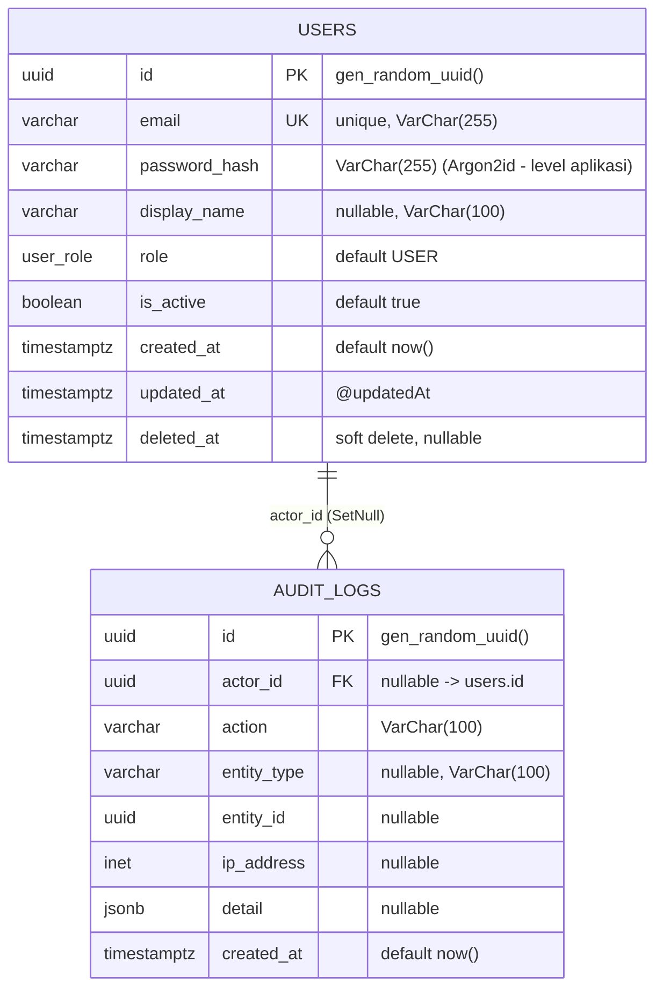

# Technical Documentation: Core Schema (Users & Audit Logs)

- **Date**: 2026-11-11
- **Author**: ai-base (Database Engineer)
- **Target Project**: `osc_base`
- **Migration / Schema Reference**: `osc_base/prisma/schema.prisma` (bootstrap — belum dimigrasi ke database)

## 1. Overview & Business Context

Skema inti (bootstrap) untuk workspace omnisight. Dua tabel fondasi dibuat sebagai dasar untuk seluruh modul berikutnya:

1. **`users`** — identitas pengguna aplikasi: kredensial login (email + password hash), peran (RBAC dasar via enum `user_role`), status aktif, dan soft-delete untuk auditabilitas.
2. **`audit_logs`** — jejak audit generik (meng-cover task tertunda "audit log" pada `notes.txt`): mencatat aksi pengguna/sistem terhadap entitas apa pun (`entity_type` + `entity_id`), konteks jaringan (`ip_address`), dan payload detail fleksibel (`jsonb`). Baris dengan `actor_id = NULL` merepresentasikan aksi sistem.

Kontrak yang dipatuhi seluruh model (aturan tetap workspace):

- PK `UUID` native (`@db.Uuid`) dengan default `gen_random_uuid()` (built-in PostgreSQL ≥ 13, tanpa ekstensi `pgcrypto`).
- Timestamp memakai `Timestamptz(3)` — selalu disimpan dengan zona waktu.
- Nama tabel/kolom `snake_case` via `@@map` / `@map`; model Prisma PascalCase, field camelCase.
- Referential actions **eksplisit** di setiap relasi; kolom yang di-index tidak memakai `String` tanpa panjang (`VarChar`).
- Prisma client pinned pada major **v6** (`package.json`) agar sintaks generator `prisma-client-js` stabil.

## 2. Entity Relationship Diagram (ERD)



## 3. Table & Column Specifications

### Model `User` → tabel `users`

| Column (`@map`) | Prisma Type | PostgreSQL Type | Constraints & Indexes | Description |
| :--- | :--- | :--- | :--- | :--- |
| `id` | `String` | `UUID` | `PK, @default(dbgenerated("gen_random_uuid()"))` | Identifier utama |
| `email` | `String` | `VarChar(255)` | `UNIQUE` (index b-tree implisit) | Email login, unik global |
| `password_hash` | `String` | `VarChar(255)` | — | Hash password (Argon2id di level `osc_rest`, bukan di DB) |
| `display_name` | `String?` | `VarChar(100)` | — | Nama tampilan opsional |
| `role` | `Role` | `user_role` (enum) | `@default(USER)`, index `users_role_idx` | Peran RBAC dasar (`USER` / `ADMIN`) |
| `is_active` | `Boolean` | `BOOLEAN` | `@default(true)`, index `users_is_active_idx` | Penanda nonaktif tanpa menghapus data |
| `created_at` | `DateTime` | `Timestamptz(3)` | `@default(now())` | Waktu dibuat |
| `updated_at` | `DateTime` | `Timestamptz(3)` | `@updatedAt` | Waktu terakhir diubah |
| `deleted_at` | `DateTime?` | `Timestamptz(3)` | — | Soft-delete; query aplikasi harus memfilter `NULL` |

### Enum `Role` → type `user_role`

| Value | Arti |
| :--- | :--- |
| `USER` | Pengguna biasa |
| `ADMIN` | Administrator |

### Model `AuditLog` → tabel `audit_logs`

| Column (`@map`) | Prisma Type | PostgreSQL Type | Constraints & Indexes | Description |
| :--- | :--- | :--- | :--- | :--- |
| `id` | `String` | `UUID` | `PK, @default(dbgenerated("gen_random_uuid()"))` | Identifier utama |
| `actor_id` | `String?` | `UUID` | `FK -> users.id` `ON DELETE SET NULL ON UPDATE CASCADE`, index `audit_logs_actor_id_idx` | Pelaku aksi; `NULL` = aksi sistem |
| `action` | `String` | `VarChar(100)` | — | Kode aksi (mis. `user.login`, `excel.import`) |
| `entity_type` | `String?` | `VarChar(100)` | index komposit `audit_logs_entity_type_entity_id_idx` | Jenis entitas sasaran (mis. `User`, `Invoice`) |
| `entity_id` | `String?` | `UUID` | (satu index dengan `entity_type`) | ID entitas sasaran; **tanpa FK** agar audit tetap ada saat entitas lain dihapus |
| `ip_address` | `String?` | `INET` | — | IP pelaku (tipe `INET` memvalidasi format IPv4/IPv6) |
| `detail` | `Json?` | `JSONB` | — | Payload detail fleksibel (before/after, metadata) |
| `created_at` | `DateTime` | `Timestamptz(3)` | `@default(now())`, index `audit_logs_created_at_idx` | Waktu aksi |

## 4. Indexing & Query Optimization Strategy

| Index | Kolom | Pola query yang dioptimalkan |
| :--- | :--- | :--- |
| `users_email_key` | `email` (UNIQUE) | Lookup login by-email (hot path autentikasi); unique constraint = index b-tree implisit |
| `users_role_idx` | `role` | Filter listing admin "semua user dengan role X" |
| `users_is_active_idx` | `is_active` | Filter sesi/agent "user aktif saja" |
| `audit_logs_actor_id_idx` | `actor_id` | Foreign key — wajib ter-index; riwayat aktivitas per pengguna |
| `audit_logs_entity_type_entity_id_idx` | `(entity_type, entity_id)` | Komposit: "seluruh aksi pada entitas ini" — urutan kolom sesuai pola equality-then-range |
| `audit_logs_created_at_idx` | `created_at` | Rentang waktu (dashboard, rotasi/purge audit lama) |

Catatan lanjutan (dipertimbangkan saat datanya besar): partial index `WHERE deleted_at IS NULL` pada `users`, dan GIN index pada `detail` (`jsonb`) **hanya jika** query berbasis konten JSONB benar-benar muncul — jangan dibuat preventif.

## 5. Migration & Rollback Notes

**Prasyarat**: PostgreSQL hidup (`docker compose up -d osc_base` dari root workspace) dan `osc_base/.env` berisi `DATABASE_URL` (host → port ter-publish `36661`). Prisma client pinned v6.

```bash
cd osc_base
npm install                 # pasang prisma + @prisma/client v6
npx prisma format           # normalisasi format schema
npx prisma validate         # validasi schema vs datasource postgresql
npx prisma migrate dev --name core_users_audit_logs   # buat + terapkan migrasi
npx prisma generate         # regenerate client setelah migrasi
```

- `migrate dev` memakai **shadow database** untuk menghitung SQL; membutuhkan hak membuat/drop database pada user `dbe` (default image `postgres` punya ini sebagai superuser).
- **Locking**: migrasi awal ini `CREATE TABLE` + `CREATE INDEX` (non-concurrent) — aman pada database baru; untuk tabel besar di masa depan, gunakan `CREATE INDEX CONCURRENTLY` via SQL mentah agar tidak mengunci tabel.
- **Zero-downtime**: tabel baru, tidak ada perubahan kolom pada tabel existing — risiko rendah.
- **Rollback**: karena ini migrasi pertama, rollback paling bersih adalah `npx prisma migrate resolve --rolled-back core_users_audit_logs` setelah SQL-nya dibalik manual, atau (dev only, DESTROY data) `prisma migrate reset`. **Jangan pernah** `migrate reset` / `--force-reset` di lingkungan shared/production.
- Perubahan berikutnya yang menyebabkan data loss (drop kolom/atau menyempitkan tipe) wajib didokumentasikan ulang di `osc_docs/base/` dengan peringatan eksplisit.
