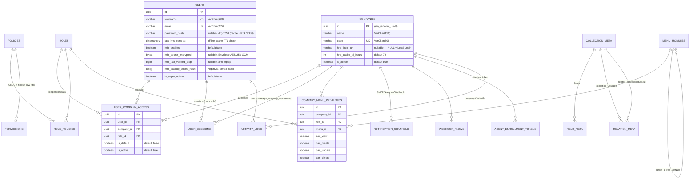

# Technical Documentation: Core Schema Part 1 — Multi-Company, HRIS Cache, MFA, RBAC, Menu Privilege, Studio Metadata, Notification & Agent Enrollment

- **Date**: 2026-11-12
- **Author**: ai-base (Database Engineer)
- **Target Project**: `osc_base`
- **Migration / Schema Reference**: `osc_base/prisma/schema.prisma` (P1 — belum dimigrasi ke database; migrasi menyusul pada Hari 8 / `SESI 1.4`)
- **Blueprint**: `osc_docs/reengineering.md` bab 5.1–5.8; infrastruktur: `osc_docs/infrastructure.md`

## 1. Overview & Business Context

Skema Bagian 1 adalah fondasi identitas & platform dari omnisight (reengineering.md, WBS Hari 6 / `SESI 1.2`). Model yang dibuat:

1. **Multi-Company tenant master** (`companies`) — dengan link HRIS ASMX opsional (`hris_login_url` nullable; NULL = Local Login mode) dan TTL cache password offline (`hris_cache_ttl_hours`, default `72`).
2. **Identity + HRIS sync + MFA** (`users`) — `username`/`email`/`password_hash` (Argon2id cache hasil HRIS login), `last_hris_sync_at` untuk offline-cache fallback, serta kolom TOTP MFA opsional (`mfa_enabled`, `mfa_secret_encrypted` bytea, `mfa_last_verified_step` anti-replay, `mfa_backup_codes_hash`) dan `is_super_admin`.
3. **RBAC Directus-style** — `roles` → `role_policies` (m2m) → `policies` → `permissions` (aksi CRUD + `fields_allowed` field-level columns + `row_filter` JSON rules → Filter AST parameterized di `osc_rest`).
4. **Sesi revocable DB-backed** (`user_sessions`) — hash token, konteks `active_company_id` untuk Company Switcher, revocable per-token (bukan JWT stateless panjang).
5. **Company Switcher** (`user_company_access`) — `user_id` × `company_id` × `role_id` (UNIQUE), `is_default`, `is_active`.
6. **Menu Privilege** (`menu_modules` tree + `company_menu_privileges`) — sumber sidebar dinamis; `can_view=false` tidak dikirim ke UI.
7. **Studio metadata koleksi dinamis** (`collection_meta`, `field_meta`, `relation_meta`) — 3 tabel Directus-style; DDL runtime koleksi baru dieksekusi dynamic SQL oleh `osc_rest`, **bukan** via Prisma migrate.
8. **Audit multi-tenant** (`activity_logs`) — menggantikan `audit_logs` bootstrap; kini membawa `company_id` (tenant isolation bab 5.6) dan `user_agent`.
9. **Notification & Flow** (`notification_channels` SMTP/Telegram/Webhook per company, `webhook_flows`) — eksekusi asinkron oleh `osc_auto/flow_worker_agent` via outbox.
10. **Agent enrollment** (`agent_enrollment_tokens`) — one-time token terikat `company_id`, DB menyimpan hash token saja.

Perubahan dari skema bootstrap (`schema-core.md`, belum dimigrasi sehingga aman di-refactor):

| Elemen bootstrap | Keputusan P1 | Alasan |
| :--- | :--- | :--- |
| Enum `Role` (`user_role`: USER/ADMIN) | **Dihapus**, diganti model `Role` (tabel `roles`) | RBAC multi-company butuh role dinamis per company, bukan enum statis |
| `User.role`, `User.email` sebagai kunci login utama | `User.username` + `email`, `role` diganti relasi `UserCompanyAccess` | HRIS login memakai username; role kini kontekstual per company |
| `AuditLog` (`audit_logs`) | Diganti `ActivityLog` (`activity_logs`) + kolom `company_id`, `user_agent` | Tenant isolation & kebutuhan tracing HRIS/MFA (bab 5.6, 5.8) |

Kontrak yang dipatuhi seluruh model: PK UUID native (`gen_random_uuid()`), `Timestamptz(3)`, `@@map`/`@map` snake_case, referential actions eksplisit, audit fields + soft-delete pada entitas bisnis, Prisma v6. Secret tidak pernah plaintext di DB: TOTP secret dan config channel/webhook dienkripsi **Envelope AES-256-GCM** (KEK `APP_MASTER_ENCRYPTION_KEY`, lihat `infrastructure.md` §4) di level `osc_rest`.

## 2. Entity Relationship Diagram (ERD)



## 3. Table & Column Specifications (Rust SQLx Mapping Reference)

### 3.1 `Company` → tabel `companies` (bab 5.1)

| Column (`@map`) | Prisma Type | PostgreSQL Type | Nullable | Constraints & Indexes | Description |
| :--- | :--- | :--- | :--- | :--- | :--- |
| `id` | `String` | `UUID` | `NO` | `PK, gen_random_uuid()` | Identifier |
| `name` | `String` | `VarChar(150)` | `NO` | — | Nama tenant |
| `code` | `String` | `VarChar(50)` | `NO` | `UNIQUE` | Kode tenant (lookup switcher) |
| `hris_login_url` | `String?` | `VarChar(500)` | `YES` | — | Template URL ASMX HRIS `{\(U}`/`{\)P}`; **NULL = Local Login**; hanya diisi admin (anti-SSRF allowlist di `osc_rest`) |
| `hris_cache_ttl_hours` | `Int` | `INTEGER` | `NO` | `@default(72)` | TTL offline cache password |
| `is_active` | `Boolean` | `BOOLEAN` | `NO` | `@default(true)`, idx | Tenant nonaktif tanpa hapus data |
| `created_at` / `updated_at` / `deleted_at` | `DateTime` | `Timestamptz(3)` | — | audit + soft-delete | Standar workspace |

sqlx mapping: `UUID → uuid::Uuid`, `Timestamptz → chrono::DateTime<Utc>`, `JsonB → serde_json::Value`.

### 3.2 `User` → tabel `users` (bab 5.1–5.3)

| Column (`@map`) | Prisma Type | PostgreSQL Type | Nullable | Constraints & Indexes | Description |
| :--- | :--- | :--- | :--- | :--- | :--- |
| `id` | `String` | `UUID` | `NO` | `PK` | Identifier |
| `username` | `String` | `VarChar(100)` | `NO` | `UNIQUE` | Login name (HRIS & lokal) |
| `email` | `String` | `VarChar(255)` | `NO` | `UNIQUE` | Email (profil HRIS / reset MFA via email token) |
| `password_hash` | `String?` | `VarChar(255)` | `YES` | — | Argon2id; cache hasil HRIS login atau hash lokal. NULL = belum pernah sync |
| `display_name` | `String?` | `VarChar(100)` | `YES` | — | Nama tampilan |
| `last_hris_sync_at` | `DateTime?` | `Timestamptz(3)` | `YES` | idx | Acuan offline cache: `now() − last_hris_sync_at <= companies.hris_cache_ttl_hours` |
| `mfa_enabled` | `Boolean` | `BOOLEAN` | `NO` | `@default(false)` | TOTP opsional untuk login umum |
| `mfa_secret_encrypted` | `Bytes?` | `BYTEA` | `YES` | — | TOTP secret Envelope AES-256-GCM; sqlx: `Vec<u8>` |
| `mfa_last_verified_step` | `BigInt?` | `BIGINT` | `YES` | — | Anti-replay step TOTP terakhir; sqlx: `i64` |
| `mfa_backup_codes_hash` | `String[]` | `VarChar(255)[]` | `NO` | `@default([])` | Kode backup sekali pakai (hash Argon2id); tercairkan = dihapus |
| `is_super_admin` | `Boolean` | `BOOLEAN` | `NO` | `@default(false)` | Global Super Admin (seeder bootstrap) |
| `is_active`, `created_at`, `updated_at`, `deleted_at` | | | | audit + soft-delete | Standar workspace |

### 3.3 `Role`, `Policy`, `RolePolicy`, `Permission` → `roles`, `policies`, `role_policies`, `permissions`

| Model (`@@map`) | Column | Prisma Type | PostgreSQL Type | Nullable | Constraints & Indexes | Description |
| :--- | :--- | :--- | :--- | :--- | :--- | :--- |
| `Role` (`roles`) | `id` | `String` | `UUID` | `NO` | `PK` | Identifier |
| | `name` | `String` | `VarChar(100)` | `NO` | `UNIQUE` | Nama peran |
| | `description` | `String?` | `VarChar(500)` | `YES` | — | Keterangan |
| | `is_system` | `Boolean` | `BOOLEAN` | `NO` | `@default(false)` | Role bawaan (tidak boleh dihapus) |
| `Policy` (`policies`) | `id` / `name` / `description` / `is_system` | | | | `name UNIQUE` | Kumpulan permission; dapat dipakai lintas role |
| `RolePolicy` (`role_policies`) | `role_id` + `policy_id` | `String` | `UUID` | `NO` | `UNIQUE(role_id, policy_id)`, idx `policy_id` | Join m2m; `onDelete: Cascade` |
| `Permission` (`permissions`) | `policy_id` | `String` | `UUID` | `NO` | FK Cascade; bagian unique | Policy pemilik |
| | `collection` | `String` | `VarChar(100)` | `NO` | bagian unique `(policy_id, collection, action)` | Nama koleksi sasaran |
| | `action` | `PermissionAction` | `permission_action` (enum) | `NO` | bagian unique | `CREATE`/`READ`/`UPDATE`/`DELETE` |
| | `fields_allowed` | `String[]` | `VarChar(100)[]` | `NO` | `@default([])` | Field-level allowed columns; kosong = semua field (Directus-style CASE WHEN di `osc_rest`) |
| | `row_filter` | `Json?` | `JSONB` | `YES` | — | JSON row filter rules (Filter AST → SQL parameterized); NULL = semua baris |

Evaluasi otorisasi: multi-policy **union `_or`** antar policy pada role aktif; field-level via kolom yang diizinkan; row-level via `row_filter` — semua di `osc_rest`, bukan di DB.

### 3.4 `Session` → tabel `user_sessions` (bab 5.4)

| Column | Prisma Type | PostgreSQL Type | Nullable | Constraints & Indexes | Description |
| :--- | :--- | :--- | :--- | :--- | :--- |
| `id` | `String` | `UUID` | `NO` | `PK` | Identifier |
| `user_id` | `String` | `UUID` | `NO` | FK `users` `Cascade`, idx | Pemilik sesi |
| `active_company_id` | `String?` | `UUID` | `YES` | FK `companies` `SetNull`, idx | Konteks company aktif (claim `active_company_id`) |
| `token_hash` | `String` | `VarChar(255)` | `NO` | `UNIQUE` | Hash token revocable DB-backed (bukan plaintext) |
| `ip_address` | `String?` | `INET` | `YES` | — | IP login |
| `user_agent` | `String?` | `VarChar(500)` | `YES` | — | User agent login |
| `expires_at` | `DateTime` | `Timestamptz(3)` | `NO` | idx | Kedaluwarsa (purge worker) |
| `revoked_at` | `DateTime?` | `Timestamptz(3)` | `YES` | — | Revocation per-token (reset MFA = revoke semua sesi user) |
| `last_used_at` | `DateTime?` | `Timestamptz(3)` | `YES` | — | Sliding activity marker |

### 3.5 `UserCompanyAccess` → tabel `user_company_access` (bab 5.4)

| Column | Prisma Type | PostgreSQL Type | Nullable | Constraints & Indexes | Description |
| :--- | :--- | :--- | :--- | :--- | :--- |
| `id` | `String` | `UUID` | `NO` | `PK` | Identifier |
| `user_id` | `String` | `UUID` | `NO` | FK Cascade, bagian unique | Pengguna |
| `company_id` | `String` | `UUID` | `NO` | FK Cascade + idx, bagian unique | Tenant |
| `role_id` | `String` | `UUID` | `NO` | FK Cascade + idx, bagian unique | Role dalam konteks company ini |
| `is_default` | `Boolean` | `BOOLEAN` | `NO` | `@default(false)` | Company default saat login; tepat 1 per user di-enforce level aplikasi |
| `is_active` | `Boolean` | `BOOLEAN` | `NO` | `@default(true)` | Akses dicabut tanpa hapus baris |

`UNIQUE (user_id, company_id, role_id)` — sesuai blueprint bab 5.4 (user boleh multi-role dalam satu company; endpoint switch-company memvalidasi baris aktif).

### 3.6 `MenuModule` → tabel `menu_modules` & `CompanyMenuPrivilege` → tabel `company_menu_privileges` (bab 5.5)

| Model (`@@map`) | Column | Prisma Type | PostgreSQL Type | Nullable | Constraints & Indexes | Description |
| :--- | :--- | :--- | :--- | :--- | :--- | :--- |
| `MenuModule` | `code` | `String` | `VarChar(100)` | `NO` | `UNIQUE` | Kode modul stabil (manifest seeder) |
| | `label` | `String` | `VarChar(150)` | `NO` | — | Label sidebar |
| | `route_path` | `String?` | `VarChar(300)` | `YES` | — | Path front-end; NULL = grup/headless |
| | `icon` | `String?` | `VarChar(100)` | `YES` | — | Nama ikon |
| | `parent_id` | `String?` | `UUID` | `YES` | FK self `SetNull`, idx | Tree menu |
| | `sort_order` | `Int` | `INTEGER` | `NO` | `@default(0)`, idx `(is_active, sort_order)` | Urutan render |
| | `is_active` | `Boolean` | `BOOLEAN` | `NO` | `@default(true)` | Modul dimatikan sementara |
| `CompanyMenuPrivilege` | `company_id` + `role_id` + `menu_id` | `String` | `UUID` | `NO` | `UNIQUE(company_id, role_id, menu_id)` + idx masing-masing | Sumber `GET /me/navigation` |
| | `can_view` / `can_create` / `can_update` / `can_delete` | `Boolean` | `BOOLEAN` | `NO` | `@default(false)` | Item `can_view=false` tidak dikirim ke UI |

### 3.7 Studio Metadata: `CollectionMeta`, `FieldMeta`, `RelationMeta`

| Model (`@@map`) | Column | Prisma Type | PostgreSQL Type | Nullable | Constraints & Indexes | Description |
| :--- | :--- | :--- | :--- | :--- | :--- | :--- |
| `CollectionMeta` (`collection_meta`) | `collection` | `String` | `VarChar(100)` | `NO` | `UNIQUE` | Nama tabel fisik koleksi (sasar DDL runtime) |
| | `icon`, `note`, `is_hidden`, `is_system`, `sort_order` | | | | | Metadata UI ala Directus |
| `FieldMeta` (`field_meta`) | `collection_id` | `String` | `UUID` | `NO` | FK Cascade; `UNIQUE(collection_id, field)` | Koleksi pemilik |
| | `field` | `String` | `VarChar(100)` | `NO` | bagian unique | Nama kolom |
| | `is_required`, `is_hidden` | `Boolean` | `BOOLEAN` | `NO` | `@default(false)` | Validasi & visibilitas |
| | `special` | `String?` | `VarChar(255)` | `YES` | — | Flag special Directus (uuid, cast-tipe) |
| | `meta` | `Json?` | `JSONB` | `YES` | — | Opsi UI/validasi |
| `RelationMeta` (`relation_meta`) | `collection_id` | `String` | `UUID` | `NO` | FK Cascade, bagian unique | Koleksi sumber |
| | `field` | `String` | `VarChar(100)` | `NO` | bagian unique `(collection_id, field)` | Field relasi |
| | `related_collection_id` | `String?` | `UUID` | `YES` | FK `SetNull`, idx | Koleksi target (NULL = relasi rusak/dihapus) |
| | `relation_type` | `String` | `VarChar(20)` | `NO` | — | `M2O` / `O2M` / `M2M` / `M2A` |
| | `on_delete_action` | `String?` | `VarChar(20)` | `YES` | — | Aksi referential yang di-render saat DDL runtime |
| | `meta` | `Json?` | `JSONB` | `YES` | — | Metadata sort/filter field |

> DDL runtime koleksi dinamis dieksekusi `osc_rest` via dynamic SQL (identifier tervalidasi terhadap 3 tabel metadata ini) — **bukan** `prisma migrate`. Snapshot SQL untuk sqlx tetap dibuat dari tabel-tabel statis.

### 3.8 `ActivityLog` → tabel `activity_logs` (bab 5.6, 5.8)

| Column | Prisma Type | PostgreSQL Type | Nullable | Constraints & Indexes | Description |
| :--- | :--- | :--- | :--- | :--- | :--- |
| `id` | `String` | `UUID` | `NO` | `PK` | Identifier |
| `company_id` | `String?` | `UUID` | `YES` | FK `SetNull`; idx `(company_id, created_at)` | Tenant (NULL = aksi platform-level) |
| `user_id` | `String?` | `UUID` | `YES` | FK `SetNull`; idx `(user_id, created_at)` | Aktor; NULL = sistem |
| `action` | `String` | `VarChar(100)` | `NO` | idx | Kode aksi: `LOGIN_HRIS_OFFLINE_CACHE`, `MFA_RESET`, `MFA_RESET_SELF_BACKUP`, `MFA_RESET_SELF_EMAIL`, cross-tenant attempt, dst. |
| `entity_type` / `entity_id` | `String?` / `String?` | `VarChar(100)` / `UUID` | `YES` | idx komposit | Sasaran polimorfik (tanpa FK agar riwayat kekal) |
| `ip_address` | `String?` | `INET` | `YES` | — | IP sumber |
| `user_agent` | `String?` | `VarChar(500)` | `YES` | — | Konteks client |
| `detail` | `Json?` | `JSONB` | `YES` | — | Payload (reason MFA reset, before/after, security event) |
| `created_at` | `DateTime` | `Timestamptz(3)` | `NO` | `@default(now())` | Waktu aksi |

### 3.9 `WebhookFlow` & `NotificationChannel` (bab 5.8)

| Model (`@@map`) | Column | Prisma Type | PostgreSQL Type | Nullable | Constraints & Indexes | Description |
| :--- | :--- | :--- | :--- | :--- | :--- | :--- |
| `WebhookFlow` (`webhook_flows`) | `company_id` | `String` | `UUID` | `NO` | FK Cascade; idx `(company_id, is_active)` | Tenant |
| | `name` | `String` | `VarChar(150)` | `NO` | — | Nama flow |
| | `trigger_event` | `String` | `VarChar(100)` | `NO` | idx | Event pemicu |
| | `config` | `Json` | `JSONB` | `NO` | — | Target URL/header/payload template; nilai sensitif terenkripsi app-side |
| | `is_active`, `created_at/updated_at/deleted_at` | | | | audit + soft-delete | |
| `NotificationChannel` (`notification_channels`) | `company_id` | `String` | `UUID` | `NO` | FK Cascade; bagian unique | Tenant |
| | `type` | `NotificationChannelType` | `notification_channel_type` (enum) | `NO` | bagian unique `(company_id, type)` | `SMTP_EMAIL` / `TELEGRAM` / `WEBHOOK` |
| | `config` | `Json` | `JSONB` | `NO` | — | SMTP password / bot token / webhook URL — **terenkripsi** Envelope AES-256-GCM |
| | `event_filter` | `String[]` | `VarChar(100)[]` | `NO` | `@default([])` | Event yang dikirim (email reset MFA, alert, downtime, SIEM) |
| | `is_active`, `created_at/updated_at/deleted_at` | | | | audit + soft-delete | Konsumen: `flow_worker_agent` via outbox |

### 3.10 `AgentEnrollmentToken` → tabel `agent_enrollment_tokens` (bab 5.8)

| Column | Prisma Type | PostgreSQL Type | Nullable | Constraints & Indexes | Description |
| :--- | :--- | :--- | :--- | :--- | :--- |
| `id` | `String` | `UUID` | `NO` | `PK` | Identifier |
| `company_id` | `String` | `UUID` | `NO` | FK Cascade + idx | Tenant pemilik token |
| `token_hash` | `String` | `VarChar(255)` | `NO` | `UNIQUE` | **Hash** token; token mentah ditampilkan sekali di UI admin |
| `node_type` | `NodeType?` | `node_type` (enum) | `YES` | — | Rencana tipe node agent: `HOST`/`NETWORK`/`VIRTUAL`/`CONTAINER`/`RACK_MOUNTED`/`SERVICE` |
| `expires_at` | `DateTime` | `Timestamptz(3)` | `NO` | idx | TTL token |
| `used_at` | `DateTime?` | `Timestamptz(3)` | `YES` | — | Single-use: `POST /agents/enroll` men-set saat klaim sukses |
| `created_at` | `DateTime` | `Timestamptz(3)` | `NO` | `@default(now())` | Waktu dibuat |

## 4. Indexing, Partitioning & Query Optimization Strategy

| Index | Pola query yang dioptimalkan |
| :--- | :--- |
| `companies.code` (UNIQUE) | Lookup tenant saat login/switch-company |
| `users.username` / `users.email` (UNIQUE) | Hot path autentikasi HRIS & lokal |
| `users.last_hris_sync_at` | Cek offline-cache fallback (`now() − last_hris_sync_at <= ttl`) & job sinkronisasi |
| `user_sessions.token_hash` (UNIQUE) | Verifikasi sesi per request (DB-backed revocable) |
| `user_sessions.expires_at` | Purge sesi kedaluwarsa oleh worker |
| `user_company_access(company_id)` / `(role_id)` | FK index — daftar akses per company / per role |
| `permissions(collection, action)` | Evaluasi RBAC union multi-policy untuk koleksi tertentu |
| `menu_modules(is_active, sort_order)` komposit | Render sidebar: filter aktif lalu urutkan (equality-then-order) |
| `company_menu_privileges(company_id, role_id, menu_id)` UNIQUE | Lookup navigasi `GET /me/navigation` (hot path UI) |
| `activity_logs(company_id, created_at)` / `(user_id, created_at)` komposit | Timeline audit per tenant/user; siap partitioning range `created_at` saat volume besar |
| `webhook_flows(company_id, is_active)` / `notification_channels(company_id, is_active)` | Dispatcher `flow_worker_agent` memilih channel aktif per tenant |
| `agent_enrollment_tokens(expires_at)` | Housekeeping token TTL |

Catatan: `activity_logs` adalah tabel append-only ber-volume tinggi — rencana lanjutan (P3): partitioning bulanan pada `created_at` + retensi terjadwal (bab 5.8). GIN index pada kolom `JSONB` (`row_filter`, `config`, `detail`) **tidak** dibuat preventif; tambahkan hanya jika query konten JSONB muncul.

## 5. Migration, SQLx Sync & Rollback Notes

**Prasyarat**: PostgreSQL hidup (`docker compose up -d osc_base`) dan `osc_base/.env` berisi `DATABASE_URL` (host → port publish `36661`). Prisma pinned v6.

```bash
cd osc_base
npm install
npx prisma format                          # ✅ 2026-11-12
npx prisma validate                        # ✅ 2026-11-12
npx prisma migrate dev --name p1_core_multi_company_rbac   # menyusul (Hari 8 / SESI 1.4)
npx prisma generate
```

- **sqlx type mapping** (`osc_rest`): `UUID → uuid::Uuid`, `Timestamptz(3) → chrono::DateTime<Utc>`, `BYTEA → Vec<u8>` (ciphertext Envelope), `BIGINT → i64`, `INET → ipnet::IpNet`/`std::net::IpAddr`, `JSONB → serde_json::Value`, `VarChar(n)[] → Vec<String>`.
- **Snapshot SQL**: saat migrasi dibuat (Hari 8), generate `osc_base/prisma/sql/schema_snapshot.sql` via `npx prisma migrate diff --from-empty --to-schema-datamodel prisma/schema.prisma --script` agar query sqlx di `osc_rest` cocok persis tipe/nullability.
- **Locking & zero-downtime**: seluruh objek P1 adalah `CREATE TABLE`/`CREATE TYPE`/`CREATE INDEX` baru (non-concurrent) — aman karena belum ada trafik; tidak ada perubahan destruktif pada tabel existing (bootstrap belum dimigrasi, jadi pergantian `users`/penghapusan `audit_logs` tidak menimpa data).
- **Rollback**: forward-only ala Prisma; rollback migrasi ini cukup `DROP TABLE` objek P1 dalam urutan terbalik (child dulu). **Dilarang** `prisma migrate reset` / `--force-reset` di lingkungan shared/production.
- **Keamanan**: token enrollment & token sesi hanya disimpan sebagai hash; TOTP secret (`mfa_secret_encrypted`), config channel (`notification_channels.config`) dan flow (`webhook_flows.config`) wajib lolos Envelope AES-256-GCM (KEK `APP_MASTER_ENCRYPTION_KEY`) sebelum masuk DB — diverifikasi test SOC (`ai-test`).
