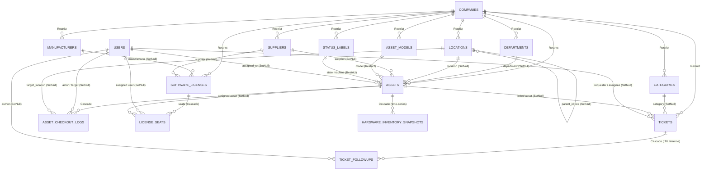
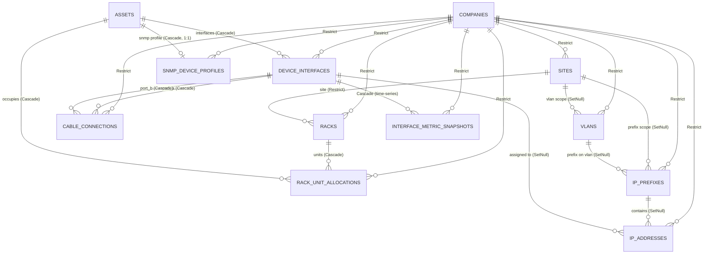

# Technical Documentation: Core Schema Part 2 — ITAM, Service Desk, DCIM & IPAM (terikat `company_id`)

- **Date**: 2026-11-12
- **Author**: ai-base (Database Engineer)
- **Target Project**: `osc_base`
- **Migration / Schema Reference**: `osc_base/prisma/schema.prisma` (P2 — belum dimigrasi ke database; migrasi menyusul pada Hari 8 / `SESI 1.4`)
- **Blueprint**: `osc_docs/reengineering.md` bab 3 (entitas induk `Asset`/`ManagedNode`), bab 4 (peta modul Snipe-IT/GLPI/NetBox/LibreNMS), bab 5.6 (strict tenant isolation); pendahulu: `osc_docs/base/schema-p1.md`

## 1. Overview & Business Context

Skema Bagian 2 (WBS Hari 7 / `SESI 1.3`) menurunkan **24 model baru** yang seluruhnya **wajib membawa FK `company_id` NOT NULL dengan referential action `Restrict` dan terindeks** (strict tenant isolation, bab 5.6 — filter `company_id = $1` otomatis dari `RequestContext`):

**ITAM & Service Desk (pola Snipe-IT/GLPI)** — 14 model:
1. Master referensi: `Department`, `Location` (tree), `Category` (type termasuk `TICKET` untuk ITIL), `Manufacturer`, `Supplier`, `StatusLabel` (state machine `DEPLOYABLE/PENDING/ARCHIVED`), `AssetModel` (device type).
2. **Entitas induk `Asset`** (alias `ManagedNode`, bab 3) — server / network device / workstation: `node_type` (enum `NodeType` P1), `asset_tag` unique per company, `hostname`/`fqdn`/`mgmt_ip` (INET)/`serial_number`, `site_id` + `location_path`, status `ACTIVE…DECOMMISSIONED` + FK `StatusLabel`, inventaris agent-driven (`is_dynamic`, `last_seen_at`, `source`), `metadata`/`custom_fields` JSONB, soft-delete.
3. Aktivitas & lisensi: `AssetCheckoutLog` (timeline checkout/checkin append-only), `SoftwareLicense` + `LicenseSeat` (claim seat atomik), `HardwareInventorySnapshot` (inventaris GLPI agent-driven).
4. Service Desk ITIL: `Ticket` (state int ala GLPI: `NEW…UNDER_APPROVAL`, kode per company) + `TicketFollowup` (timeline, `is_private` untuk catatan teknisi).

**DCIM & IPAM (pola NetBox/LibreNMS)** — 10 model:
1. DCIM: `Site` → `Rack` → `RackUnitAllocation` (okupansi unit, UNIQUE `(rack_id, unit_number, face)`), `DeviceInterface` (per aset, UNIQUE `(asset_id, name)`), `CableConnection` (A↔B, uniqueness satu-termination di-enforce app-level).
2. IPAM: `Vlan` (vid unique per company), `IpPrefix` (cidr `VarChar`, GIST via migration SQL), `IpAddress` (tipe native `INET`, unique per company).
3. Telemetry: `SnmpDeviceProfile` (kredensial v1/v2c/v3 **terenkripsi Envelope AES-256-GCM**, satu profil per aset), `InterfaceMetricSnapshot` (time-series delta/rate ala LibreNMS).

**Keputusan desain kunci:**

| Topik | Keputusan | Alasan |
| :--- | :--- | :--- |
| FK `company_id` pada semua model P2 | `Restrict` + `@@index([companyId, …])` | Blueprint bab 3: PROTECT untuk referensi bisnis — tenant tidak boleh terhapus diam-diam; index menopang filter RequestContext otomatis |
| `Asset` = entitas induk tunggal | Hub FK bagi interface, rack, snapshot, tiket, SNMP profile | Bab 3: menyatukan Asset Snipe-IT / Device GLPI-NetBox / system beszel / device LibreNMS |
| `cidr`/`ltree`/GIST tidak didukung Prisma | `prefix` sebagai `VarChar(64)`; GIST index & partial unique dibuat via migration SQL (Hari 8); hierarki lokasi pakai `location_path` text | Keterbatasan Prisma DDL; pola NetBox (path enumeration app-side, bab 4) |
| Kredensial SNMP, kunci lisensi | Tidak pernah plaintext — Envelope AES-256-GCM di `osc_rest` (`Bytes` = bytea) | Kontrak keamanan lintas wave (bab 1) |
| Validasi koherensi (overlap prefix, okupansi rack, checkout availability, IP-interface tenant match) | App-level `osc_rest`: transaksi + `SELECT … FOR UPDATE` + re-check | Blueprint bab 3 (pola Snipe-IT `lockForUpdate + re-check`) |

Konvensi identik P1: PK UUID native `gen_random_uuid()`, `Timestamptz(3)`, `@@map`/`@map` snake_case, referential actions eksplisit, audit `created_at`/`updated_at` + soft-delete (`deleted_at`) pada entitas bisnis. Prisma v6.19.3.

## 2. Entity Relationship Diagram (ERD)

### 2.1 ITAM & Service Desk



### 2.2 DCIM & IPAM



### 2.3 Relasi lintas modul (ringkasan)

`Asset` adalah **hub lintas modul** (bab 3): ITAM (checkout log, seat lisensi, tiket, snapshot inventaris), DCIM (interface, okupansi rack, kabel, IP), IPAM (alamat IP), telemetry P3 (SNMP profile → `InterfaceMetricSnapshot`; agent enrollment → `Asset.isDynamic`/`lastSeenAt`/`source`), dan modul P3 (telemetry/uptime/PAM) akan berlanjut memakai `assets.id` sebagai FK. `User` dari P1 menjadi aktor lintas ITAM (assignee aset, aktor/target checkout, requester/assignee tiket, pemilik seat lisensi).

## 3. Table & Column Specifications (Rust SQLx Mapping Reference)

> Kolom audit `created_at`/`updated_at` (`Timestamptz(3)`) dan `deleted_at` (soft-delete, pada entitas bisnis) berlaku seragam di seluruh model kecuali disebutkan; tidak diulang per baris. Kolom `company_id` (`UUID NOT NULL`, FK `companies` `Restrict`, **terindeks**) ada di **semua** 24 model.

### 3.1 Master referensi ITAM: `Department`, `Location`, `Category`, `Manufacturer`, `Supplier`, `StatusLabel`, `AssetModel`

| Model (`@@map`) | Column | Prisma Type | PostgreSQL Type | Nullable | Constraints & Indexes | Description |
| :--- | :--- | :--- | :--- | :--- | :--- | :--- |
| `Department` (`departments`) | `name` / `notes` | `String` / `String?` | `VarChar(150)` / `VarChar(500)` | — | `UNIQUE(company_id, name)` | Unit organisasi |
| | `manager_user_id` | `String?` | `UUID` | `YES` | FK `users` `SetNull`, idx `(company_id, is_active)` | Manajer unit |
| `Location` (`locations`) | `name` / `address` / `city` | `String` / `String?` / `String?` | `VarChar(150/300/100)` | — | `UNIQUE(company_id, name)` | Lokasi fisik |
| | `parent_id` | `String?` | `UUID` | `YES` | FK self `SetNull`, idx | Tree lokasi |
| `Category` (`categories`) | `name` | `String` | `VarChar(150)` | `NO` | `UNIQUE(company_id, type, name)` | Kategori item |
| | `type` | `CategoryType` | `category_type` (enum) | `NO` | idx `(company_id, type)` | `ASSET`/`ACCESSORY`/`COMPONENT`/`CONSUMABLE`/`LICENSE`/`TICKET` |
| `Manufacturer` (`manufacturers`) | `name`, `support_email/phone/url` | `String` / `String?` | `VarChar(200/255/50/500)` | — | `UNIQUE(company_id, name)` | Pabrikan |
| `Supplier` (`suppliers`) | `name`, `contact_*`, `address`, `website_url` | `String` / `String?` | `VarChar(200/150/255/50/300/500)` | — | `UNIQUE(company_id, name)` | Pemasok/vendor |
| `StatusLabel` (`status_labels`) | `name` | `String` | `VarChar(150)` | `NO` | `UNIQUE(company_id, name)` | Label status |
| | `type` | `StatusLabelType` | `status_label_type` (enum) | `NO` | idx `(company_id, type)` | `DEPLOYABLE`/`PENDING`/`ARCHIVED` — state machine checkout |
| | `color` | `String?` | `VarChar(20)` | `YES` | — | Warna badge UI |
| `AssetModel` (`asset_models`) | `name` / `model_number` | `String` / `String?` | `VarChar(200/150)` | — | `UNIQUE(company_id, name)` | Model perangkat (device type) |
| | `category_id` | `String` | `UUID` | `NO` | FK `categories` `Restrict`, idx | Kategori model |
| | `manufacturer_id` | `String` | `UUID` | `NO` | FK `manufacturers` `Restrict`, idx | Pabrikan |
| | `eol_months` | `Int?` | `INTEGER` | `YES` | — | Estimasi EOL sejak pembelian |

### 3.2 `Asset` → tabel `assets` (entitas induk, bab 3)

| Column (`@map`) | Prisma Type | PostgreSQL Type | Nullable | Constraints & Indexes | Description |
| :--- | :--- | :--- | :--- | :--- | :--- |
| `id` | `String` | `UUID` | `NO` | `PK, gen_random_uuid()` | Identifier |
| `company_id` | `String` | `UUID` | `NO` | FK `Restrict`; idx `(company_id, node_type)`, `(company_id, status)` | Tenant |
| `name` | `String` | `VarChar(150)` | `NO` | — | Nama aset |
| `asset_tag` | `String` | `VarChar(100)` | `NO` | `UNIQUE(company_id, asset_tag)` | Tag fisik (barcode/QR) |
| `node_type` | `NodeType` | `node_type` (enum P1) | `NO` | `@default(HOST)` | `HOST`/`NETWORK`/`VIRTUAL`/`CONTAINER`/`RACK_MOUNTED`/`SERVICE` |
| `status` | `AssetStatus` | `asset_status` (enum) | `NO` | `@default(ACTIVE)`, idx | `ACTIVE`/`PLANNED`/`STAGED`/`OFFLINE`/`FAILED`/`DECOMMISSIONED` |
| `hostname` / `fqdn` | `String?` | `VarChar(255)` | `YES` | unique partial per company via migration SQL | Identitas jaringan |
| `mgmt_ip` | `String?` | `INET` | `YES` | — | IP manajemen |
| `serial_number` | `String?` | `VarChar(255)` | `YES` | unique partial per company via migration SQL | Nomor seri |
| `asset_model_id` | `String` | `UUID` | `NO` | FK `asset_models` `Restrict`, idx | Model/device type |
| `status_label_id` | `String` | `UUID` | `NO` | FK `status_labels` `Restrict`, idx | State machine checkout |
| `site_id` | `String?` | `UUID` | `YES` | FK `sites` `SetNull`, idx | Site DCIM |
| `department_id` / `location_id` / `supplier_id` | `String?` | `UUID` | `YES` | FK `SetNull`, idx masing-masing | Penempatan & pengadaan |
| `assigned_to_user_id` | `String?` | `UUID` | `YES` | FK `users` `SetNull`, idx | Pemegang aset (checkout) |
| `location_path` | `String?` | `VarChar(500)` | `YES` | — | Path enumeration hierarki lokasi (pola NetBox, bab 4) |
| `purchase_date` / `purchase_cost` / `warranty_months` | `DateTime?` / `Decimal?` / `Int?` | `DATE` / `Decimal(12,2)` / `INTEGER` | `YES` | — | Data pengadaan |
| `last_seen_at` | `DateTime?` | `Timestamptz(3)` | `YES` | idx | Inventory agent-driven (GLPI) |
| `is_dynamic` / `source` | `Boolean` / `String?` | `BOOLEAN` / `VarChar(100)` | `NO` / `YES` | `@default(false)` | Sumber inventaris (agent/manual) |
| `notes` / `metadata` / `custom_fields` | `String?` / `Json?` / `Json?` | `TEXT` / `JSONB` / `JSONB` | `YES` | — | Catatan + field generik (NetBox `custom_field_data`) |

### 3.3 `AssetCheckoutLog`, `SoftwareLicense`, `LicenseSeat`, `HardwareInventorySnapshot`

| Model (`@@map`) | Column | Prisma Type | PostgreSQL Type | Nullable | Constraints & Indexes | Description |
| :--- | :--- | :--- | :--- | :--- | :--- | :--- |
| `AssetCheckoutLog` (`asset_checkout_logs`) | `asset_id` | `String` | `UUID` | `NO` | FK `Cascade`, idx `(asset_id, created_at DESC)` | Aset yang dicatat |
| | `action` | `CheckoutAction` | `checkout_action` (enum) | `NO` | — | `CHECKOUT`/`CHECKIN` |
| | `actor_user_id` / `target_user_id` | `String?` | `UUID` | `YES` | FK `users` `SetNull`, idx target | Yang men-checkout / penerima |
| | `target_location_id` | `String?` | `UUID` | `YES` | FK `locations` `SetNull` | Checkout ke lokasi |
| | `expected_checkin_at` | `DateTime?` | `Timestamptz(3)` | `YES` | idx | Jadwal pengembalian |
| `SoftwareLicense` (`software_licenses`) | `name` / `license_key` | `String` / `String?` | `VarChar(200/500)` | — / `YES` | `UNIQUE(company_id, name)` | Kunci lisensi (disarankan Envelope AES-256-GCM app-side) |
| | `type` | `LicenseType` | `license_type` (enum) | `NO` | `@default(PERPETUAL)` | `PERPETUAL`/`SUBSCRIPTION`/`OEM`/`VOLUME` |
| | `seats_total` | `Int` | `INTEGER` | `NO` | `@default(1)` | Jumlah seat |
| | `manufacturer_id` / `supplier_id` | `String?` | `UUID` | `YES` | FK `SetNull` | Pengadaan |
| | `purchase_date` / `expiry_date` | `DateTime?` | `DATE` | `YES` | idx `(company_id, expiry_date)` | Siklus hidup lisensi |
| `LicenseSeat` (`license_seats`) | `license_id` | `String` | `UUID` | `NO` | FK `Cascade` | Lisensi induk |
| | `seat_number` | `Int` | `INTEGER` | `NO` | `UNIQUE(license_id, seat_number)` | Nomor seat |
| | `assigned_user_id` / `assigned_asset_id` | `String?` | `UUID` | `YES` | FK `SetNull`, idx | Pemegang seat (claim atomik + `FOR UPDATE`) |
| `HardwareInventorySnapshot` (`hardware_inventory_snapshots`) | `asset_id` | `String` | `UUID` | `NO` | FK `Cascade`, idx `(asset_id, collected_at DESC)` | Aset terinventaris |
| | `collected_at` | `DateTime` | `Timestamptz(3)` | `NO` | `@default(now())` | Waktu kumpul (agent) |
| | `cpu_model` / `cpu_cores` | `String?` / `Int?` | `VarChar(200)` / `INTEGER` | `YES` | — | CPU |
| | `memory_total_bytes` / `storage_total_bytes` | `BigInt?` | `BIGINT` | `YES` | — | Kapasitas; sqlx `i64` |
| | `os_name` / `os_version` | `String?` | `VarChar(150/100)` | `YES` | — | OS target |
| | `payload` | `Json` | `JSONB` | `NO` | — | Inventaris mentah (komponen/disk/NIC ala GLPI) |

### 3.4 `Ticket` & `TicketFollowup` (Service Desk ITIL ala GLPI)

| Model (`@@map`) | Column | Prisma Type | PostgreSQL Type | Nullable | Constraints & Indexes | Description |
| :--- | :--- | :--- | :--- | :--- | :--- | :--- |
| `Ticket` (`tickets`) | `code` | `String` | `VarChar(50)` | `NO` | `UNIQUE(company_id, code)` | Nomor tiket per tenant (sequence app-generated) |
| | `title` / `description` | `String` / `String?` | `VarChar(300)` / `TEXT` | — / `YES` | — | Isi tiket |
| | `type` | `TicketType` | `ticket_type` (enum) | `NO` | `@default(INCIDENT)` | `INCIDENT`/`REQUEST` |
| | `status` | `TicketStatus` | `ticket_status` (enum) | `NO` | idx `(company_id, status)` | State int GLPI: `NEW`/`ASSIGNED`/`PLANNED`/`PENDING`/`SOLVED`/`CLOSED`/`ACCEPTED`/`UNDER_APPROVAL` |
| | `priority` | `TicketPriority` | `ticket_priority` (enum) | `NO` | `@default(MEDIUM)` | `VERY_LOW`…`VERY_HIGH` |
| | `category_id` | `String?` | `UUID` | `YES` | FK `categories` `SetNull` | Kategori ITIL (`Category.type = TICKET`) |
| | `asset_id` | `String?` | `UUID` | `YES` | FK `assets` `SetNull`, idx | Aset terkait insiden |
| | `requester_user_id` / `requester_email` | `String?` / `String?` | `UUID` / `VarChar(255)` | `YES` | FK `SetNull` | Pelapor (user atau email eksternal) |
| | `assignee_user_id` | `String?` | `UUID` | `YES` | FK `SetNull`, idx | Teknisi penanggung jawab |
| | `opened_at` / `due_at` / `resolved_at` / `closed_at` | `DateTime` / `DateTime?` | `Timestamptz(3)` | — | idx `opened_at DESC`, idx `due_at` | Timeline SLA |
| `TicketFollowup` (`ticket_followups`) | `ticket_id` | `String` | `UUID` | `NO` | FK `Cascade`, idx `(ticket_id, created_at DESC)` | Tiket induk |
| | `author_user_id` | `String?` | `UUID` | `YES` | FK `users` `SetNull` | Penulis follow-up |
| | `body` | `String` | `TEXT` | `NO` | — | Isi follow-up |
| | `is_private` | `Boolean` | `BOOLEAN` | `NO` | `@default(false)` | Catatan internal teknisi (tidak tampil ke requester) |

### 3.5 DCIM: `Site`, `Rack`, `RackUnitAllocation`, `DeviceInterface`, `CableConnection`

| Model (`@@map`) | Column | Prisma Type | PostgreSQL Type | Nullable | Constraints & Indexes | Description |
| :--- | :--- | :--- | :--- | :--- | :--- | :--- |
| `Site` (`sites`) | `name` / `code` | `String` / `String?` | `VarChar(150/50)` | — / `YES` | `UNIQUE(company_id, name)` | Site/datacenter |
| | `address` / `city` / `latitude` / `longitude` | `String?` / `Decimal?` | `VarChar(300/100)` / `Decimal(9,6)` | `YES` | — | Geolokasi |
| `Rack` (`racks`) | `site_id` | `String` | `UUID` | `NO` | FK `sites` `Restrict`, idx | Site pemilik |
| | `name` / `u_height` / `model` | `String` / `Int` / `String?` | `VarChar(100)` / `INTEGER` / `VarChar(150)` | — | `UNIQUE(company_id, site_id, name)`, `u_height @default(42)` | Rak fisik |
| `RackUnitAllocation` (`rack_unit_allocations`) | `rack_id` / `asset_id` | `String` | `UUID` | `NO` | FK `Cascade`, idx `asset_id` | Rak & aset |
| | `unit_number` | `Int` | `INTEGER` | `NO` | `UNIQUE(rack_id, unit_number, face)` | Unit 1..u_height |
| | `face` | `RackFace` | `rack_face` (enum) | `NO` | `@default(FRONT)` | `FRONT`/`REAR` |
| `DeviceInterface` (`device_interfaces`) | `asset_id` | `String` | `UUID` | `NO` | FK `Cascade`, idx `(company_id, asset_id)` | Aset pemilik |
| | `name` / `type` | `String` | `VarChar(100/50)` | `NO` | `UNIQUE(asset_id, name)`, `type @default("ethernet")` | e.g. `eth0`, slug NetBox |
| | `mac_address` / `mtu` / `speed_mbps` / `is_enabled` | `String?` / `Int?` / `Int?` / `Boolean` | `VarChar(50)` / `INTEGER` / `INTEGER` / `BOOLEAN` | `YES` | `is_enabled @default(true)` | Atribut fisik/link |
| `CableConnection` (`cable_connections`) | `port_a_id` / `port_b_id` | `String` | `UUID` | `NO` | FK `device_interfaces` `Cascade`, idx masing-masing | Ujung A↔B |
| | `type` / `length_m` / `status` | `String?` / `Decimal?` / `CableStatus` | `VarChar(50)` / `Decimal(8,2)` / `cable_status` (enum) | `YES` | idx `(company_id, status)` | `CONNECTED`/`PLANNED`/`DECOMMISSIONING` |

> Uniqueness "satu termination satu kabel" (ala NetBox) dan validasi port A≠B di-enforce **app-level** (`osc_rest`) — blueprint bab 3/4.

### 3.6 IPAM: `Vlan`, `IpPrefix`, `IpAddress`

| Model (`@@map`) | Column | Prisma Type | PostgreSQL Type | Nullable | Constraints & Indexes | Description |
| :--- | :--- | :--- | :--- | :--- | :--- | :--- |
| `Vlan` (`vlans`) | `vid` | `Int` | `INTEGER` | `NO` | `UNIQUE(company_id, vid)` | VLAN ID 1–4094 (validasi app-level) |
| | `name` / `status` | `String` / `VlanStatus` | `VarChar(150)` / `vlan_status` (enum) | `NO` | `@default(ACTIVE)` | `ACTIVE`/`RESERVED`/`DEPRECATED` |
| | `site_id` | `String?` | `UUID` | `YES` | FK `sites` `SetNull`, idx `(company_id, site_id)` | Cakupan site |
| `IpPrefix` (`ip_prefixes`) | `prefix` | `String` | `VarChar(64)` | `NO` | `UNIQUE(company_id, prefix)` | CIDR text, e.g. `10.10.0.0/24`; GIST `inet` via migration SQL |
| | `status` / `is_pool` | `PrefixStatus` / `Boolean` | `prefix_status` (enum) / `BOOLEAN` | `NO` | `@default(ACTIVE)` / `@default(false)` | `ACTIVE`/`RESERVED`/`CONTAINER`/`DEPRECATED` |
| | `site_id` / `vlan_id` | `String?` | `UUID` | `YES` | FK `SetNull`, idx masing-masing | Asosiasi |
| `IpAddress` (`ip_addresses`) | `address` | `String` | `INET` | `NO` | `UNIQUE(company_id, address)` | Tipe native INET |
| | `status` | `IpAddressStatus` | `ip_address_status` (enum) | `NO` | idx | `ACTIVE`/`RESERVED`/`DEPRECATED`/`DHCP`/`SLAAC` |
| | `prefix_id` | `String?` | `UUID` | `YES` | FK `ip_prefixes` `SetNull`, idx | Prefix induk |
| | `interface_id` | `String?` | `UUID` | `YES` | FK `device_interfaces` `SetNull`, idx | Assignment ke interface (tenant match di-validasi app-level) |
| | `is_gateway` / `dns_name` | `Boolean` / `String?` | `BOOLEAN` / `VarChar(255)` | `NO` / `YES` | `@default(false)` | Penanda gateway & FQDN |

### 3.7 Telemetry: `SnmpDeviceProfile`, `InterfaceMetricSnapshot`

| Model (`@@map`) | Column | Prisma Type | PostgreSQL Type | Nullable | Constraints & Indexes | Description |
| :--- | :--- | :--- | :--- | :--- | :--- | :--- |
| `SnmpDeviceProfile` (`snmp_device_profiles`) | `asset_id` | `String` | `UUID` | `NO` | FK `assets` `Cascade`, `UNIQUE(asset_id)` (1 profil per device) | Target polling |
| | `version` / `port` | `SnmpVersion` / `Int` | `snmp_version` (enum) / `INTEGER` | `NO` | `@default(V2C)` / `@default(161)` | Versi & port SNMP |
| | `community_encrypted` | `Bytes?` | `BYTEA` | `YES` | — | Community v1/v2c — Envelope AES-256-GCM; sqlx `Vec<u8>` |
| | `v3_username` / `v3_auth_protocol` / `v3_priv_protocol` | `String?` | `VarChar(100/20/20)` | `YES` | — | Parameter v3 |
| | `v3_auth_pass_encrypted` / `v3_priv_pass_encrypted` | `Bytes?` | `BYTEA` | `YES` | — | Passphrase v3 — Envelope AES-256-GCM |
| | `poll_interval_seconds` / `last_polled_at` | `Int` / `DateTime?` | `INTEGER` / `Timestamptz(3)` | — / `YES` | `@default(300)`, idx `last_polled_at` | Scheduler due-ness DB-driven (LibreNMS) |
| `InterfaceMetricSnapshot` (`interface_metric_snapshots`) | `interface_id` | `String` | `UUID` | `NO` | FK `Cascade`, idx `(interface_id, collected_at DESC)` | Interface sumber |
| | `collected_at` | `DateTime` | `Timestamptz(3)` | `NO` | `@default(now())` | Waktu sampel |
| | `in_octets` / `out_octets` | `BigInt` | `BIGINT` | `NO` | — | Counter mentah 64-bit |
| | `in/out_unicast_packets`, `in/out_errors`, `in/out_discards` | `BigInt?` | `BIGINT` | `YES` | — | Counter ifIn*/ifOut* |
| | `in_rate_bps` / `out_rate_bps` | `BigInt?` | `BIGINT` | `YES` | — | Hasil komputasi delta/rate poller (LibreNMS) |

## 4. Indexing, Partitioning & Query Optimization Strategy

| Index | Pola query yang dioptimalkan |
| :--- | :--- |
| `@@index([companyId, …])` di **semua** 24 model | Filter tenant otomatis `RequestContext` (`company_id = $1`, bab 5.6) — FK `company_id` selalu kolom terdepan |
| `assets(company_id, asset_tag)` UNIQUE / partial unique `hostname`, `serial_number` | Dedup inventaris per tenant; partial unique dieksekusi di migration SQL (Prisma tidak mendukung partial index) |
| `assets(company_id, node_type)`, `(company_id, status)` | Filter dashboard ITAM per tipe/status node |
| `asset_checkout_logs(asset_id, created_at DESC)` | Timeline checkout/checkin per aset (latest-first) |
| `software_licenses(company_id, expiry_date)` | Peringatan lisensi mendekati kadaluarsa |
| `license_seats(license_id, seat_number)` UNIQUE, idx `assigned_user_id`/`assigned_asset_id` | Claim seat atomik (`FOR UPDATE` + re-check) & audit pemakaian |
| `tickets(company_id, status)`, `(company_id, opened_at DESC)`, `assignee_user_id`, `due_at` | Antrian helpdesk, SLA overdue, beban kerja teknisi |
| `ticket_followups(ticket_id, created_at DESC)` | ITIL timeline per tiket |
| `rack_unit_allocations(rack_id, unit_number, face)` UNIQUE | Cegah okupansi ganda; visualisasi rack front/rear |
| `device_interfaces(asset_id, name)` UNIQUE, idx `(company_id, asset_id)` | Daftar port per device |
| `cable_connections(port_a_id)` / `(port_b_id)` | Trace kabel dari/negap interface (CablePath app-level) |
| `vlans(company_id, vid)` UNIQUE, `ip_prefixes(company_id, prefix)` UNIQUE, `ip_addresses(company_id, address)` UNIQUE | Natural keys IPAM per tenant |
| `snmp_device_profiles(asset_id)` UNIQUE, idx `(company_id, is_active)`, `last_polled_at` | Scheduler polling due-ness (`last_polled_at + interval <= now()`) |
| `interface_metric_snapshots(interface_id, collected_at DESC)` / `(company_id, collected_at DESC)` | Grafik delta/rate & bucket agregat NOC |

**Partitioning & retensi (time-series):** `interface_metric_snapshots` dan `hardware_inventory_snapshots` adalah append-only ber-volume tinggi — rencana (Hari 8 / P3): partitioning range bulanan pada `collected_at` + retensi batch 30–90 hari oleh job terjadwal (bab 5.8) sebelum migrasi ke tier agregat. **GIN index** pada `payload`/`metadata`/`custom_fields` (JSONB) tidak dibuat preventif — tambah hanya saat query konten JSONB muncul (diukur dari pola nyata).

## 5. Migration, SQLx Sync & Rollback Notes

**Prasyarat**: PostgreSQL hidup (`docker compose up -d osc_base`) dan `osc_base/.env` berisi `DATABASE_URL` (host → port publish `36661`). Prisma pinned v6.19.3.

```bash
cd osc_base
npx prisma format                          # ✅ 2026-11-12
npx prisma validate                        # ✅ 2026-11-12 (exit 0)
npx prisma migrate dev --name p2_itam_service_desk_dcim_ipam   # menyusul (Hari 8 / SESI 1.4)
npx prisma generate
```

- **sqlx type mapping** (`osc_rest`): `UUID → uuid::Uuid`, `Timestamptz(3) → chrono::DateTime<Utc>`, `DATE → chrono::NaiveDate`, `Decimal(12,2)/(9,6)/(8,2) → rust_decimal::Decimal`, `BYTEA → Vec<u8>` (ciphertext Envelope), `BIGINT → i64`, `INET → std::net::IpAddr`/`ipnet::IpNet`, `JSONB → serde_json::Value`, enum → `sqlx::Type` (PostgreSQL native enum).
- **Post migration SQL (tambahan di atas output Prisma, Hari 8)**:
  1. Partial unique index per tenant pada kolom nullable `assets`: `CREATE UNIQUE INDEX assets_company_hostname_uq ON assets (company_id, hostname) WHERE hostname IS NOT NULL AND deleted_at IS NULL;` (idem `serial_number`).
  2. GIST index IPAM: `CREATE EXTENSION IF NOT EXISTS ip4r;` atau GIST pada cast inet — `CREATE INDEX ip_addresses_company_gist ON ip_addresses USING gist (address inet_ops);` — dan pertimbangkan tipe `cidr` untuk `ip_prefixes.prefix` (Prisma menyimpan `VarChar(64)`; cast dikelola sqlx).
  3. `CHECK` constraint domain: `vlans.vid BETWEEN 1 AND 4094`, `rack_unit_allocations.unit_number BETWEEN 1 AND (SELECT u_height …)` (unit range di-enforce app-level terhadap rack terkait).
- **Locking & zero-downtime**: seluruh objek P2 adalah `CREATE TABLE`/`CREATE TYPE`/`CREATE INDEX` baru pada database yang belum menerima trafik produksi (migrasi P1 juga menyusul di Hari 8) — non-concurrent index build aman; tidak ada perubahan destruktif pada tabel existing; hanya penambahan kolom relasi balik virtual di Prisma (tanpa DDL) pada `companies`/`users`.
- **Rollback**: forward-only ala Prisma; rollback = `DROP TABLE` objek P2 dalam urutan terbalik (anak dulu: `interface_metric_snapshots` → … → `sites`/master referensi → `assets`), lalu `DROP TYPE` enum P2. **Dilarang** `prisma migrate reset` / `--force-reset` di lingkungan shared/production.
- **Keamanan**: `snmp_device_profiles.community_encrypted` / `v3_auth_pass_encrypted` / `v3_priv_pass_encrypted` wajib lolos Envelope AES-256-GCM (KEK `APP_MASTER_ENCRYPTION_KEY`) sebelum masuk DB; `software_licenses.license_key` disarankan senada; diverifikasi test SOC (`ai-test`). Validasi koherensi lintas tenant (IP↔interface, seat↔company, checkout availability) di-enforce `osc_rest` dengan transaksi + `SELECT … FOR UPDATE` + re-check.
