# Technical Documentation: Prisma Schema Part 3 — Telemetry, Uptime, Nginx, Docker, Alerting, SecOps, PAM & File Asset

- **Date**: 2026-11-12
- **Author**: ai-base (Database Engineer)
- **Target Project**: `osc_base`
- **Migration / SQL DDL Reference**: `osc_base/prisma/migrations/20261112073513_init_enterprise_platform/migration.sql`

---

## 1. Overview & Business Context

Part 3 (SESI 1.4) menuntaskan skema Prisma Bagian 3 sesuai Master Blueprint `osc_docs/reengineering.md` (bab 3 & 5.6–5.8): seluruh modul operasional Wave 2/3 yang sebelumnya hanya berupa pola referensi (Uptime Kuma, Nginx UI, Dockge/Arcane, Beszel, Wazuh, JumpServer) kini memiliki model data multi-tenant di PostgreSQL.

Prinsip yang dipertahankan konsisten dengan P1/P2:

- **Strict Tenant Isolation (bab 5.6)**: seluruh 19 model baru mengikat `company_id` (FK → `companies`, `onDelete: Restrict`, terindeks). Middleware `RequestContext` di `osc_rest` menyisipkan filter `company_id` otomatis.
- **Tipe native PostgreSQL eksplisit** (`@db.Uuid`, `@db.Timestamptz(3)`, `@db.Decimal`, `@db.Inet`, `INET[]`, `bytea`) agar Rust **SQLx** (`osc_rest`) mendapatkan mapping tipe yang deterministik.
- **Secret tidak pernah plaintext**: TOTP/config channel/secret vault/env compose dienkripsi **Envelope AES-256-GCM** app-level (kolom `Bytes` = `bytea`); token sesi/enrollment/push disimpan sebagai **hash**.
- **Time-series & retention (bab 5.8)**: tabel snapshot/heartbeat/event bersifat append-only dengan indeks komposit waktu, termasuk indeks komposit wajib **`(company_id, host_id, recorded_at)`** pada `system_metric_snapshots` & `container_metric_snapshots` untuk mendukung job retention cleanup **30–90 hari** (batch delete per tenant per host per rentang waktu).

Ruang lingkup model baru (19 tabel, 17 enum):

| Domain | Model |
| :--- | :--- |
| Uptime & Status Page | `UptimeMonitor`, `UptimeHeartbeat`, `StatusPage`, `StatusPageMonitor` (join m2m) |
| Nginx Control Plane | `NginxNode`, `NginxVirtualHost` |
| Docker & Compose | `DockerHost`, `ComposeStack` |
| Telemetry | `SystemMetricSnapshot`, `ContainerMetricSnapshot` |
| Alerting | `AlertRule`, `AlertHistory` |
| SecOps (SIEM/FIM/CVE/SCA) | `FimBaselineEvent`, `SecurityAlertEvent`, `VulnerabilityFinding`, `ComplianceCheckResult` |
| PAM Bastion & Vault | `PamAccessPolicy`, `PamVaultAccount`, `PamSessionLog` |
| Object Storage Registry | `FileAsset` |

Model global (tanpa `company_id`) tetap hanya: `User`, `Role`, `Policy`, `RolePolicy`, `Permission`, `MenuModule`, `CollectionMeta`/`FieldMeta`/`RelationMeta` (Studio).

---

## 2. Entity Relationship Diagram (ERD)

```mermaid
erDiagram
    COMPANY ||--o{ UPTIME_MONITOR : "company_id (Restrict)"
    ASSET ||--o{ UPTIME_MONITOR : "asset_id (Cascade)"
    UPTIME_MONITOR ||--o{ UPTIME_HEARTBEAT : "monitor_id"
    COMPANY ||--o{ STATUS_PAGE : "company_id"
    STATUS_PAGE ||--o{ STATUS_PAGE_MONITOR : ""
    UPTIME_MONITOR ||--o{ STATUS_PAGE_MONITOR : ""

    COMPANY ||--o{ NGINX_NODE : "company_id"
    ASSET ||--o{ NGINX_NODE : "asset_id (Cascade)"
    NGINX_NODE ||--o{ NGINX_VIRTUAL_HOST : "nginx_node_id"

    COMPANY ||--o{ DOCKER_HOST : "company_id"
    ASSET ||--o{ DOCKER_HOST : "asset_id (Cascade)"
    DOCKER_HOST ||--o{ COMPOSE_STACK : "docker_host_id"
    DOCKER_HOST ||--o{ CONTAINER_METRIC_SNAPSHOT : "host_id"

    COMPANY ||--o{ SYSTEM_METRIC_SNAPSHOT : "company_id"
    ASSET ||--o{ SYSTEM_METRIC_SNAPSHOT : "host_id (Cascade)"

    NOTIFICATION_CHANNEL ||--o{ ALERT_RULE : "notification_channel_id (SetNull)"
    ALERT_RULE ||--o{ ALERT_HISTORY : "alert_rule_id"

    ASSET ||--o{ FIM_BASELINE_EVENT : "asset_id"
    USER ||--o{ FIM_BASELINE_EVENT : "resolved_by (SetNull)"
    ASSET ||--o{ SECURITY_ALERT_EVENT : "asset_id"
    USER ||--o{ SECURITY_ALERT_EVENT : "acknowledged_by (SetNull)"
    ASSET ||--o{ VULNERABILITY_FINDING : "asset_id"
    ASSET ||--o{ COMPLIANCE_CHECK_RESULT : "asset_id"

    COMPANY ||--o{ PAM_ACCESS_POLICY : "company_id"
    PAM_ACCESS_POLICY ||--o{ PAM_VAULT_ACCOUNT : "policy_id (SetNull)"
    ASSET ||--o{ PAM_VAULT_ACCOUNT : "asset_id"
    PAM_VAULT_ACCOUNT ||--o{ PAM_SESSION_LOG : "account_id"
    USER ||--o{ PAM_SESSION_LOG : "requested_by (SetNull)"

    COMPANY ||--o{ FILE_ASSET : "company_id"
```



Semua panah ke `COMPANY` berarti FK `company_id` dengan referential action `ON DELETE RESTRICT ON UPDATE CASCADE` (tenant tidak bisa musnah karena data operasional masih menggantung) — konsisten pola P2.

---

## 3. Table & Column Specifications (Rust SQLx Mapping Reference)

Mapping tipe umum Prisma → PostgreSQL → Rust SQLx (berlaku untuk semua tabel di bawah):

| Prisma | PostgreSQL | Rust SQLx (`osc_rest`) |
| :--- | :--- | :--- |
| `String @db.Uuid` | `UUID` | `uuid::Uuid` |
| `DateTime @db.Timestamptz(3)` | `TIMESTAMP(3) WITH TIME ZONE` | `chrono::DateTime<Utc>` |
| `Decimal @db.Decimal(p,s)` | `NUMERIC(p,s)` | `rust_decimal::Decimal` |
| `BigInt` | `BIGINT` | `i64` |
| `Int` | `INTEGER` | `i32` |
| `Boolean` | `BOOLEAN` | `bool` |
| `String @db.VarChar(n)` | `VARCHAR(n)` | `String` |
| `String @db.Text` | `TEXT` | `String` |
| `String @db.Inet` | `INET` | `ipnetwork::IpNetwork` (atau `std::net::IpAddr`) |
| `String[] @db.Inet` | `INET[]` | `Vec<ipnetwork::IpNetwork>` |
| `Bytes` | `BYTEA` | `Vec<u8>` (ciphertext Envelope AES-256-GCM) |
| `Json @db.JsonB` | `JSONB` | `serde_json::Value` |
| Enum Prisma | `CREATE TYPE ... AS ENUM` | `String` + `sqlx::Type` derive / casting `::text` |
| `String[] @db.VarChar(n)` | `VARCHAR(n)[]` | `Vec<String>` |

### 3.1 UptimeMonitor (`uptime_monitors`)

| Column (`@map`) | Prisma Type | PostgreSQL Type | Nullable | Constraints & Indexes | Description |
| :--- | :--- | :--- | :--- | :--- | :--- |
| `id` | `String` | `UUID` | `NO` | `PK, gen_random_uuid()` | Primary identifier |
| `company_id` | `String` | `UUID` | `NO` | `FK → companies (Restrict)`, idx `(company_id, is_active)` | Tenant owner |
| `asset_id` | `String` | `UUID` | `YES` | `FK → assets (Cascade)`, idx | ManagedNode target (opsional — monitor eksternal boleh standalone) |
| `name` | `String` | `VARCHAR(150)` | `NO` | `UNIQUE (company_id, name)` | Nama monitor |
| `type` | `UptimeMonitorType` | `ENUM uptime_monitor_type` | `NO` | default `HTTP` | HTTP/HTTPS/TCP/ICMP/DNS/KEYWORD/PUSH |
| `target` | `String` | `VARCHAR(500)` | `NO` | — | URL / host:port / hostname; SSRF divalidasi app-level |
| `config` | `Json` | `JSONB` | `YES` | — | Config polymorphic per tipe (headers, keyword, auth — sensitif terenkripsi app-side) |
| `interval_seconds` | `Int` | `INTEGER` | `NO` | default `60` | Interval eksekusi poller |
| `retries` | `Int` | `INTEGER` | `NO` | default `1` | Retry sebelum DOWN |
| `push_token_hash` | `String` | `VARCHAR(255)` | `YES` | `UNIQUE` | Hash token push heartbeat (mode PUSH) |
| `is_active` | `Boolean` | `BOOLEAN` | `NO` | default `true` | Aktif/nonaktif |
| `created_at` / `updated_at` / `deleted_at` | `DateTime` | `TIMESTAMPTZ(3)` | no/no/yes | `@default(now())` / `@updatedAt` | Audit + soft-delete |

### 3.2 UptimeHeartbeat (`uptime_heartbeats`)

| Column | Prisma Type | PostgreSQL Type | Nullable | Constraints & Indexes | Description |
| :--- | :--- | :--- | :--- | :--- | :--- |
| `id` | `String` | `UUID` | `NO` | `PK` | Primary identifier |
| `company_id` | `String` | `UUID` | `NO` | `FK → companies (Restrict)`, idx `(company_id, recorded_at DESC)` | Tenant owner |
| `monitor_id` | `String` | `UUID` | `NO` | `FK → uptime_monitors (Cascade)`, idx `(monitor_id, recorded_at DESC)` | Monitor pemilik heartbeat |
| `recorded_at` | `DateTime` | `TIMESTAMPTZ(3)` | `NO` | `@default(now())` | Waktu eksekusi |
| `status` | `HeartbeatStatus` | `ENUM heartbeat_status` | `NO` | default `PENDING` | UP/DOWN/PENDING/MAINTENANCE |
| `ping_ms` | `Int` | `INTEGER` | `YES` | — | Latensi ms (NULL saat DOWN) |
| `important` | `Boolean` | `BOOLEAN` | `NO` | default `false`; **index partial via migration SQL** | Flag transisi UP↔DOWN (pola partial index Uptime Kuma) |
| `msg` | `String` | `VARCHAR(500)` | `YES` | — | Pesan error/diagnostic |

### 3.3 StatusPage (`status_pages`)

| Column | Prisma Type | PostgreSQL Type | Nullable | Constraints & Indexes | Description |
| :--- | :--- | :--- | :--- | :--- | :--- |
| `id` | `String` | `UUID` | `NO` | `PK` | Primary identifier |
| `company_id` | `String` | `UUID` | `NO` | `FK → companies (Cascade)`, `UNIQUE (company_id, slug)` | Tenant owner |
| `slug` | `String` | `VARCHAR(100)` | `NO` | bagian dari UNIQUE | Slug akses publik |
| `title` | `String` | `VARCHAR(150)` | `NO` | — | Judul halaman |
| `description` | `String` | `VARCHAR(500)` | `YES` | — | Deskripsi |
| `is_published` | `Boolean` | `BOOLEAN` | `NO` | default `false`, idx | Publik/tersembunyi |
| `created_at` / `updated_at` / `deleted_at` | `DateTime` | `TIMESTAMPTZ(3)` | no/no/yes | audit | Audit + soft-delete |

### 3.4 StatusPageMonitor (`status_page_monitors`) — join m2m

| Column | Prisma Type | PostgreSQL Type | Nullable | Constraints & Indexes | Description |
| :--- | :--- | :--- | :--- | :--- | :--- |
| `id` | `String` | `UUID` | `NO` | `PK` | Primary identifier |
| `company_id` | `String` | `UUID` | `NO` | `FK → companies (Cascade)`, idx | Tenant owner (denormalisasi untuk filter cepat) |
| `status_page_id` | `String` | `UUID` | `NO` | `FK → status_pages (Cascade)`, `UNIQUE (status_page_id, monitor_id)` | Halaman status |
| `monitor_id` | `String` | `UUID` | `NO` | `FK → uptime_monitors (Cascade)`, idx | Monitor yang ditampilkan |
| `sort_order` | `Int` | `INTEGER` | `NO` | default `0` | Urutan tampil |

### 3.5 NginxNode (`nginx_nodes`)

| Column | Prisma Type | PostgreSQL Type | Nullable | Constraints & Indexes | Description |
| :--- | :--- | :--- | :--- | :--- | :--- |
| `id` | `String` | `UUID` | `NO` | `PK` | Primary identifier |
| `company_id` | `String` | `UUID` | `NO` | `FK → companies (Restrict)`, idx `(company_id, is_active)` | Tenant owner |
| `asset_id` | `String` | `UUID` | `YES` | `FK → assets (Cascade)`, idx | ManagedNode tempat agent berjalan |
| `name` | `String` | `VARCHAR(150)` | `NO` | `UNIQUE (company_id, name)` | Nama node |
| `endpoint` | `String` | `VARCHAR(255)` | `NO` | — | Endpoint agent infra_control (auth HMAC enrollment bab 5.8) |
| `config_dir` | `String` | `VARCHAR(500)` | `YES` | — | Direktori konfigurasi nginx di node |
| `status` | `NodeOnlineStatus` | `ENUM node_online_status` | `NO` | default `UNKNOWN`, idx | ONLINE/OFFLINE/UNKNOWN |
| `nginx_version` | `String` | `VARCHAR(50)` | `YES` | — | Versi nginx hasil probe agent |
| `last_seen_at` | `DateTime` | `TIMESTAMPTZ(3)` | `YES` | idx | Heartbeat terakhir agent |
| `is_active` | `Boolean` | `BOOLEAN` | `NO` | default `true` | Aktif |
| `created_at` / `updated_at` / `deleted_at` | `DateTime` | `TIMESTAMPTZ(3)` | no/no/yes | audit | Audit + soft-delete |

### 3.6 NginxVirtualHost (`nginx_virtual_hosts`)

| Column | Prisma Type | PostgreSQL Type | Nullable | Constraints & Indexes | Description |
| :--- | :--- | :--- | :--- | :--- | :--- |
| `id` | `String` | `UUID` | `NO` | `PK` | Primary identifier |
| `company_id` | `String` | `UUID` | `NO` | `FK → companies (Restrict)`, idx `(company_id, status)` | Tenant owner |
| `nginx_node_id` | `String` | `UUID` | `NO` | `FK → nginx_nodes (Cascade)`, `UNIQUE (nginx_node_id, server_name, listen_port)` | Node pemilik server block |
| `server_name` | `String` | `VARCHAR(255)` | `NO` | bagian UNIQUE | Domain / server_name |
| `listen_port` | `Int` | `INTEGER` | `NO` | default `80`, bagian UNIQUE | Port listen |
| `status` | `NginxVhostStatus` | `ENUM nginx_vhost_status` | `NO` | default `DRAFT` | DRAFT/TESTING/APPLIED/FAILED/ROLLED_BACK |
| `config_content` | `String` | `TEXT` | `NO` | — | Isi server block (preview AST gonginx verbatim) |
| `ssl_cert_path` / `ssl_key_path` | `String` | `VARCHAR(500)` | `YES` | — | Path sertifikat (cert 0644/key 0600 — audit-b §5) |
| `backup_object_key` | `String` | `VARCHAR(500)` | `YES` | — | Pointer backup config di RustFS (`osc-config-backups`) |
| `last_error` | `String` | `VARCHAR(500)` | `YES` | — | Alasan FAILED/ROLLED_BACK (wajib diisi saat gagal) |
| `validated_at` / `applied_at` | `DateTime` | `TIMESTAMPTZ(3)` | `YES` | — | Timestamp pipeline validasi/aplikasi |
| `created_at` / `updated_at` / `deleted_at` | `DateTime` | `TIMESTAMPTZ(3)` | no/no/yes | audit | Audit + soft-delete |

### 3.7 DockerHost (`docker_hosts`)

| Column | Prisma Type | PostgreSQL Type | Nullable | Constraints & Indexes | Description |
| :--- | :--- | :--- | :--- | :--- | :--- |
| `id` | `String` | `UUID` | `NO` | `PK` | Primary identifier |
| `company_id` | `String` | `UUID` | `NO` | `FK → companies (Restrict)`, idx `(company_id, is_active)` | Tenant owner |
| `asset_id` | `String` | `UUID` | `YES` | `FK → assets (Cascade)`, idx | ManagedNode host |
| `name` | `String` | `VARCHAR(150)` | `NO` | `UNIQUE (company_id, name)` | Nama host |
| `endpoint` | `String` | `VARCHAR(255)` | `NO` | — | Endpoint daemon (hanya via agent — tidak ekspos langsung) |
| `docker_version` | `String` | `VARCHAR(50)` | `YES` | — | Versi daemon |
| `status` | `NodeOnlineStatus` | `ENUM node_online_status` | `NO` | default `UNKNOWN`, idx | ONLINE/OFFLINE/UNKNOWN |
| `container_count` | `Int` | `INTEGER` | `YES` | — | Jumlah container (cached dari probe) |
| `last_seen_at` | `DateTime` | `TIMESTAMPTZ(3)` | `YES` | idx | Heartbeat terakhir agent |
| `is_active` | `Boolean` | `BOOLEAN` | `NO` | default `true` | Aktif |
| `created_at` / `updated_at` / `deleted_at` | `DateTime` | `TIMESTAMPTZ(3)` | no/no/yes | audit | Audit + soft-delete |

### 3.8 ComposeStack (`compose_stacks`)

| Column | Prisma Type | PostgreSQL Type | Nullable | Constraints & Indexes | Description |
| :--- | :--- | :--- | :--- | :--- | :--- |
| `id` | `String` | `UUID` | `NO` | `PK` | Primary identifier |
| `company_id` | `String` | `UUID` | `NO` | `FK → companies (Restrict)`, idx `(company_id, drift_status)` | Tenant owner |
| `docker_host_id` | `String` | `UUID` | `NO` | `FK → docker_hosts (Cascade)`, `UNIQUE (docker_host_id, name)` | Host target |
| `name` | `String` | `VARCHAR(150)` | `NO` | bagian UNIQUE | Nama project compose |
| `working_dir` | `String` | `VARCHAR(500)` | `NO` | — | Direktori stack di host (path traversal divalidasi app-level) |
| `compose_content` | `String` | `TEXT` | `NO` | — | Isi compose.yaml ter-deploy (parse compose-go app-level) |
| `env_encrypted` | `Bytes` | `BYTEA` | `YES` | — | Env overrides — **Envelope AES-256-GCM**, bukan plaintext |
| `drift_status` | `DriftStatus` | `ENUM drift_status` | `NO` | default `UNKNOWN` | IN_SYNC/DRIFTED/UNKNOWN (drift watcher Arcane-style) |
| `backup_object_key` | `String` | `VARCHAR(500)` | `YES` | — | Pointer backup di RustFS |
| `last_deployed_at` / `last_synced_at` | `DateTime` | `TIMESTAMPTZ(3)` | `YES` | — | Timestamp deploy/sync terakhir |
| `last_error` | `String` | `VARCHAR(500)` | `YES` | — | Error deploy terakhir |
| `is_active` | `Boolean` | `BOOLEAN` | `NO` | default `true` | Aktif |
| `created_at` / `updated_at` / `deleted_at` | `DateTime` | `TIMESTAMPTZ(3)` | no/no/yes | audit | Audit + soft-delete |

### 3.9 SystemMetricSnapshot (`system_metric_snapshots`) — time-series host

| Column | Prisma Type | PostgreSQL Type | Nullable | Constraints & Indexes | Description |
| :--- | :--- | :--- | :--- | :--- | :--- |
| `id` | `String` | `UUID` | `NO` | `PK` | Primary identifier |
| `company_id` | `String` | `UUID` | `NO` | `FK → companies (Restrict)`; **idx komposit `(company_id, host_id, recorded_at)`** | Tenant owner |
| `host_id` | `String` | `UUID` | `NO` | `FK → assets (Cascade)`; idx `(host_id, recorded_at DESC)` | Host (ManagedNode/Asset) sumber metrik |
| `recorded_at` | `DateTime` | `TIMESTAMPTZ(3)` | `NO` | `@default(now())`; idx tunggal `recorded_at` (untuk global purge) | Waktu sampling |
| `tier` | `MetricTier` | `ENUM metric_tier` | `NO` | default `TIER_1M` | Tier retensi 1m (30 hari) / 10m (90 hari) — bab 5.8 |
| `cpu_usage_pct` | `Decimal` | `NUMERIC(5,2)` | `YES` | — | Persen CPU |
| `load1` / `load5` / `load15` | `Decimal` | `NUMERIC(6,2)` | `YES` | — | Load average |
| `mem_used_bytes` / `mem_total_bytes` | `BigInt` | `BIGINT` | `YES` | — | Memori |
| `disk_used_bytes` / `disk_total_bytes` | `BigInt` | `BIGINT` | `YES` | — | Disk |
| `net_in_bps` / `net_out_bps` | `BigInt` | `BIGINT` | `YES` | — | Throughput agregat (delta keyed per interval — pola Beszel) |
| `uptime_seconds` | `BigInt` | `BIGINT` | `YES` | — | Uptime host |
| `agent_id` | `String` | `UUID` | `YES` | — (tanpa FK — identitas agent enrol, bab 5.8) | Agent pelapor |

### 3.10 ContainerMetricSnapshot (`container_metric_snapshots`) — time-series container

| Column | Prisma Type | PostgreSQL Type | Nullable | Constraints & Indexes | Description |
| :--- | :--- | :--- | :--- | :--- | :--- |
| `id` | `String` | `UUID` | `NO` | `PK` | Primary identifier |
| `company_id` | `String` | `UUID` | `NO` | `FK → companies (Restrict)`; **idx komposit `(company_id, host_id, recorded_at)`** | Tenant owner |
| `host_id` | `String` | `UUID` | `NO` | `FK → docker_hosts (Cascade)`; idx `(host_id, recorded_at DESC)` | Docker host sumber |
| `container_ref` | `String` | `VARCHAR(100)` | `NO` | idx `(container_ref, recorded_at DESC)` | Docker container ID / name (bukan FK — kontainer sementara) |
| `container_name` | `String` | `VARCHAR(150)` | `YES` | — | Nama container |
| `recorded_at` | `DateTime` | `TIMESTAMPTZ(3)` | `NO` | `@default(now())`; idx tunggal `recorded_at` | Waktu sampling |
| `cpu_usage_pct` | `Decimal` | `NUMERIC(5,2)` | `YES` | — | Persen CPU container |
| `mem_used_bytes` / `mem_limit_bytes` | `BigInt` | `BIGINT` | `YES` | — | Memori & cgroup limit |
| `net_in_bps` / `net_out_bps` | `BigInt` | `BIGINT` | `YES` | — | Network container |
| `block_read_bps` / `block_write_bps` | `BigInt` | `BIGINT` | `YES` | — | Block I/O |
| `pids` | `Int` | `INTEGER` | `YES` | — | Jumlah PIDs |
| `is_running` | `Boolean` | `BOOLEAN` | `NO` | default `true` | Status runtime saat sampling |

### 3.11 AlertRule (`alert_rules`)

| Column | Prisma Type | PostgreSQL Type | Nullable | Constraints & Indexes | Description |
| :--- | :--- | :--- | :--- | :--- | :--- |
| `id` | `String` | `UUID` | `NO` | `PK` | Primary identifier |
| `company_id` | `String` | `UUID` | `NO` | `FK → companies (Restrict)`, `UNIQUE (company_id, name)` | Tenant owner |
| `name` | `String` | `VARCHAR(150)` | `NO` | bagian UNIQUE | Nama rule |
| `metric` | `String` | `VARCHAR(100)` | `NO` | idx `(company_id, is_active)` | Dot-path metrik: `system.cpu_pct`, `container.mem_pct`, `uptime.down`, `fim.event`, `vuln.cve` (tervalidasi app-level) |
| `operator` | `AlertOperator` | `ENUM alert_operator` | `NO` | default `GT` | GT/GTE/LT/LTE/EQ/NEQ |
| `threshold` | `Decimal` | `NUMERIC(12,2)` | `NO` | — | Nilai ambang |
| `duration_seconds` | `Int` | `INTEGER` | `NO` | default `60` | Durasi bertahan sebelum firing (anti-flapping/histeresis Beszel-style) |
| `severity` | `AlertSeverity` | `ENUM alert_severity` | `NO` | default `WARNING` | INFO/WARNING/CRITICAL |
| `target_filter` | `Json` | `JSONB` | `YES` | — | Filter target (host/container/tag) |
| `notification_channel_id` | `String` | `UUID` | `YES` | `FK → notification_channels (SetNull)`, idx | Channel tujuan (dispatcher bab 5.8) |
| `is_active` | `Boolean` | `BOOLEAN` | `NO` | default `true` | Aktif |
| `created_at` / `updated_at` / `deleted_at` | `DateTime` | `TIMESTAMPTZ(3)` | no/no/yes | audit | Audit + soft-delete |

### 3.12 AlertHistory (`alert_histories`)

| Column | Prisma Type | PostgreSQL Type | Nullable | Constraints & Indexes | Description |
| :--- | :--- | :--- | :--- | :--- | :--- |
| `id` | `String` | `UUID` | `NO` | `PK` | Primary identifier |
| `company_id` | `String` | `UUID` | `NO` | `FK → companies (Restrict)`, idx `(company_id, fired_at DESC)` | Tenant owner |
| `alert_rule_id` | `String` | `UUID` | `NO` | `FK → alert_rules (Cascade)`, idx `(alert_rule_id, fired_at DESC)` | Rule pemicu |
| `state` | `AlertState` | `ENUM alert_state` | `NO` | default `FIRING` | FIRING/RESOLVED |
| `severity` | `AlertSeverity` | `ENUM alert_severity` | `NO` | default `WARNING` | Snapshot severity saat firing |
| `target_ref` | `String` | `VARCHAR(150)` | `YES` | — | Ref target (asset UUID / container ref / monitor id) |
| `value` | `Decimal` | `NUMERIC(12,2)` | `YES` | — | Nilai metrik saat firing |
| `message` | `String` | `VARCHAR(500)` | `YES` | — | Pesan human-readable |
| `fired_at` | `DateTime` | `TIMESTAMPTZ(3)` | `NO` | `@default(now())` | Waktu firing |
| `resolved_at` | `DateTime` | `TIMESTAMPTZ(3)` | `YES` | idx | Waktu resolved (histeresis app-level) |

### 3.13 FimBaselineEvent (`fim_baseline_events`)

| Column | Prisma Type | PostgreSQL Type | Nullable | Constraints & Indexes | Description |
| :--- | :--- | :--- | :--- | :--- | :--- |
| `id` | `String` | `UUID` | `NO` | `PK` | Primary identifier |
| `company_id` | `String` | `UUID` | `NO` | `FK → companies (Restrict)`; idx `(company_id, asset_id, detected_at DESC)` | Tenant owner |
| `asset_id` | `String` | `UUID` | `NO` | `FK → assets (Cascade)`; idx `(asset_id, path, detected_at DESC)` | Host sumber event |
| `path` | `String` | `VARCHAR(1000)` | `NO` | — | Path file berubah (normalisasi app-level) |
| `event_type` | `FimEventType` | `ENUM fim_event_type` | `NO` | — | CREATED/MODIFIED/DELETED/ATTRIBUTE_CHANGED |
| `detection_source` | `FimDetectionSource` | `ENUM fim_detection_source` | `NO` | default `SCHEDULED` | REALTIME (inotify) / SCHEDULED (checksum) — dual-event Wazuh |
| `baseline_version` | `Int` | `INTEGER` | `NO` | default `1` | Versi baseline (diff antar baseline) |
| `old_checksum` / `new_checksum` | `String` | `VARCHAR(64)` | `YES` | — | Checksum SHA-256 lama/baru |
| `old_attrs` / `new_attrs` | `Json` | `JSONB` | `YES` | — | Atribut (mode, uid, gid, mtime, size) |
| `size_bytes` | `BigInt` | `BIGINT` | `YES` | — | Ukuran file |
| `detected_at` | `DateTime` | `TIMESTAMPTZ(3)` | `NO` | `@default(now())`; idx `detected_at` (purge) | Waktu deteksi |
| `is_resolved` | `Boolean` | `BOOLEAN` | `NO` | default `false`; idx | Sudah ditriage |
| `resolved_by_user_id` | `String` | `UUID` | `YES` | `FK → users (SetNull)` | Triage oleh |
| `resolved_at` | `DateTime` | `TIMESTAMPTZ(3)` | `YES` | — | Waktu triage |

### 3.14 SecurityAlertEvent (`security_alert_events`)

| Column | Prisma Type | PostgreSQL Type | Nullable | Constraints & Indexes | Description |
| :--- | :--- | :--- | :--- | :--- | :--- |
| `id` | `String` | `UUID` | `NO` | `PK` | Primary identifier |
| `company_id` | `String` | `UUID` | `NO` | `FK → companies (Restrict)`, idx `(company_id, detected_at DESC)` | Tenant owner |
| `asset_id` | `String` | `UUID` | `YES` | `FK → assets (Cascade)`, idx `(asset_id, detected_at DESC)` | Host terkait |
| `rule_name` | `String` | `VARCHAR(200)` | `NO` | — | Nama rule detector (Sigma/Syscheck terpisah dari event store) |
| `category` | `String` | `VARCHAR(100)` | `YES` | — | Kategori (authentication, malware, web_attack) |
| `severity` | `SecuritySeverity` | `ENUM security_severity` | `NO` | default `MEDIUM`; idx | LOW/MEDIUM/HIGH/CRITICAL |
| `mitre_tactic` / `mitre_technique` | `String` | `VARCHAR(100)` | `YES` | — | Mapping MITRE ATT&CK |
| `source_ip` | `String` | `INET` | `YES` | — | IP sumber serangan |
| `payload` | `Json` | `JSONB` | `YES` | — | Payload alert (decoded fields) |
| `detected_at` | `DateTime` | `TIMESTAMPTZ(3)` | `NO` | `@default(now())`; idx `detected_at` (purge) | Waktu deteksi |
| `is_acknowledged` | `Boolean` | `BOOLEAN` | `NO` | default `false`; idx | Ack SOC |
| `acknowledged_by_user_id` | `String` | `UUID` | `YES` | `FK → users (SetNull)` | Ack oleh |
| `acknowledged_at` | `DateTime` | `TIMESTAMPTZ(3)` | `YES` | — | Waktu ack |

### 3.15 VulnerabilityFinding (`vulnerability_findings`)

| Column | Prisma Type | PostgreSQL Type | Nullable | Constraints & Indexes | Description |
| :--- | :--- | :--- | :--- | :--- | :--- |
| `id` | `String` | `UUID` | `NO` | `PK` | Primary identifier |
| `company_id` | `String` | `UUID` | `NO` | `FK → companies (Restrict)`; idx `(company_id, status)`, `(company_id, severity)` | Tenant owner |
| `asset_id` | `String` | `UUID` | `NO` | `FK → assets (Cascade)`; **`UNIQUE (asset_id, cve_id)`** | Host dengan paket rentan |
| `cve_id` | `String` | `VARCHAR(20)` | `NO` | bagian UNIQUE | ID CVE |
| `title` | `String` | `VARCHAR(300)` | `NO` | — | Judul temuan |
| `severity` | `SecuritySeverity` | `ENUM security_severity` | `NO` | default `MEDIUM` | Severity |
| `cvss_score` | `Decimal` | `NUMERIC(3,1)` | `YES` | — | Skor CVSS 0.0–10.0 |
| `version_installed` / `version_fixed` | `String` | `VARCHAR(150)` | `YES` | — | Versi terpasang vs versi fix (version matcher) |
| `status` | `VulnerabilityStatus` | `ENUM vulnerability_status` | `NO` | default `OPEN` | OPEN/FIXED/ACCEPTED/FALSE_POSITIVE (triage) |
| `source_feed` | `String` | `VARCHAR(100)` | `YES` | — | Sumber feed CVE |
| `first_detected_at` / `last_detected_at` | `DateTime` | `TIMESTAMPTZ(3)` | `NO` | `@default(now())`; idx `last_detected_at` | Dedupe update last_seen |
| `resolved_at` | `DateTime` | `TIMESTAMPTZ(3)` | `YES` | — | Waktu selesai ditangani |

### 3.16 ComplianceCheckResult (`compliance_check_results`)

| Column | Prisma Type | PostgreSQL Type | Nullable | Constraints & Indexes | Description |
| :--- | :--- | :--- | :--- | :--- | :--- |
| `id` | `String` | `UUID` | `NO` | `PK` | Primary identifier |
| `company_id` | `String` | `UUID` | `NO` | `FK → companies (Restrict)`; idx `(company_id, asset_id, checked_at DESC)`, `(company_id, status)` | Tenant owner |
| `asset_id` | `String` | `UUID` | `NO` | `FK → assets (Cascade)`; `UNIQUE (asset_id, benchmark, check_id, checked_at)` | Host diaudit |
| `benchmark` | `String` | `VARCHAR(100)` | `NO` | bagian UNIQUE | e.g. `CIS Ubuntu 22.04 LTS L1` |
| `check_id` | `String` | `VARCHAR(50)` | `NO` | bagian UNIQUE | Nomor check, e.g. `5.2.3` |
| `title` | `String` | `VARCHAR(300)` | `NO` | — | Judul check |
| `status` | `ComplianceStatus` | `ENUM compliance_status` | `NO` | default `FAIL` | PASS/FAIL/ERROR/SKIPPED |
| `severity` | `SecuritySeverity` | `ENUM security_severity` | `NO` | default `MEDIUM` | Dampak bila gagal |
| `evidence` | `Json` | `JSONB` | `YES` | — | Bukti (expected vs actual, output ringkas) |
| `checked_at` | `DateTime` | `TIMESTAMPTZ(3)` | `NO` | `@default(now())`; idx `checked_at` (purge) | Waktu audit |

### 3.17 PamAccessPolicy (`pam_access_policies`)

| Column | Prisma Type | PostgreSQL Type | Nullable | Constraints & Indexes | Description |
| :--- | :--- | :--- | :--- | :--- | :--- |
| `id` | `String` | `UUID` | `NO` | `PK` | Primary identifier |
| `company_id` | `String` | `UUID` | `NO` | `FK → companies (Restrict)`, `UNIQUE (company_id, name)` | Tenant owner |
| `name` | `String` | `VARCHAR(150)` | `NO` | bagian UNIQUE | Nama policy |
| `mfa_required` | `Boolean` | `BOOLEAN` | `NO` | default `true` | **Selalu true** — mandatory MFA PAM (bab 5.3); pelanggaran → 403 `MFA_REQUIRED_FOR_PAM` |
| `step_up_window_minutes` | `Int` | `INTEGER` | `NO` | default `15` | Step-up OTP bila verifikasi TOTP terakhir > window |
| `approval_required` | `Boolean` | `BOOLEAN` | `NO` | default `false` | ACL staging: perlu approval |
| `ticket_required` | `Boolean` | `BOOLEAN` | `NO` | default `false` | ACL staging: perlu tiket |
| `command_filter` | `Json` | `JSONB` | `YES` | — | `{deny, confirm, allow}` — command filter JumpServer-style |
| `allowed_source_cidrs` | `String[]` | `INET[]` | `NO` | default `ARRAY[]` | CIDR allowlist sumber koneksi |
| `max_session_minutes` | `Int` | `INTEGER` | `NO` | default `120` | Batas durasi sesi |
| `is_active` | `Boolean` | `BOOLEAN` | `NO` | default `true`, idx `(company_id, is_active)` | Aktif |
| `created_at` / `updated_at` / `deleted_at` | `DateTime` | `TIMESTAMPTZ(3)` | no/no/yes | audit | Audit + soft-delete |

### 3.18 PamVaultAccount (`pam_vault_accounts`)

| Column | Prisma Type | PostgreSQL Type | Nullable | Constraints & Indexes | Description |
| :--- | :--- | :--- | :--- | :--- | :--- |
| `id` | `String` | `UUID` | `NO` | `PK` | Primary identifier |
| `company_id` | `String` | `UUID` | `NO` | `FK → companies (Restrict)`, idx `(company_id, is_active)` | Tenant owner |
| `asset_id` | `String` | `UUID` | `NO` | `FK → assets (Cascade)`; **`UNIQUE (asset_id, username)`** | ManagedNode target |
| `policy_id` | `String` | `UUID` | `YES` | `FK → pam_access_policies (SetNull)`, idx | Policy akses (NULL = tidak bisa diakses) |
| `label` | `String` | `VARCHAR(150)` | `NO` | — | Label akun |
| `account_type` | `PamAccountType` | `ENUM pam_account_type` | `NO` | default `SSH_PASSWORD` | SSH_PASSWORD/SSH_KEY/DATABASE/HTTP_ENDPOINT |
| `username` | `String` | `VARCHAR(150)` | `NO` | bagian UNIQUE | Username target |
| `secret_encrypted` | `Bytes` | `BYTEA` | `NO` | — | Secret (password/private key) — **vault 2 lapis Envelope AES-256-GCM** (KEK ≠ DEK; anti-pattern AES-ECB JumpServer legacy) |
| `port` | `Int` | `INTEGER` | `NO` | default `22` | Port service target |
| `is_active` | `Boolean` | `BOOLEAN` | `NO` | default `true` | Aktif |
| `created_at` / `updated_at` / `deleted_at` | `DateTime` | `TIMESTAMPTZ(3)` | no/no/yes | audit | Audit + soft-delete |

### 3.19 PamSessionLog (`pam_session_logs`)

| Column | Prisma Type | PostgreSQL Type | Nullable | Constraints & Indexes | Description |
| :--- | :--- | :--- | :--- | :--- | :--- |
| `id` | `String` | `UUID` | `NO` | `PK` | Primary identifier |
| `company_id` | `String` | `UUID` | `NO` | `FK → companies (Restrict)`, idx `(company_id, created_at DESC)` | Tenant owner |
| `account_id` | `String` | `UUID` | `NO` | `FK → pam_vault_accounts (Cascade)`, idx `(account_id, started_at DESC)` | Akun vault yang dipakai |
| `policy_id` | `String` | `UUID` | `YES` | `FK → pam_access_policies (SetNull)`, idx | Snapshot policy saat sesi |
| `requested_by_user_id` | `String` | `UUID` | `YES` | `FK → users (SetNull)`, idx | User peminta sesi |
| `status` | `PamSessionStatus` | `ENUM pam_session_status` | `NO` | default `REQUESTED`; idx | REQUESTED/AUTHORIZED/ACTIVE/CLOSED/DENIED/EXPIRED |
| `source_ip` | `String` | `INET` | `YES` | — | IP sumber koneksi |
| `ws_ticket_hash` | `String` | `VARCHAR(255)` | `YES` | — | Hash WS ticket ephemeral (ticket mentah tidak pernah disimpan) |
| `command_count` | `Int` | `INTEGER` | `NO` | default `0` | Jumlah command terekam |
| `recording_object_key` | `String` | `VARCHAR(500)` | `YES` | — | Pointer rekaman `.cast.gz`/`.mp4` di RustFS (`osc-pam-recordings`) — DB hanya metadata + pointer (bab 5.8) |
| `denied_reason` | `String` | `VARCHAR(300)` | `YES` | — | Alasan penolakan authorize |
| `started_at` / `ended_at` | `DateTime` | `TIMESTAMPTZ(3)` | `YES` | — | Rentang sesi |
| `duration_seconds` | `Int` | `INTEGER` | `YES` | — | Durasi (app-computed saat close) |
| `created_at` | `DateTime` | `TIMESTAMPTZ(3)` | `NO` | `@default(now())` | Waktu request (append-only — tanpa update/delete dari API) |

### 3.20 FileAsset (`file_assets`)

| Column | Prisma Type | PostgreSQL Type | Nullable | Constraints & Indexes | Description |
| :--- | :--- | :--- | :--- | :--- | :--- |
| `id` | `String` | `UUID` | `NO` | `PK` | Primary identifier |
| `company_id` | `String` | `UUID` | `NO` | `FK → companies (Restrict)`, idx `(company_id, category, created_at DESC)` | Tenant owner |
| `category` | `FileAssetCategory` | `ENUM file_asset_category` | `NO` | default `ATTACHMENT` | PAM_RECORDING/CONFIG_BACKUP/EXCEL_EXPORT/ATTACHMENT |
| `bucket` | `String` | `VARCHAR(100)` | `NO` | **`UNIQUE (bucket, object_key)`** | Bucket RustFS (S3) |
| `object_key` | `String` | `VARCHAR(500)` | `NO` | bagian UNIQUE | Object key (path dalam bucket) |
| `file_name` | `String` | `VARCHAR(255)` | `NO` | — | Nama file asli |
| `mime_type` | `String` | `VARCHAR(150)` | `YES` | — | MIME type |
| `size_bytes` | `BigInt` | `BIGINT` | `NO` | — | Ukuran objek |
| `sha256` | `String` | `VARCHAR(64)` | `YES` | — | Checksum integritas (diverifikasi saat download) |
| `uploaded_by_user_id` | `String` | `UUID` | `YES` | idx; tanpa FK eksplisit (aktor) | Pengunggah |
| `created_at` / `updated_at` / `deleted_at` | `DateTime` | `TIMESTAMPTZ(3)` | no/no/yes | audit | Audit + soft-delete |

> Catatan relasi balik yang ditambahkan pada model lama: `Company` (+19 array relasi Part 3), `Asset` (+9 array relasi), `User` (+3 relasi balik `SecurityAlertAcknowledger`/`FimEventResolver`/`PamSessionLog`), `NotificationChannel` (+`alertRules`).

---

## 4. Indexing, Partitioning & Query Optimization Strategy

### 4.1 Indeks komposit wajib `(company_id, host_id, recorded_at)`

```sql
CREATE INDEX "system_metric_snapshots_company_id_host_id_recorded_at_idx"
    ON "system_metric_snapshots"("company_id", "host_id", "recorded_at");
CREATE INDEX "container_metric_snapshots_company_id_host_id_recorded_at_idx"
    ON "container_metric_snapshots"("company_id", "host_id", "recorded_at");
```

Melayani dua pola query sekaligus:

1. **Retention cleanup 30–90 hari (bab 5.8)** — job harian `flow_worker_agent`/cron `osc_rest` menjalankan batch delete ter-throttle per tenant+host+rentang:
   ```sql
   DELETE FROM system_metric_snapshots
   WHERE company_id = $1 AND host_id = ANY($2::uuid[])
     AND recorded_at < now() - INTERVAL '30 days'
     AND tier = 'TIER_1M'
   ```
   Prefix kiri `(company_id, host_id)` menekankan tenant isolation dan membuat range scan `recorded_at` efisien; indeks tunggal `recorded_at` tersisa untuk purge global tak terikat tenant.
2. **Grafik time-series per host di NOC dashboard** — range scan `recorded_at DESC` per tenant per host tanpa file sort.

### 4.2 Strategi lainnya

- **Uptime**: idx `(monitor_id, recorded_at DESC)` untuk riwayat monitor & perhitungan uptime % rolling window; idx partial `important WHERE important = true` (via migration SQL manual — Prisma tidak mengekspos partial index) untuk timeline insiden Uptime Kuma-style.
- **Alerting**: idx `(alert_rule_id, fired_at DESC)` untuk evaluasi state terakhir per rule (histeresis); idx `(resolved_at)` untuk mencari FIRING yang belum resolved.
- **SecOps**: idx `(asset_id, path, detected_at DESC)` pada FIM untuk korelasi per-file; `UNIQUE (asset_id, cve_id)` pada CVE untuk dedupe + `last_detected_at` upsert ala version matcher.
- **PAM**: idx `(account_id, started_at DESC)` untuk audit trail per akun; sesi append-only (immutable audit).
- **Partitioning (kandidat, belum diaktifkan)**: `system_metric_snapshots`, `container_metric_snapshots`, `uptime_heartbeats`, `fim_baseline_events` cocok di-partition range bulanan pada kolom waktu setelah volume menuntut (PG declarative partitioning; PK menjadi `(id, recorded_at)`). Keputusan P4+; saat ini retensi 30–90 hari + batch delete sudah memadai.

---

## 5. Migration, SQLx Sync & Rollback Notes

### 5.1 Migrasi terapan

```bash
cd osc_base
npx prisma migrate dev --name init_enterprise_platform
# → prisma/migrations/20261112073513_init_enterprise_platform/migration.sql
#   61 CREATE TABLE, 31 CREATE TYPE, seluruh CREATE INDEX & FK (RestRICT/CASCADE/SET NULL)
```

Verifikasi: `npx prisma format` OK, `npx prisma validate` OK, `npx prisma migrate status` → "Database schema is up to date!" (Prisma 6.19.3).

### 5.2 SQLx sync untuk `osc_rest`

- Sumber DDL kanonis = `migration.sql` di atas (snapshot penuh skema P1+P2+P3). `osc_rest` membaca URL database internal (`osc_base:5432` via network `omnisight_internal`) — tipe kolom harus cocok persis dengan tabel 3.
- Konvensi mapping (tabel di atas): `UUID → uuid::Uuid`, `TIMESTAMPTZ → chrono::DateTime<Utc>`, `NUMERIC → rust_decimal::Decimal`, `JSONB → serde_json::Value`, `INET/INET[] → ipnetwork::IpNetwork/Vec<IpNetwork>`, `BYTEA → Vec<u8>` (selalu ciphertext Envelope).
- Enum PostgreSQL Prisma dibaca Rust sebagai `String` + cast `::text`, atau derive `sqlx::Type(rename_all = "snake_case")` pada unit enum Rust.
- **Perhatian kolom `INET[]`** (`pam_access_policies.allowed_source_cidrs`): bind sebagai `Vec<IpNetwork>`; jangan bind string JSON.

### 5.3 DDL manual yang direkomendasikan menyusul (non-blocking Prisma)

Prisma tidak mengekspos fitur PostgreSQL berikut; tambahkan sebagai migrasi SQL kosong (`prisma migrate dev --create-only` + edit):

```sql
-- 1) Partial index heartbeat penting (transisi UP/DOWN) — pola Uptime Kuma
CREATE INDEX CONCURRENTLY uptime_heartbeats_important_idx
    ON uptime_heartbeats (monitor_id, recorded_at DESC) WHERE important = true;

-- 2) Indeks GIN untuk payload JSONB SIEM (bila query payload aktif)
CREATE INDEX CONCURRENTLY security_alert_events_payload_gin_idx
    ON security_alert_events USING GIN (payload jsonb_path_ops);
```

### 5.4 Zero-downtime & rollback

- Migrasi ini adalah **baseline awal** (CREATE-only, tanpa DROP/ALTER data lama) → tidak ada degradasi lock berbahaya; `CREATE INDEX` biasa aman karena tabel baru masih kosong. Untuk indeks berat di atas, gunakan `CREATE INDEX CONCURRENTLY` via migrasi SQL manual.
- **Rollback**: baseline tidak punya predecessor — rollback berarti drop database di lingkungan dev. Di lingkungan bersama/produksi, **jangan** jalankan `prisma migrate reset` / `--force-reset` (destruktif); buat migrasi mundur eksplisit (`DROP TABLE`/`DROP TYPE` terurut dengan `IF EXISTS`) bila benar-benar diperlukan.
- Data retention purge (30–90 hari) **wajib** batch + throttling (`LIMIT n` loop dengan sleep) agar tidak menahan lock lama dan selalu tercatat di `ActivityLog` (bab 5.8).

### 5.5 Seeder idempotent (`osc_base/prisma/seed.ts`)

- Dijalankan: `npx prisma db seed` (terdaftar di `package.json` → `"prisma": {"seed": "tsx prisma/seed.ts"}`; otomatis juga setelah `prisma migrate dev`).
- **1) Global Super Admin** — dibaca dari `.env` root: `SUPERADMIN_USERNAME`, `SUPERADMIN_EMAIL`, `SUPERADMIN_INITIAL_PASSWORD` (tersedia juga di `.env.example`). Password di-hash **Argon2id** (`@node-rs/argon2`, m=19456,t=2,p=1 — selaras kebijakan bab 5.2). Idempotensi: upsert by username; `passwordHash` **hanya di-set saat create** sehingga password yang sudah diubah user tidak tertimpa saat re-run; konflik email ditolak eksplisit.
- **2) Master registry `MenuModule`** — manifest deklaratif 37 modul (dashboard, ITAM, Service Desk, DCIM/IPAM, Uptime, Infra Nginx/Docker/Compose, Alerting, SecOps, PAM, Studio, Files, Admin) di-upsert by `code` (unique), tree `parent_id` di-resolve pass kedua; modul baru muncul otomatis pasca-migrasi, privilege default per Company tetap dibuat admin (bab 5.8 poin 2).
- Verifikasi terapan (2026-11-12): 2× eksekusi `npx prisma db seed` berturut-turut → `users = 1` (id tetap `94d71b4e-a3a8-41f7-8dfd-6377b0db15de`, hash `$argon2id$v=19$m=19456,t=2,p=1...`), `menu_modules = 37` (11 root) — tidak ada duplikasi.
