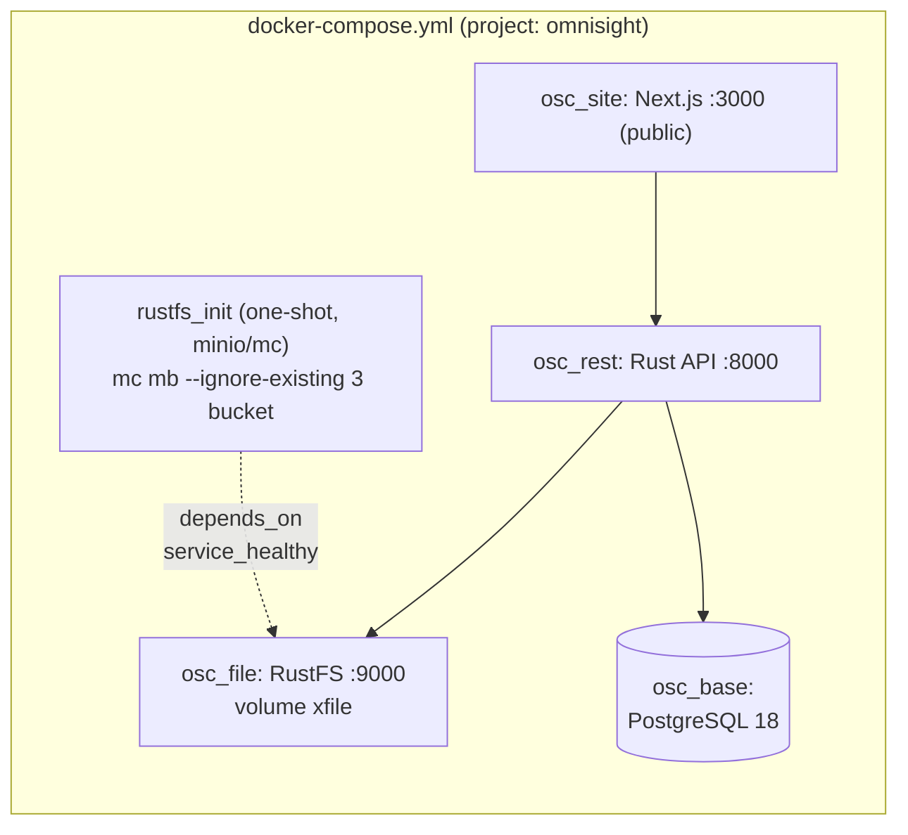

# DevOps Bootstrap: Topologi Infrastruktur Awal omnisight

- **Date**: 2026-11-12 (penyelarasan bucket RustFS & variabel keamanan)
- **Author**: ai-main (PM, System Analyst & Docker DevOps Architect)
- **Scope**: `Infrastructure | Bootstrap`
- **Referensi**: `osc_docs/reengineering.md` (bab 5.8, 6, 7), `osc_docs/architecture.md`, `osc_docs/infrastructure.md`, `osc_docs/checklist.md`

## 1. Ringkasan

Dokumen ini mencatat topologi infrastruktur awal stack master `docker-compose.yml`
 besarta penyelarasan terhadap cetak biru `osc_docs/reengineering.md`:

1. **Bucket RustFS per-fungsi** dibuat otomatis oleh container one-shot `rustfs_init`
   (image `minio/mc`) — tidak lagi bergantung pada pembuatan manual/fase `ai-rest`.
2. **Variabel keamanan & kriptografi** dan **Bootstrap Seeder** ditambahkan ke
   `.env.example` dan diikat (passthrough) ke service `osc_rest`.

Konfigurasi yang sudah valid dari sesi sebelumnya **tidak diubah**: nama service
(`osc_base`, `osc_file`, `osc_rest`, `osc_site`), network `blackbox` (external,
static IP 172.99.66.1–4), volume `xbase`/`xfile`, healthcheck, log rotation,
`no-new-privileges`, dan resource limits dipertahankan.

## 2. Topologi Service



| Service | Image | Peran | Keterangan |
| :--- | :--- | :--- | :--- |
| `osc_base` | `postgres:18-alpine` | PostgreSQL 18 | static IP `172.99.66.1` di `blackbox` |
| `osc_file` | `rustfs/rustfs:1.0.4` | S3-compatible storage | healthcheck `curl /health`; static IP `172.99.66.2` |
| `rustfs_init` | `minio/mc:latest` | **One-shot** bootstrap bucket | `depends_on: osc_file: service_healthy`; `restart: "no"`; static IP `172.99.66.5` |
| `osc_rest` | build `./osc_rest` | Rust REST API | env baru: bucket per-fungsi + keamanan + seeder |
| `osc_site` | build `./osc_site` | Next.js UI + BFF | satu-satunya published port stack |

## 3. Bucket RustFS (dibuat otomatis oleh `rustfs_init`)

Perintah yang dieksekusi `rustfs_init` (idempotent — aman dijalankan ulang):

```sh
mc alias set local "$RUSTFS_ENDPOINT" "$RUSTFS_ACCESS_KEY" "$RUSTFS_SECRET_KEY"
mc mb --ignore-existing "local/$RUSTFS_BUCKET_FILES"
mc mb --ignore-existing "local/$RUSTFS_BUCKET_PAM"
mc mb --ignore-existing "local/$RUSTFS_BUCKET_BACKUPS"
```

| Variabel `.env` | Default | Fungsi | Wave Pemakai |
| :--- | :--- | :--- | :--- |
| `RUSTFS_BUCKET_FILES` | `osc-assets-files` | Lampiran file & pipeline Excel Import/Export | Wave 1 (`ai-rest`) |
| `RUSTFS_BUCKET_PAM` | `osc-pam-recordings` | Arsip rekaman sesi PAM (`.cast.gz`/`.mp4`) + lifecycle retention | Wave 3 (reengineering.md bab 5.8) |
| `RUSTFS_BUCKET_BACKUPS` | `osc-config-backups` | Backup konfigurasi (nginx editor, compose stack) | Wave 2–3 |
| `RUSTFS_BUCKET` | `osc` | Bucket default lama (dipertahankan; tidak dihapus dari volume) | — |

> Catatan: `rustfs_init` hanya **membuat** bucket. Penempatan lifecycle policy
> arsip PAM (retensi bab 5.8) menyusul di fase `ai-rest` Wave 3.

## 4. Variabel Keamanan, Kriptografi & Bootstrap Seeder (baru)

Semua diikat sebagai environment `osc_rest` dengan default placeholder
(`change_me_*`); **wajib diganti** sebelum staging/prod. Generate key:

```sh
openssl rand -hex 32   # untuk tiap secret / master key
```

| Variabel | Default (placeholder) | Fungsi |
| :--- | :--- | :--- |
| `JWT_ACCESS_SECRET` | `change_me_jwt_access_secret_32bytes` | Signing JWT access token (pendek umur) |
| `JWT_REFRESH_SECRET` | `change_me_jwt_refresh_secret_32bytes` | Signing JWT refresh (terpisah agar revocable) |
| `APP_MASTER_ENCRYPTION_KEY` | `change_me_master_kek_32bytes` | KEK **Envelope AES-256-GCM** — harus tepat 32 byte |
| `AGENT_ENROLLMENT_SECRET` | `change_me_agent_enrollment_secret` | Secret flow enrollment agent (HMAC, bab 5.8) |
| `HRIS_ALLOWED_HOSTS` | `hris.internal.example.local` | Allowlist host/IP intranet HRIS — mitigasi **SSRF** (bab 7) |
| `BOOTSTRAP_ADMIN_USERNAME` | `superadmin` | Seeder idempotent Global Super Admin (bab 5.8) |
| `BOOTSTRAP_ADMIN_EMAIL` | `superadmin@example.local` | Upsert by username/email |
| `BOOTSTRAP_ADMIN_PASSWORD` | `change_me_on_first_login` | Tidak pernah di-commit; wajib ganti saat login pertama |

Aturan keamanan yang tetap berlaku (reengineering.md bab 6–7):
`.env` tidak pernah di-commit; placeholder default menimbulkan error nyata di
aplikasi jika lupa diganti; seeder idempotent tidak menimpa password yang sudah
diubah; HRIS client hanya outbound ke allowlist (tidak di-expose).

## 5. Verifikasi

```sh
# Validasi konfigurasi tanpa menjalankan container
docker compose config --quiet

# (opsional) lihat resolusi env & topology
docker compose config | grep -A6 rustfs_init
docker compose ps
```

Hasil validasi terakhir: `docker compose config --quiet` → **OK (exit 0)**
(tanggal 2026-11-12; lihat log harian di `osc_docs/checklist.md`).

## 6. Risiko & Tindak Lanjut

| Risiko | Mitigasi |
| :--- | :--- |
| Placeholder secret lupa diganti | Nilai `change_me_*` ditolak oleh pipeline SOC test (Wave `ai-test`); wajib `:?required` saat wave app memakai secret secara aktif |
| `rustfs_init` gagal (kredensial salah) | `depends_on: service_healthy` memastikan RustFS siap; `restart: "no"` agar tidak retry-loop; jalankan ulang `docker compose up rustfs_init` setelah memperbaiki `.env` |
| Bucket lama `osc` terhapus | Tidak ada perintah delete di init; bucket lama dipertahankan |
