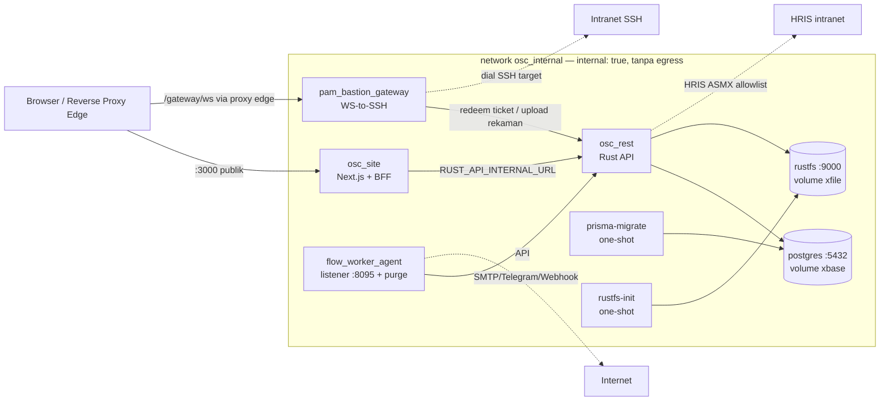

# Panduan Deployment Produksi: omnisight (SESI 5.1 / Hari 20)

- **Date**: 2026-11-13
- **Author**: ai-main (PM, System Analyst & Docker DevOps Architect)
- **Source Target**: Local workspace `omnisight` (git root, branch aktif)
- **Scope**: Infrastructure — finalisasi image produksi non-root, orkestrasi full-stack, hardening & healthcheck
- **Delegated Skills**: `ai-base` (runner Prisma), `ai-rest` (image `osc_rest`), `ai-site` (image `osc_site`), `ai-auto` (image agents), `ai-test` (smoke test Hari 21)

---

## 1. Executive Summary

Sesi ini memfinalisasi seluruh ekosistem omnisight menjadi arsitektur Docker produksi:

1. **Multi-stage Dockerfile non-root** untuk semua komponen — builder berat (toolchain Rust/Node/Go) dipisah dari runtime minimal (distroless/alpine standalone).
2. **`docker-compose.yml` master** yang menjalankan 8 service: `postgres`, `rustfs`, `rustfs-init`, `prisma-migrate`, `osc_rest`, `osc_site`, `pam_bastion_gateway`, `flow_worker_agent`.
3. **Isolasi jaringan berlapis** (`osc_internal` tanpa egress, `osc_egress` selektif, `osc_edge` publik, `blackbox` legacy).
4. **Hardening menyeluruh**: `read_only: true`, `no-new-privileges:true`, `cap_drop: ALL`, log rotation, resource limits, secret tanpa default-bypass untuk kredensial kritis.

Perubahan penamaan dari compose sebelumnya (breaking, disengaja): `osc_base`→`postgres`, `osc_file`→`rustfs`, `osc_save`→`rustfs-init`. **Volume data `xbase` dan `xfile` dipertahankan dengan nama sama** sehingga data existing tidak yatim. Compose dev (`docker-compose.dev.yml`, project `omnisight-dev`) tidak berubah.

## 2. Arsitektur Topologi



### 2.1 Jaringan

| Network | `internal` | Anggota | Fungsi |
| :--- | :--- | :--- | :--- |
| `osc_internal` | **true** (tanpa rute keluar) | semua service | Lalu lintas antar-service, tidak ada yang keluar ke internet |
| `osc_egress` | false (tanpa port publik) | `osc_rest`, `pam_bastion_gateway`, `flow_worker_agent` | Outbound terkontrol: HRIS, SSH target, SMTP/Telegram/webhook |
| `osc_edge` | false | `osc_site` (dan proxy edge bila dipakai) | Pemegang satu-satunya published port stack |
| `blackbox` (external) | false | `postgres` (.1), `rustfs` (.2) | Konvensi existing: akses host/legacy via static IP 172.99.66.x |

### 2.2 Rantai Dependensi Startup

```
postgres (healthy) ─┬─→ rustfs-init (one-shot, exit 0)
rustfs   (healthy) ─┴─→ prisma-migrate (one-shot: migrate deploy && db seed)
                              │ service_completed_successfully
                              ▼
                          osc_rest (healthy)
                              │ service_healthy
              ┌───────────────┼───────────────┐
              ▼               ▼               ▼
          osc_site   pam_bastion_gateway  flow_worker_agent
        (port publik)   (loopback 8090)   (listener 8095)
```

## 3. Inventaris Image (Dockerfile Non-Root)

| Image | Dockerfile | Builder | Runtime | User | Port |
| :--- | :--- | :--- | :--- | :--- | :--- |
| `omnisight/osc_rest` | `osc_rest/Dockerfile` | `cargo-chef` (rust 1.99.1 slim-bookworm, pinned) | **`gcr.io/distroless/cc-debian12:nonroot`** | UID 65532 | 8000 |
| `omnisight/osc_site` | `osc_site/Dockerfile` | node:22-alpine, `output: 'standalone'` | node:22-alpine (standalone) | `nextjs` UID 1001 | 3000 |
| `omnisight/osc_base` | `osc_base/Dockerfile` | — (npm ci di satu stage) | node:22-alpine + Prisma CLI | `node` UID 1000 | — (one-shot) |
| `omnisight/pam_bastion_gateway` | `osc_auto/pam_bastion_gateway/Dockerfile` | golang:1.26-alpine, `CGO_ENABLED=0` + `-trimpath -ldflags "-s -w"` | **`gcr.io/distroless/static-debian12:nonroot`** | UID 65532 | 8090 |
| `omnisight/flow_worker_agent` | `osc_auto/flow_worker_agent/Dockerfile` | golang:1.26-alpine, `CGO_ENABLED=0` | **`gcr.io/distroless/static-debian12:nonroot`** | UID 65532 | 8095 |

Catatan teknis penting:

- **Healthcheck di distroless**: image distroless tidak memiliki shell/curl. Setiap image distroless membundel `/bin/busybox` statis (dari `busybox:stable-musl`) **hanya** sebagai probe (`wget`/`sh` applet). Probe agent menerima status HTTP apa pun (404/400 pun berarti listener hidup); koneksi ditolak = unhealthy.
- **State agent persisten**: direktori state di-seed dengan ownership `nonroot` di dalam image (`COPY --chown`) sehingga named volume (`pam_gateway_state`, `flow_worker_state`) mewarisi ownership benar pada mount pertama.
- **Binary native non-container**: untuk deployment berbasis host OS (Linux systemd / Windows Service), build cross-platform tetap tersedia via `deploy/windows/install-service.ps1` dan unit `deploy/linux/*.service` di masing-masing agent — jalur container dan host saling melengkapi, tidak saling menggantikan.
- **Runner Prisma bekerja offline**: engine Prisma & `tsx` dibundel saat `npm ci` (build time), sehingga `prisma-migrate` aman berjalan di `osc_internal` tanpa egress.

## 4. Hardening Compose (Ringkasan Kontrol)

| Kontrol | postgres | rustfs | rustfs-init | prisma-migrate | osc_rest | osc_site | pam gateway | flow worker |
| :--- | :-: | :-: | :-: | :-: | :-: | :-: | :-: | :-: |
| `read_only: true` | ✅ +tmpfs socket/tmp | ✅ +tmpfs | ✅ +tmpfs /root | ✅ +tmpfs | ✅ +tmpfs | ✅ +tmpfs `.next/cache` | ✅ +tmpfs | ✅ +tmpfs |
| `no-new-privileges` | ✅ | ✅ | ✅ | ✅ | ✅ | ✅ | ✅ | ✅ |
| `cap_drop: ALL` | — (butuh caps init PG) | — | — | ✅ | ✅ | ✅ | ✅ | ✅ |
| Resource limits | 1 CPU/1G | 1 CPU/1G | 0.25/128M | 0.5/512M | 1/1G | 1/1G | 1/1G | 0.5/256M |
| Healthcheck | pg_isready | curl /health | — (one-shot) | — (one-shot) | wget /api/v1/health | wget /api/health | wget status-any | wget status-any |
| Log rotation | 10m×3 | 10m×3 | 10m×3 | 10m×3 | 10m×3 | 10m×3 | 10m×3 | 10m×3 |

Secret wajib (compose gagal start bila kosong — `:?` guard): `PG_PASS`, `RUSTFS_ACCESS_KEY`, `RUSTFS_SECRET_KEY`, `JWT_ACCESS_SECRET`, `JWT_REFRESH_SECRET`, `APP_MASTER_ENCRYPTION_KEY`, `AGENT_ENROLLMENT_SECRET`. Tidak ada satu pun kredensial yang di-commit (`.env` di-gitignore; hanya `.env.example`).

## 5. Prosedur Deployment Produksi

### 5.1 Persiapan Host

```bash
# 1. Clone / tarik workspace, masuk direktori root
cd /opt/omnisight

# 2. Siapkan environment (JANGAN pernah commit .env)
cp .env.example .env
# 3. Generate & isi semua secret (wajib, tanpa kecuali):
sed -i "s/^PG_PASS=.*/PG_PASS=$(openssl rand -hex 16)/" .env
sed -i "s/^RUSTFS_ACCESS_KEY=.*/RUSTFS_ACCESS_KEY=$(openssl rand -hex 12)/" .env
sed -i "s/^RUSTFS_SECRET_KEY=.*/RUSTFS_SECRET_KEY=$(openssl rand -hex 32)/" .env
for v in JWT_ACCESS_SECRET JWT_REFRESH_SECRET APP_MASTER_ENCRYPTION_KEY \
         AGENT_ENROLLMENT_SECRET FLOW_WORKER_LISTEN_SECRET_HEX \
         FLOW_WORKER_QUEUE_KEY_HEX PAM_GATEWAY_STATE_KEY_HEX; do
  sed -i "s|^${v}=.*|${v}=$(openssl rand -hex 32)|" .env
done
# 4. Wajib: allowlist origin publik untuk WebSocket PAM (anti CSWSH):
#    PAM_GATEWAY_ALLOWED_ORIGINS=https://omnisight.corp.local
```

### 5.2 Build & Nyalakan Stack

```bash
# Validasi sintaks & interpolasi environment sebelum apapun
docker compose config --quiet && echo OK

# Build image + nyalakan (prisma-migrate & rustfs-init berjalan otomatis sekali)
docker compose up -d --build

# Verifikasi: postgres/rustfs/osc_rest/osc_site/agents = healthy;
# rustfs-init & prisma-migrate = Exited (0)
docker compose ps
docker compose logs prisma-migrate   # pastikan "... seed" sukses
```

`prisma-migrate` menjalankan `npx prisma migrate deploy && npx prisma db seed` — keduanya **idempotent**: aman dipanggil ulang setiap `up`/rebuild, seed hanya upsert (tidak menimpa password superadmin yang sudah diganti).

### 5.3 Enrollment Agent (One-Time, Wajib)

Kedua agent `osc_auto` menolak memakai API sebelum di-enroll (token one-time dari osc_rest):

```bash
# 1. Buat token enrollment di UI osc_site (Super Admin → Agent Enrollment)
#    atau dari response AGENT_ENROLLMENT_SECRET flow osc_rest.
# 2. Enroll (state tersimpan terenkripsi di named volume):
docker compose run --rm flow_worker_agent --enroll "$TOKEN_FLOW_WORKER"
docker compose run --rm pam_bastion_gateway --enroll "$TOKEN_PAM_GATEWAY"
# 3. Restart agar agent memuat state baru:
docker compose restart flow_worker_agent pam_bastion_gateway
# 4. (Retention purge) masukkan agent_id flow_worker ke allowlist osc_rest:
#    RETENTION_PURGE_AGENT_IDS=<agent_id_flow_worker>  di .env, lalu:
docker compose up -d osc_rest
```

> ⚠️ State enrollment hidup di volume `flow_worker_state` / `pam_gateway_state`. **Jangan pernah `docker compose down -v`** kecuali siap re-enroll semua agent.

### 5.4 Reverse Proxy Edge (wajib untuk produksi)

Satu-satunya port yang dipublish compose adalah `osc_site` (`${SITE_PORT:-3000}`) dan `pam_bastion_gateway` yang **di-bind loopback** (`127.0.0.1:${PAM_GATEWAY_PUBLIC_PORT:-8090}`) khusus untuk proxy. Browser xterm.js membuka WS **same-origin** `/gateway/ws`, sehingga reverse proxy (nginx/Traefik, di host atau container di `osc_edge`) wajib meneruskan:

```nginx
# /etc/nginx/conf.d/omnisight.conf (TLS terminate di proxy)
server {
  listen 443 ssl;
  server_name omnisight.corp.local;
  # ... ssl_certificate ...

  location /gateway/ws {                    # WebSocket PAM → gateway (loopback)
    proxy_pass http://127.0.0.1:8090;
    proxy_http_version 1.1;
    proxy_set_header Upgrade $http_upgrade;
    proxy_set_header Connection "upgrade";
    proxy_read_timeout 3600s;
  }
  location / {                              # UI + BFF → osc_site
    proxy_pass http://127.0.0.1:3000;
    proxy_set_header Host $host;
    proxy_set_header X-Forwarded-Proto $scheme;
  }
}
```

Alternatif containerized: jalankan nginx/Traefik sebagai service tambahan di network `osc_edge` dan hapus blok `ports:` pam gateway. **Jangan pernah** mempublish `postgres`, `rustfs`, `osc_rest`, atau port listener agent secara langsung.

### 5.5 Operasional Harian

```bash
docker compose ps                          # status healthy semua service
docker compose logs -f osc_rest            # log JSON terstruktur + rotasi 10m×3
docker compose restart osc_site            # restart satu service
docker compose up -d --build osc_rest      # deploy versi baru satu service
docker compose down                        # stop (volume & state AMAN)
```

Upgrade skema database: cukup `git pull` lalu `docker compose up -d --build` — `prisma-migrate` otomatis menerapkan migrasi baru sebelum `osc_rest` restart (garansi urutan via `service_completed_successfully`).

## 6. Validasi

| Langkah | Perintah | Hasil |
| :--- | :--- | :--- |
| Sintaks compose + interpolasi env | `docker compose config --quiet` | ✅ exit 0 (LOKAL, 2026-11-13) |
| Isolasi internal | `docker compose config \| grep "internal: true"` | ✅ `osc_internal` ber-flag internal |
| read_only semua service | `docker compose config` | ✅ 8/8 service `read_only: true` |
| Cleanup folder sementara | `find . -name ".rea_docs" -o -name ".tmp_reeng" -o -name ".rea_temp"` | ✅ tidak ada sisa; `.tmp_reeng/` ditambahkan ke `.gitignore` |
| Smoke test end-to-end (Hari 21) | login superadmin, MFA, import Excel, sesi PAM | ⬜ SESI `SMOKE TEST` |

Build image penuh (`docker compose build`) membutuhkan toolchain & network registry pada host build; jalankan di mesin deployment. Checklist verifikasi build per image:

```bash
docker compose build osc_rest osc_site prisma-migrate pam_bastion_gateway flow_worker_agent
# Cek non-root & lapisan image:
docker history omnisight/osc_rest:latest
docker inspect -f '{{.Config.User}}' omnisight/osc_rest:latest          # nonroot
docker inspect -f '{{.Config.User}}' omnisight/pam_bastion_gateway:latest # nonroot
```

## 7. Risiko, Keamanan & Strategi Rollback

| Risiko | Mitigasi | Rollback |
| :--- | :--- | :--- |
| Kredensial default terbawa ke produksi | Guard `:?` di compose memaksa secret diisi; `.env` di-gitignore | Rotasi secret di `.env` + `docker compose up -d` |
| Volume state agent hilang (`down -v`) | Dokumentasi tegas §5.3; volume terpisah dari data app | Re-enroll agent (token one-time baru) |
| `internal: true` memblokir egress notifikasi/SSH/HRIS | Network `osc_egress` selektif hanya untuk 3 service berkebutuhan outbound | — |
| Service one-shot gagal → `osc_rest` tidak pernah start | `service_completed_successfully` membuat kegagalan migrasi terlihat cepat, bukan 500 runtime | `docker compose logs prisma-migrate`, perbaiki, `up` ulang |
| Distroless menyulitkan debugging (tanpa shell) | JSON logging ke stdout; busybox probe terbatas healthcheck saja | `docker compose logs <svc>`; bila perlu ephemeral debug pakai `docker compose run --rm --entrypoint /bin/busybox <svc>` |
| Kompromi image Rust sebelumnya (GLIBC mismatch) | Builder rust 1.99.1 **pinned** slim-bookworm; runtime distroless cc bookworm | Rebuild dari tag pinned |
| Perubahan penamaan service memutus integrasi host lama | Static IP 172.99.66.1/.2 di `blackbox` dipertahankan untuk postgres/rustfs | Override compose dapat menambahkan kembali attachment bila ada konsumen legacy lain |

---

*Langkah berikutnya: SESI `SMOKE TEST` (Hari 21) — uji end-to-end `docker compose up -d` penuh meliputi login Super Admin, setup Company + HRIS, aktivasi MFA, switch company, import Excel aset, dan sesi terminal PAM.*
