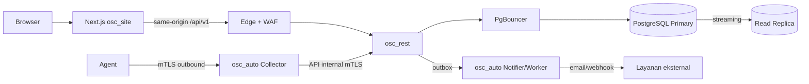

# Alur Data OmniSight

Status: Disetujui (0.6)

Dokumen ini menjelaskan perpindahan data antar komponen, batas kepercayaan, dan aturan yang harus dijaga di setiap peran: agent, database, backend, dan frontend.

## 1. Tujuan

- Menunjukkan asal, tujuan, dan pemilik setiap data.
- Mencegah data sensitif melewati jalur yang salah.
- Menjadi acuan implementasi logging, audit, retensi, dan isolasi tenant.
- Memudahkan investigasi insiden dan penelusuran request.

## 2. Struktur

| Peran | Dokumen | Fokus |
|---|---|---|
| Agent | [agent/README.md](agent/README.md) | Enrollment, metrik, tugas, backup, buffer offline |
| Database | [database/README.md](database/README.md) | Tulis, baca, audit, outbox, backup, partisi |
| Backend | [backend/README.md](backend/README.md) | Middleware, use case, adapter, error, lokalisasi |
| Frontend | [frontend/README.md](frontend/README.md) | Render server, query klien, auth, konteks, error |

## 3. Alur tingkat tinggi

## 4. Zona kepercayaan

| Zona | Isi | Aturan |
|---|---|---|
| Publik | Browser, halaman publik | Tanpa data internal |
| Edge/DMZ | Nginx/Traefik, WAF | TLS, rate limit, header keamanan |
| Aplikasi | `osc_site`, `osc_rest`, `osc_auto` | Tanpa akses langsung ke internet |
| Data | PostgreSQL, PgBouncer, backup | Tidak diekspos publik |
| Klien | Agent, perangkat, jaringan klien | Outbound-only, mTLS |

## 5. Klasifikasi data

| Kelas | Contoh | Aturan |
|---|---|---|
| Publik | Artikel, halaman status | Boleh publik |
| Internal | Inventaris, tiket tanpa data sensitif | Perlu login dan scope |
| Rahasia | Kredensial, konfigurasi firewall, audit | Enkripsi, akses terbatas |
| Sangat rahasia | Vault key, private key, rekaman bastion | Vault, approval, audit |

## 6. Aturan umum

- Data tenant tidak boleh melintas ke tenant lain, termasuk melalui cache atau log.
- Agent tidak pernah mengakses database.
- `osc_auto` tidak menulis database domain; memakai API internal.
- Browser tidak memanggil host internal atau integrasi eksternal.
- Setiap request memiliki `request_id` untuk korelasi.
- Data sensitif diredaksi di log, audit, dan pesan error.
- Retensi mengikuti kebijakan per kelas data.

## 7. Dokumen terkait

- [Topologi dan akses](../../technical/backend/topologi-dan-akses.md)
- [Kontrak API](../../technical/backend/kontrak-api.md)
- [Keamanan](../../security/README.md)
- [Operasi](../../operations/README.md)
