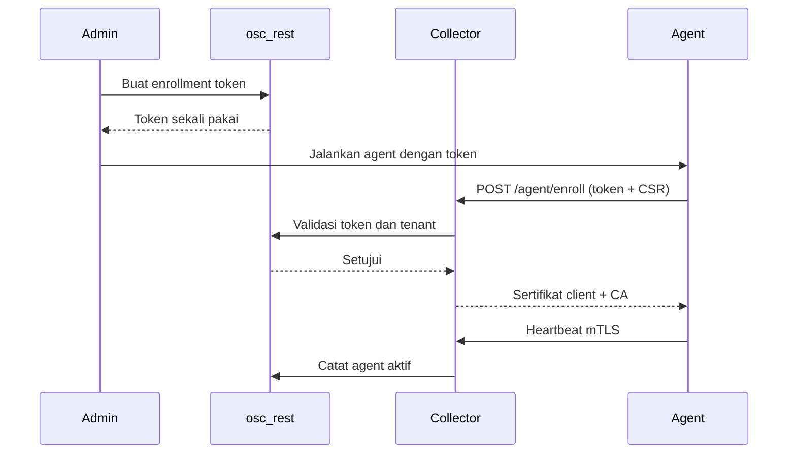
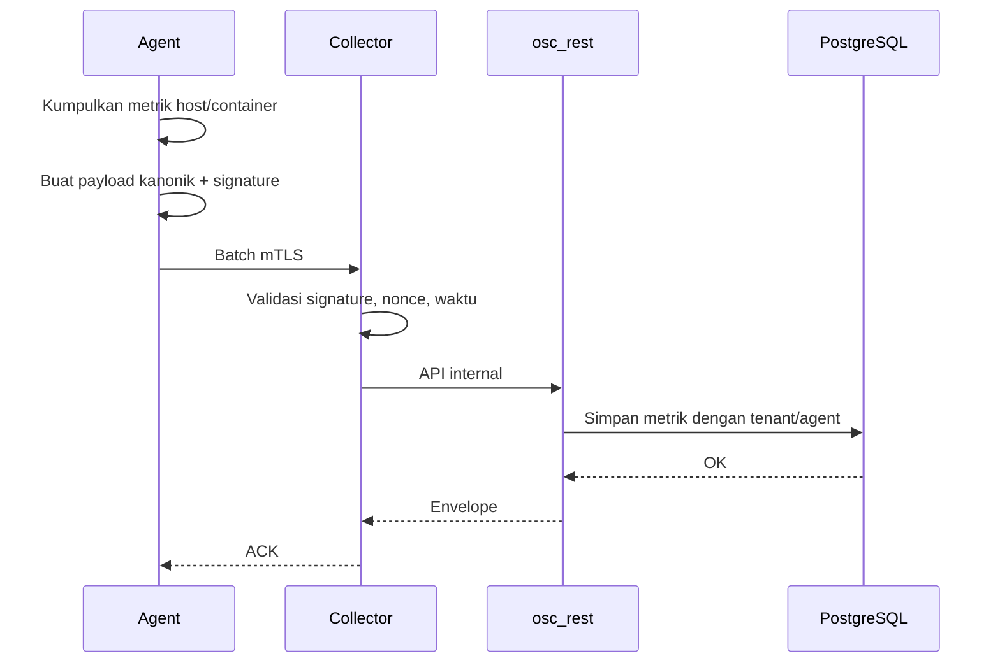
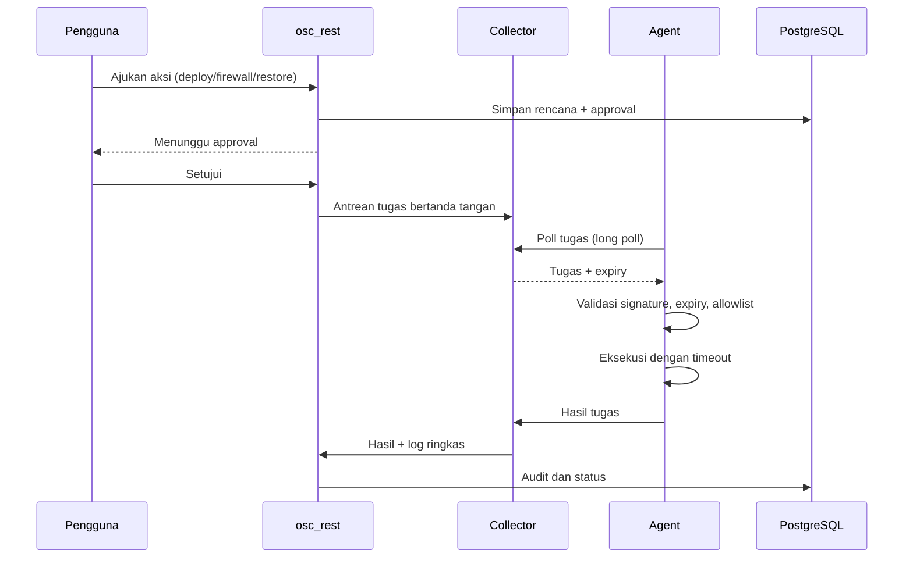
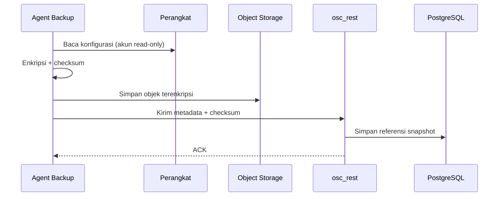

# Alur Data Agent

Status: Disetujui (0.6)

Agent mengirim data keluar melalui mTLS, menerima tugas yang sudah disetujui, dan menyimpan sementara data saat offline. Agent tidak membuka port masuk dan tidak mengakses database.

## 1. Enrollment

Data yang melewati jalur ini: token enrollment, CSR, fingerprint, dan identitas agent. Token tidak disimpan setelah enrollment.

## 2. Telemetri

Aturan:

- Batch memiliki `agent_id`, `message_id`, `sent_at`, `nonce`, dan signature Ed25519.
- Collector menolak timestamp di luar ±5 menit dan nonce berulang.
- Metrik tidak memuat environment variable, nama file sensitif, atau data pribadi.
- ACK diberikan setelah data diterima dan divalidasi, bukan setelah komit database akhir.

## 3. Tugas

Agent menolak tugas yang kedaluwarsa, di luar allowlist, atau signature-nya tidak valid. Hasil tugas tidak boleh memuat rahasia.

## 4. Backup konfigurasi

Isi konfigurasi tidak dikirim ke metrik atau log. Metadata yang disimpan hanya referensi objek, checksum, waktu, target, dan status.

## 5. Buffer offline

- Data disimpan terenkripsi dengan batas ukuran dan retensi.
- Heartbeat memiliki prioritas tertinggi.
- Saat buffer penuh, data tertua dihapus dengan catatan.
- Setelah reconnect, batch dikirim berurutan.
- Backoff eksponensial dengan jitter; tidak ada retry tanpa batas.

## 6. Data yang dilarang

- Password, token, private key, dan secret.
- Environment variable container.
- Isi command line proses sensitif.
- Data pribadi pengguna.
- Isi log aplikasi klien.
- Konfigurasi perangkat dalam bentuk teks mentah di metrik.

## 7. Checklist

- [ ] Enrollment memakai token sekali pakai.
- [ ] Semua payload ditandatangani dan memiliki nonce.
- [ ] Timestamp dan nonce divalidasi.
- [ ] Data sensitif tidak dikirim.
- [ ] Buffer terenkripsi dan dibatasi.
- [ ] Tugas divalidasi sebelum eksekusi.
- [ ] Backup memakai objek terenkripsi.
