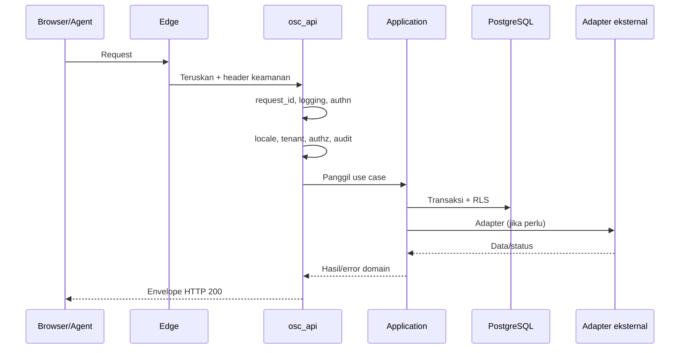
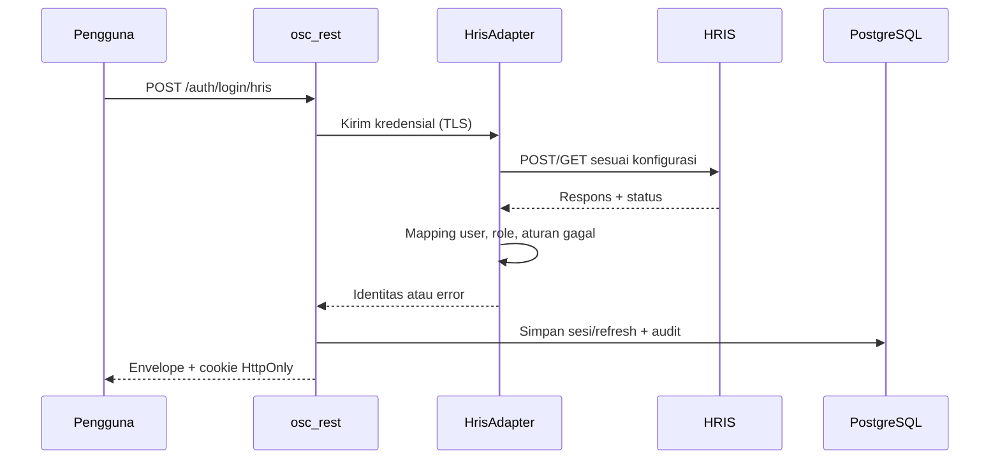
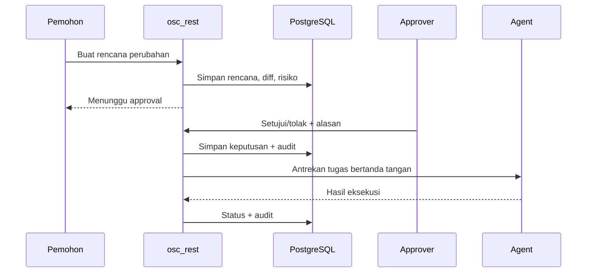
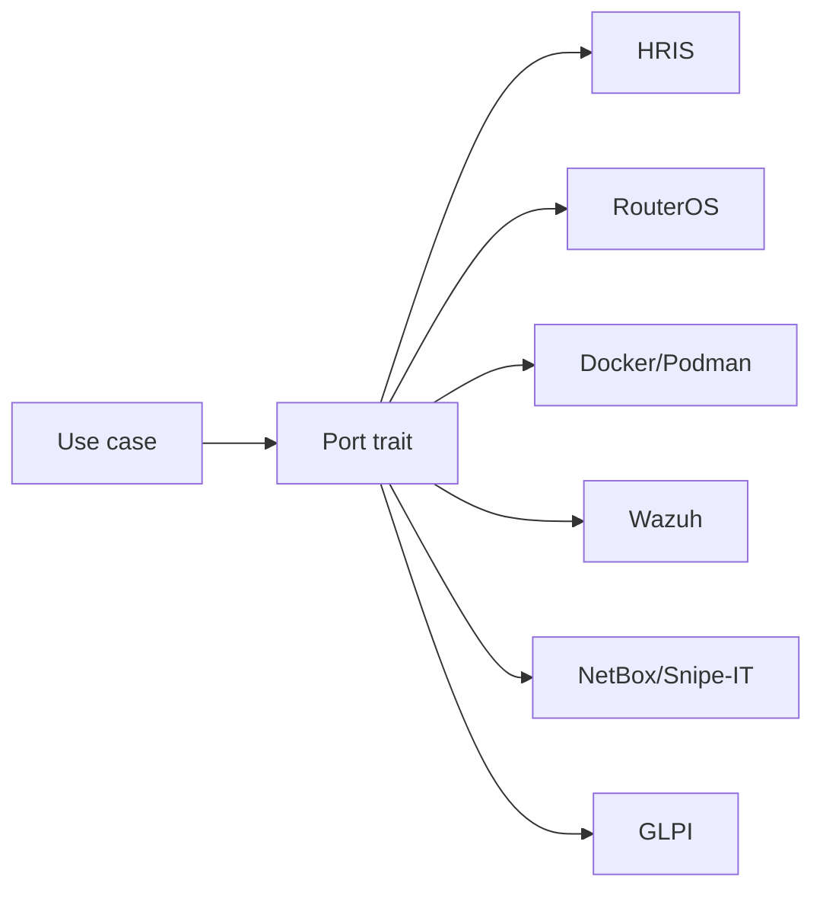
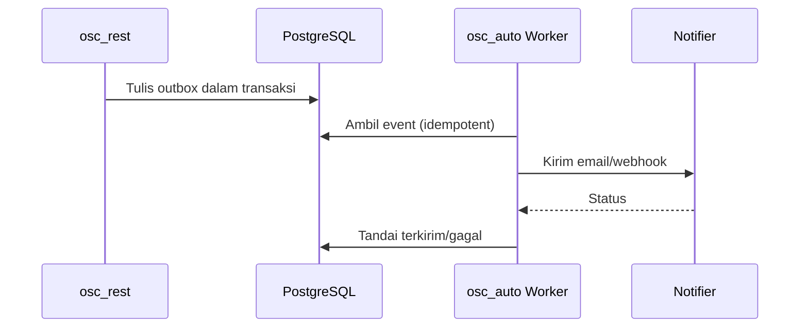

# Alur Data Backend

Status: Disetujui (0.6)

Backend `osc_rest` menerima request dari edge, memvalidasi identitas dan izin, menjalankan use case, lalu mengembalikan envelope. Backend adalah satu-satunya jalur tulis database domain.

## 1. Siklus request

Urutan middleware: `request_id`, `logging`, `security_headers`, `body_limit`, `rate_limit`, `cors`, `csrf`, `authn`, `locale`, `tenant`, `authz`, `audit`, `error_map`.

## 2. Login HRIS

Aturan:

- Password tidak pernah disimpan atau dilog.
- Timeout, circuit breaker, dan allowlist host.
- Pesan gagal generik ke pengguna.
- Fallback lokal hanya jika kebijakan perusahaan mengizinkan.
- Role dari HRIS tidak boleh menjadi platform owner.

## 3. Approval dan aksi berisiko

Aksi seperti firewall, deploy, restore, dan akses bastion tidak boleh dieksekusi tanpa approval. Idempotency key mencegah eksekusi ganda.

## 4. Adapter eksternal

- Semua panggilan keluar melewati allowlist dan proteksi SSRF.
- Timeout, retry backoff, dan circuit breaker.
- Kredensial hanya referensi vault.
- Error eksternal dipetakan ke kode OmniSight yang stabil.
- Token dan password tidak masuk log.

## 5. Notifikasi asinkron

Kegagalan notifier tidak membatalkan transaksi bisnis. Outbox memastikan event tidak hilang.

## 6. Error dan lokalisasi

- Semua hasil bisnis memakai HTTP 200 dan envelope.
- Penolakan akses `AA00-00-0003`; tidak ada 403.
- Error internal `AA00-00-0100`; layanan pendukung `AA00-00-0900`.
- `Accept-Language` > locale pengguna > locale perusahaan > `en`.
- `code` stabil; `message`/`reason` terlokalisasi.
- `request_id` selalu dikembalikan.

## 7. Checklist

- [ ] Middleware berjalan sesuai urutan.
- [ ] Tenant dan scope divalidasi sebelum use case.
- [ ] Aksi berisiko memiliki approval dan idempotency.
- [ ] Adapter memiliki timeout dan circuit breaker.
- [ ] Outbox dipakai untuk event asinkron.
- [ ] Error tidak membocorkan detail internal.
- [ ] Log memuat `request_id`, tenant, dan locale.
