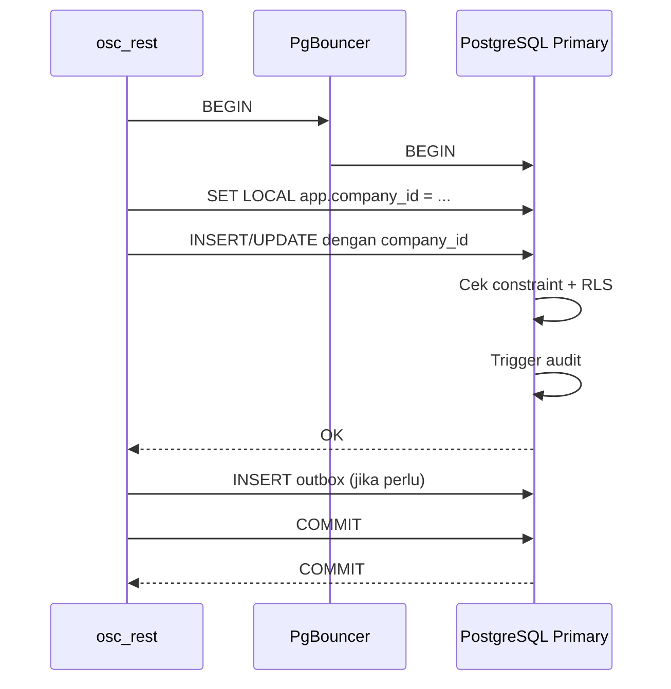
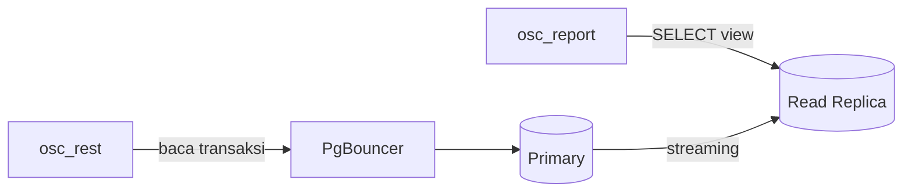
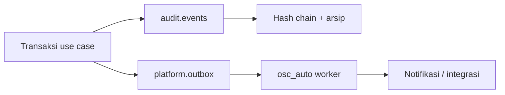
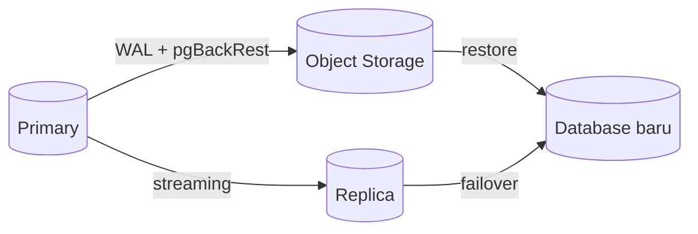

# Alur Data Database

Status: Disetujui (0.6)

Database menerima koneksi hanya dari `osc_rest` melalui PgBouncer. Setiap transaksi tenant menetapkan konteks perusahaan, lalu RLS membatasi baris yang terlihat.

## 1. Alur tulis

Aturan:

- `SET LOCAL` wajib di dalam transaksi; jangan memakai `SET` global pada koneksi pool.
- Aplikasi memakai role `osc_rest_app`, bukan superuser.
- Semua tabel tenant memiliki `company_id` dan RLS `FORCE`.
- Foreign key komposit mencegah relasi lintas perusahaan.
- Audit dan outbox ditulis dalam transaksi yang sama untuk konsistensi.

## 2. Alur baca dan laporan

- Baca operasional memakai primary.
- Laporan dan ekspor berat memakai replica dengan role `osc_report`.
- View laporan tidak boleh membocorkan tenant lain.
- Replication lag dipantau; data laporan diberi waktu pembaruan.

## 3. Audit dan outbox

- Audit bersifat append-only dan memiliki hash chain.
- Payload audit memakai urutan kunci stabil.
- Field sensitif diredaksi sebelum disimpan.
- Outbox mencegah kehilangan event saat layanan notifier gagal.
- Worker memproses outbox secara idempotent.

## 4. Backup dan restore

- Backup full + incremental + WAL archiving.
- Restore diuji berkala ke database terpisah.
- Rahasia tidak disimpan di database; hanya referensi vault.
- RPO dan RTO mengikuti dokumen operasi.

## 5. Partisi dan retensi

- Metrik, login attempt, dan job run dipartisi bulanan.
- Rollup metrik per jam untuk rentang panjang.
- Data lama diarsipkan sebelum dihapus.
- Job maintenance partisi berjalan terjadwal dan diaudit.

## 6. Kegagalan

| Kondisi | Perilaku |
|---|---|
| Pool penuh | Timeout terkontrol, error `AA00-00-0900`, metrik naik |
| Replication lag | Laporan diberi peringatan; baca operasional tetap primary |
| Konflik tulis | Retry terbatas atau kode `AA00-00-0005` |
| Transaksi gagal | Rollback penuh; tidak ada audit/outbox parsial |
| RLS tidak aktif | Tes rilis gagal; tidak boleh deploy |

## 7. Checklist

- [ ] `SET LOCAL` dipakai di setiap transaksi tenant.
- [ ] Role aplikasi bukan superuser.
- [ ] RLS `FORCE` aktif.
- [ ] Audit dan outbox transaksional.
- [ ] Replica hanya untuk laporan.
- [ ] Backup dan restore diuji.
- [ ] Partisi dan retensi berjalan.
