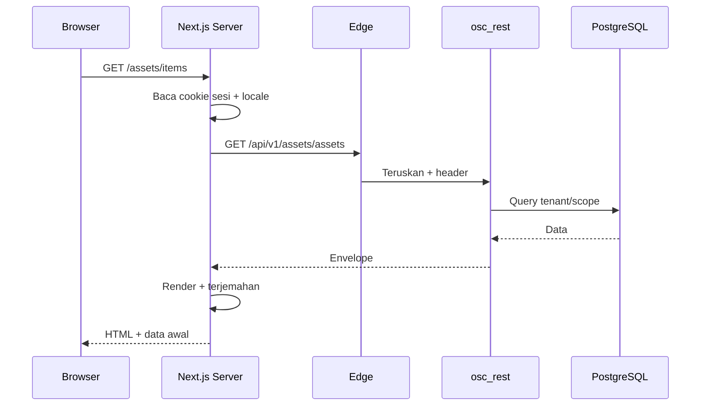
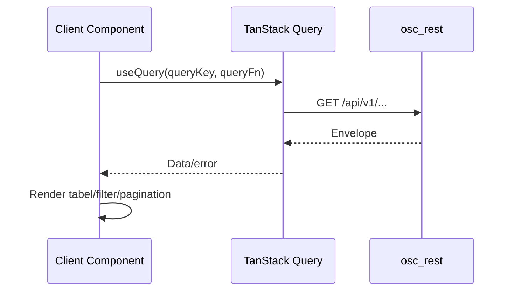
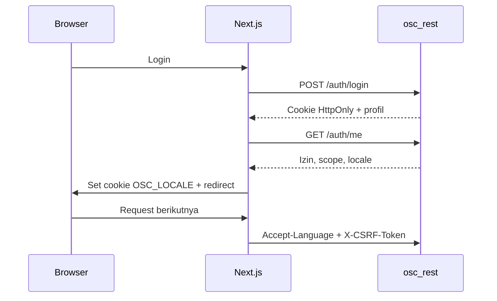
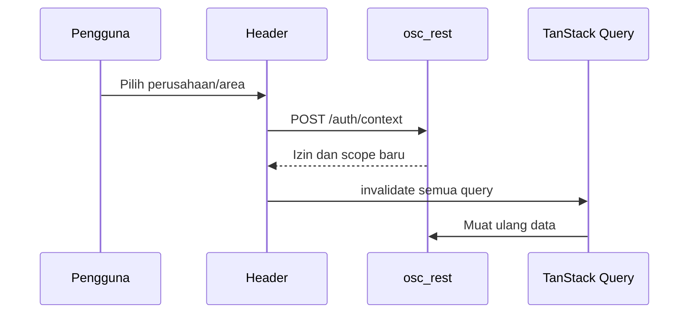

# Alur Data Frontend

Status: Disetujui (0.6)

Frontend Next.js mengambil data melalui `osc_rest` same-origin. Browser tidak memanggil host internal atau integrasi eksternal secara langsung.

## 1. Render server

Aturan:

- Server Component memakai cookie dan `Accept-Language`.
- Izin diperiksa di server, bukan hanya disembunyikan di UI.
- Data awal dikirim ke komponen klien untuk hydration.
- Halaman terautentikasi memakai `Cache-Control: private, no-store`.

## 2. Query klien

- Query key memuat `company_id`, `area_id`, dan filter.
- Ganti perusahaan/area menginvalidasi semua query.
- Tidak menyimpan data server besar di state global.
- `staleTime` sesuai jenis data: dashboard 30 detik, audit 0, master data 5 menit.

## 3. Auth, CSRF, dan locale

- Token akses/refresh hanya di cookie HttpOnly.
- CSRF token dibaca dari cookie non-HttpOnly khusus, bukan storage.
- `OSC_LOCALE` hanya preferensi bahasa, bukan otorisasi.
- Bahasa aktif dikirim melalui `Accept-Language`.

## 4. Ganti perusahaan/area

- Data lama tidak boleh ditampilkan setelah konteks berubah.
- Area yang tidak valid kembali ke area default.
- Menu dan dashboard diperbarui sesuai izin baru.

## 5. Submit dan approval

- Form memakai React Hook Form + Zod; server tetap memvalidasi.
- Tombol submit memiliki state loading dan disabled.
- Aksi sensitif menampilkan ringkasan dampak, risiko, dan alasan.
- Aksi approval memakai `Idempotency-Key`.
- Setelah sukses, query terkait diinvalidasi dan toast ditampilkan.

## 6. Error

| Kode | Alur UI |
|---|---|
| `AA00-00-0001` | Tampilkan error field |
| `AA00-00-0002` | Redirect login, bersihkan cache |
| `AA00-00-0003` | Halaman/toast akses ditolak + request id |
| `AA00-00-0004` | Halaman tidak ditemukan |
| `AA00-00-0005` | Minta muat ulang |
| `AA00-00-0006` | Countdown `retry_after_seconds` |
| `AA00-00-0100` | Pesan generik + request id |
| `AA00-00-0900` | Pesan layanan sementara |

Pesan diambil dari `message` backend; jika kosong, frontend memetakan `code` ke katalog lokal.

## 7. Batas data

- Tidak ada token di `localStorage` atau `sessionStorage`.
- Tidak ada fetch langsung ke host internal.
- Tidak ada data lintas tenant di cache.
- Markdown disanitasi; tidak ada `dangerouslySetInnerHTML` untuk input pengguna.
- Upload/download melewati API dan diaudit.

## 8. Checklist

- [ ] Server Component meneruskan cookie dan locale.
- [ ] Query key memuat tenant/area.
- [ ] Ganti konteks menginvalidasi cache.
- [ ] CSRF dan `Accept-Language` dikirim.
- [ ] Error envelope ditangani.
- [ ] Tidak ada token di storage.
- [ ] Halaman terautentikasi tidak di-cache bersama.
