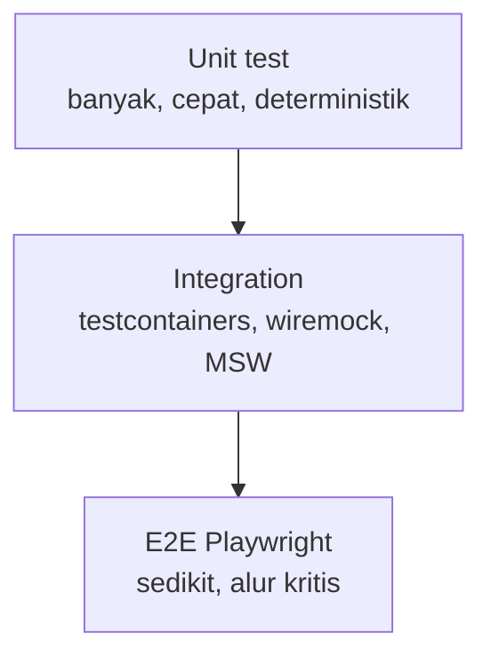

# Unit Test OmniSight

Status: Disetujui (0.6)

Dokumen ini mengatur unit test untuk setiap peran komponen: agent, database, backend, dan frontend. Tujuannya agar pengujian cepat, deterministik, dan tidak bergantung pada layanan nyata.

## 1. Cakupan

Unit test menguji satu unit perilaku secara terisolasi:

- Logika domain, aturan izin, validasi, pemetaan error, dan format data.
- Fungsi murni, parser, penandatanganan payload, dan buffer.
- Konstraint database, RLS, fungsi audit, dan seed.
- Komponen frontend, helper izin, API client, dan terjemahan.

Bukan unit test:

- Koneksi nyata ke PostgreSQL, perangkat, Docker/Podman, HRIS, atau Wazuh.
- Browser end-to-end, beban, dan pentest.
- Deployment dan restore produksi.

Semua itu masuk integration test, E2E, atau pengujian operasi di dokumen terkait.

## 2. Struktur

| Peran | Dokumen | Fokus utama |
|---|---|---|
| Agent | [agent/README.md](agent/README.md) | Go: collector, signature, buffer, executor, updater |
| Database | [database/README.md](database/README.md) | PostgreSQL: migrasi, RLS, constraint, audit, seed |
| Backend | [backend/README.md](backend/README.md) | Rust: domain, use case, policy, error, adapter contract |
| Frontend | [frontend/README.md](frontend/README.md) | TypeScript: helper izin, API client, i18n, form, komponen |

## 3. Piramida pengujian

Aturan:

- Unit test menjadi mayoritas dan harus selesai dalam hitungan detik per paket.
- Integration test dipakai untuk batas sistem nyata: database, HTTP eksternal, filesystem.
- E2E hanya untuk alur bernilai tinggi: login, ganti perusahaan, aset, deploy, approval, audit.

## 4. Aturan umum

- Uji perilaku, bukan detail implementasi.
- Nama tes menjelaskan kondisi dan hasil: `TestTaskRejectsExpiredSignature`.
- Waktu, UUID, dan randomness harus dapat dikontrol melalui fake clock/fake generator.
- Tidak ada network, sleep, atau ketergantungan urutan tes.
- Tidak memakai data produksi, data pribadi, atau rahasia nyata.
- Setiap bug produksi yang diperbaiki wajib mendapat tes regresi.
- Tes yang flaky diperbaiki atau dihapus, bukan diabaikan.
- Kode error dan kunci terjemahan diuji sebagai kontrak yang stabil.

## 5. Data uji

| Jenis | Aturan |
|---|---|
| Tenant | Minimal dua perusahaan dan dua area untuk kasus isolasi |
| Pengguna | Nama dan email sintetis, domain `.invalid` |
| Aset | Tag sintetis, tanpa data pelanggan |
| Rahasia | Placeholder; tidak pernah nilai nyata |
| Waktu | UTC dan fake clock |
| File | Fixture kecil, tidak memuat kredensial |

## 6. CI dan gerbang kualitas

- Unit test berjalan pada setiap pull request.
- Lint, type check, dan unit test wajib lulus sebelum merge.
- Cakupan minimal: 80% untuk logika domain/application; 100% untuk policy izin, RLS, dan pemetaan kode error kritis.
- Cakupan bukan tujuan akhir; jalur kritis dan kasus negatif lebih penting.
- Hasil tes disimpan sebagai artefak CI.
- Tes yang membutuhkan OS tertentu memakai matriks CI, bukan skip permanen.

## 7. Kepemilikan

| Peran | Pemilik | Reviewer |
|---|---|---|
| Agent | Platform/OS Lead | Security |
| Database | Data/Backend Lead | Security, Ops |
| Backend | Backend Lead | Security, Frontend |
| Frontend | Frontend Lead | Product, Backend |

Dokumen terkait: [Tata kelola](../../governance/README.md), [Keamanan](../../security/README.md), [Operasi](../../operations/README.md).
