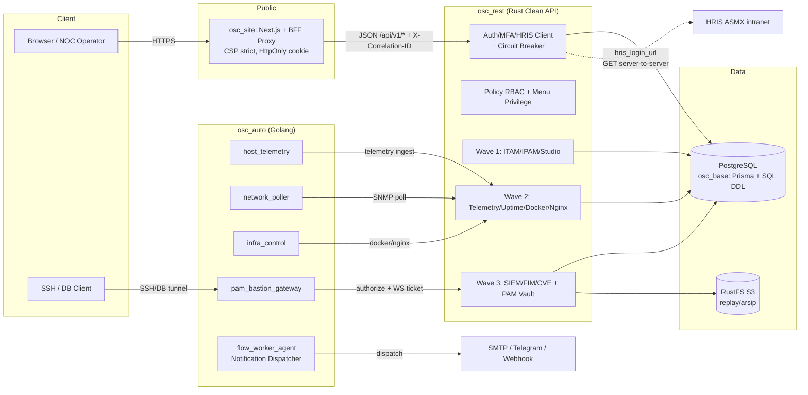
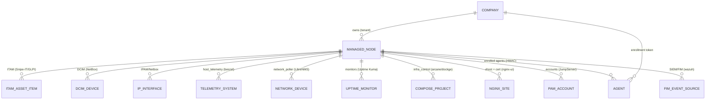
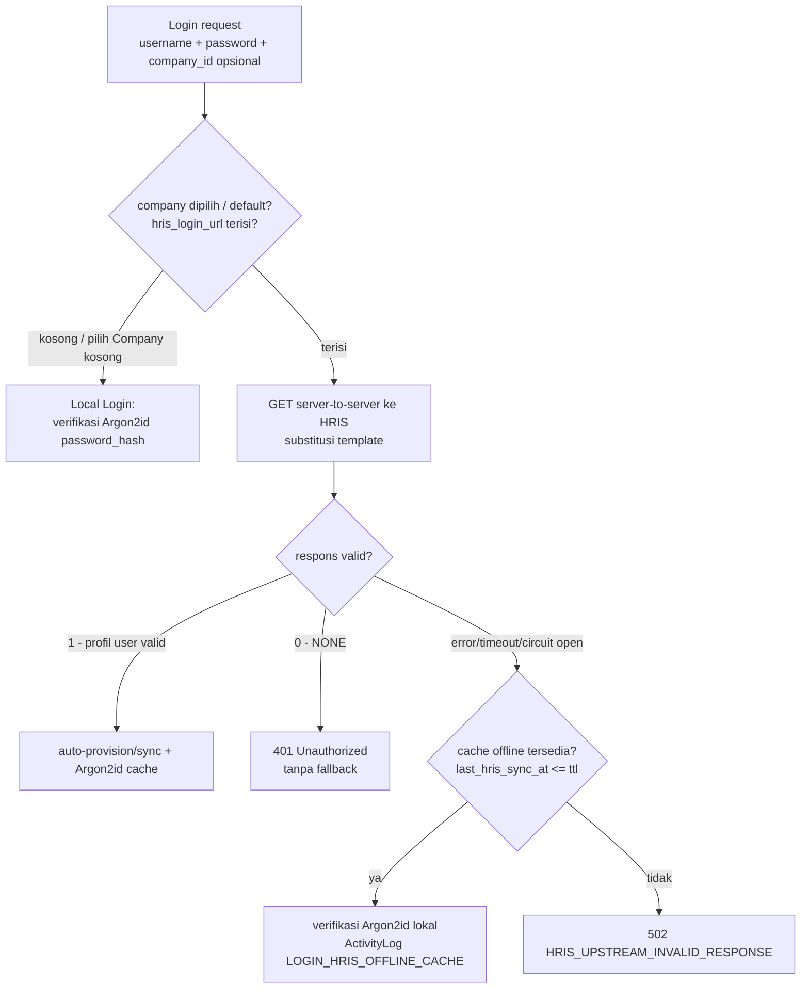
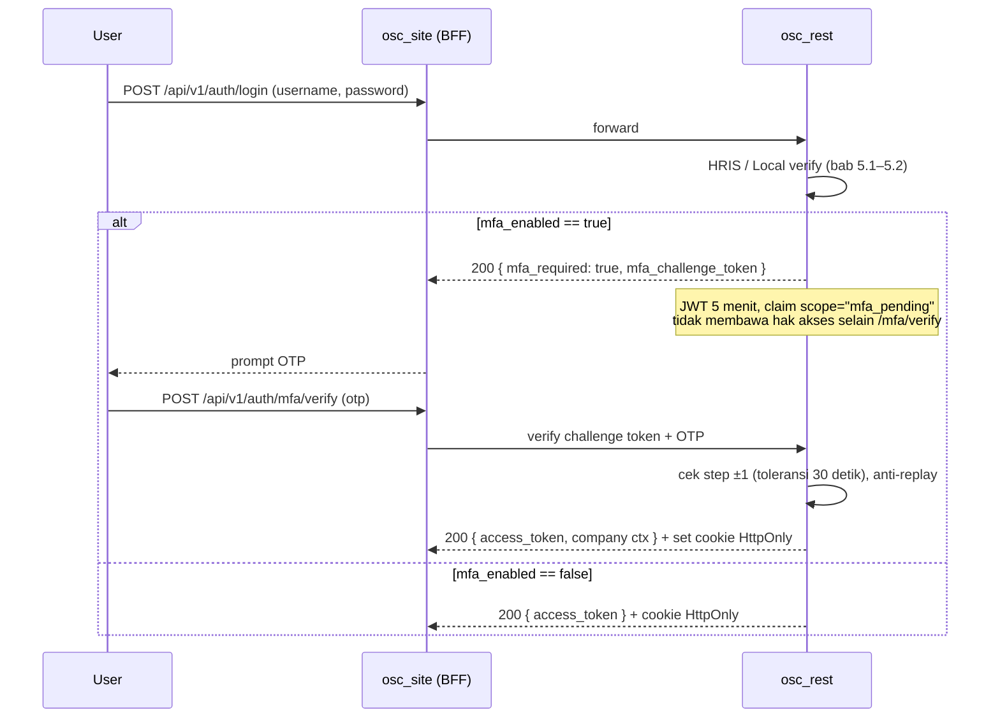
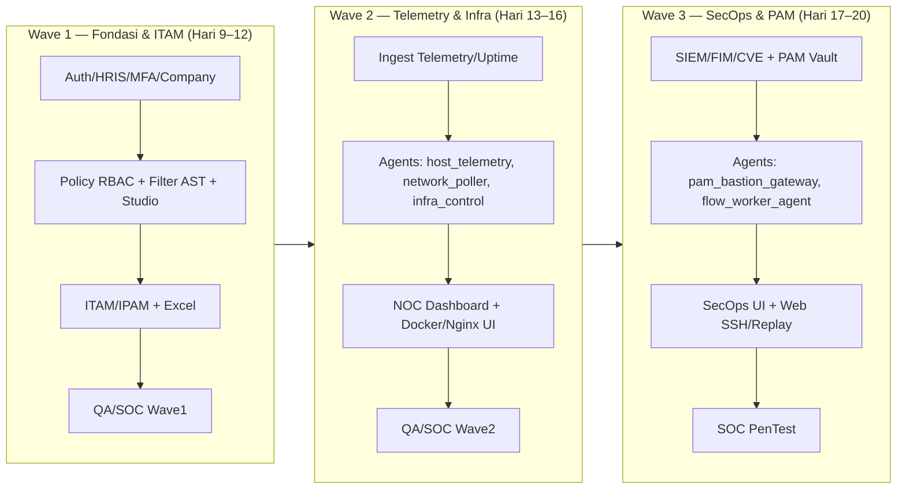

# System Blueprint & Execution Plan: omnisight — Master Re-Engineering Blueprint (Wave 1–3)

- **Date**: 2026-11-12
- **Author**: ai-main (PM, System Analyst & Docker DevOps Architect)
- **Source Target**: 12 repositori referensi (shallow clone @ `.rea_docs/`, commit hash tercatat) — audit statis di `osc_docs/audit-group-a.md`, `audit-group-b.md`, `audit-group-c.md`
- **Scope**: Full-Stack — Master Blueprint arsitektur terpadu (skema, API, UI, agents, infrastruktur, multi-company/HRIS/MFA/PAM)
- **Delegated Skills**: `ai-base` (Prisma/Postgres), `ai-rest` (Rust API + vault), `ai-site` (Next.js UI), `ai-auto` (Golang agents), `ai-test` (QA/SOC)
- **Checklist Ref**: `osc_docs/checklist.md` — Hari 4 (`SESI 0.4`)

---

## 1. Executive Summary

omnisight adalah platform NOC + ITAM + SecOps terpadu yang direkayasa ulang dari 12 sistem referensi:

| Grup | Referensi | Kontribusi inti ke blueprint |
| :--- | :--- | :--- |
| A (ITAM & Studio) | `directus`, `snipe-it`, `glpi` | Metadata koleksi dinamis (3 tabel + DDL runtime), Filter AST parameterized, RBAC multi-policy (union `_or` + CASE WHEN field-level), state machine aset + claim atomik `FOR UPDATE`, lisensi seat, rules engine dedup ber-`ranking`, tiket ITIL timeline |
| B (DCIM/IPAM & NOC) | `netbox`, `librenms`, `uptime-kuma`, `nginx-ui` | Hierarki ltree/path, inet/cidr + GIST, ObjectChange pre/post JSONB, scheduler polling DB-driven + discovery deklaratif YAML, delta/rate port + metadata DS, monitor polymorphic + rolling bucket stat + heartbeat `important` partial index, pipeline nginx validasi→history→atomic→`nginx -t`→rollback→reload, ACME + ARI |
| C (Infra & SecOps) | `dockge`, `arcane`, `beszel`, `wazuh`, `jumpserver` | Compose project lifecycle + drift + journal rollback, image update 2 lapis + admission lease, kolektor metrik host/container (delta keyed per interval), timeseries tier 1m→480m + retensi berjenjang, alert histeresis, FIM dual-event, CVE feed matching, PAM bastion (ConnectionToken, vault 2 lapis, session/command/replay pluggable S3) |

**Lapisan target**: PostgreSQL+Prisma (`osc_base`) → Rust Clean API (`osc_rest`, kontrak OpenAPI + Envelope AES-256-GCM) → Next.js + shadcn/ui (`osc_site`, CSP strict + BFF proxy) → Golang agents (`osc_auto`: `host_telemetry`, `network_poller`, `infra_control`, `pam_bastion_gateway`, `flow_worker_agent`) → QA/SOC pytest (`osc_docs/test`).

**Pilar spesifik bisnis** yang ditetapkan pada blueprint ini (bab 5): Multi-Company + HRIS ASMX Link, Parsing XML HRIS + Circuit Breaker + Cached Password Auto-Sync, Optional TOTP MFA + Mandatory PAM MFA + Safe MFA Reset, Company Switcher + Menu Privilege + Strict Tenant Isolation, dan Day-2 Operational Foundations.

---

## 2. Target End-to-End Architecture

**Standar lintas service** (wajib semua wave): `X-Correlation-ID`/`X-Request-ID` propagation, structured JSON logging dengan redaksi `uPaswd`/secret, Envelope Encryption AES-256-GCM untuk kredensial vault, healthcheck + `read_only`/`no-new-privileges`/resource limit/log rotation di semua container.

---

## 3. Entitas Induk Terpadu: `Asset` / `ManagedNode`

Satu entitas induk menjadi **hub FK tunggal** bagi seluruh modul — menyatukan `Asset` (Snipe-IT), `Computer/Device` (GLPI/NetBox), `system` (beszel), `device` (LibreNMS), `Asset` (JumpServer), dan target docker/nginx (arcane/nginx-ui).

**Definisi `ManagedNode` (alias `Asset` di Prisma, P1):**

| Kolom | Tipe | Catatan |
| :--- | :--- | :--- |
| `id` | `String` (UUID, PK) | mengikuti standar `BaseModel` GORM ala arcane / PK UUID omnisight |
| `company_id` | FK `Company`, PROTECT | **wajib ada** — tenant isolation (bab 5.6) |
| `name` / `slug` | `String` unique per company | natural-sort friendly |
| `node_type` | enum `host\|network\|virtual\|container\|rack_mounted\|service` | menentukan modul aktif |
| `hostname`, `fqdn`, `mgmt_ip` (`inet`), `serial`, `asset_tag` | | unique per company, partial unique (nullable) |
| `site_id` / `location_path` | FK / path text | hierarki NetBox (path enumeration app-side, bukan ltree Prisma) |
| `status` | enum `active\|planned\|staged\|offline\|failed\|decommissioned` | ala NetBox Device status |
| `lifecycle` | FK `AssetStatus` + flag `deployable/pending/archived` | state machine ala Snipe-IT (`availableForCheckout` = `!assigned_to && !deleted && deployable && !archived`) |
| `enrollment` | FK `Agent` nullable, `last_seen_at`, `is_dynamic`, `source` | inventaris agent-driven ala GLPI (`is_dynamic`, `last_inventory_update`, field-locking) |
| `metadata_json` / `custom_fields` | `Json` | ala NetBox `custom_field_data` + GLPI `glpi_items_device*` generik |
| `created_by/updated_by`, `created_at/updated_at`, `deleted_at` | | audit universal + soft delete |

Aturan relasi (pola NetBox): **PROTECT** untuk referensi bisnis (company, site, device_type), **SET_NULL** untuk cache/denormalisasi, **CASCADE** untuk komponen anak (interface, port, account, monitor). Validasi koherensi (overlap prefix, occupancy rack, assignment IP, checkout availability) **app-level di Rust API** dengan transaksi + `SELECT … FOR UPDATE` + re-check (pola Snipe-IT `lockForUpdate + re-check`).

---

## 4. Peta Modul Referensi → Target

| Modul omnisight | Referensi utama | Pola yang diporting | Rujukan |
| :--- | :--- | :--- | :--- |
| Studio koleksi dinamis | Directus | 3 tabel metadata, DDL runtime via dynamic SQL Rust (bukan Prisma), snapshot/diff | audit-a §2.1 |
| Filter AST & RBAC Policy | Directus + NetBox | JSON→SQL parameterized, identifier tervalidasi schema, multi-policy union `_or` + CASE WHEN field-level, ObjectPermission constraints | audit-a §2.2–2.3, audit-b §2.4 |
| ITAM (aset/lisensi/tiket) | Snipe-IT, GLPI | status label state machine, claim atomik, action_logs polymorphic, ITIL timeline + state int, rules engine `ranking` | audit-a §3–4 |
| DCIM/IPAM | NetBox | ltree→path enumeration, inet/cidr+GIST, CablePath JSONB, uniqueness app-level, ObjectChange pre/post JSONB | audit-b §2 |
| Network telemetry (SNMP) | LibreNMS | scheduler due-ness DB-driven, discovery deklaratif YAML, delta/rate, sensor divisor/multiplier/state, vault `secrets` | audit-b §3 |
| Uptime & status page | Uptime Kuma | monitor polymorphic + `config` JSON, heartbeat `important` partial index, stat bucket UNIQUE(monitor_id,timestamp), push token, incident | audit-b §4 |
| Nginx control plane & ACME | Nginx UI | pipeline simpan + sandbox `nginx -t`, gonginx AST verbatim, lego-equivalent + ARI, cert 0644/key 0600 | audit-b §5 |
| Compose lifecycle | Arcane, Dockge | compose-go parse + deploy lib, env berlapis, drift watcher, redeploy journal+rollback, image update lease, non-atomik dockge = anti-pattern | audit-c §2–3 |
| Host/container metrik | Beszel | delta keyed per interval, one-shot docker stats, timeseries tier 1m→480m, alert histeresis, ed25519 challenge enroll | audit-c §4 |
| SIEM/FIM/CVE | Wazuh 5.x | FIM dual-event + checksum, event store vs detector terpisah (Sigma), CVE feed + inventory matching + version matcher, SCA compliance/mitre | audit-c §5 |
| PAM bastion & vault | JumpServer | ConnectionToken satu pintu, ACL staging (mfa/review/ticket), service-account signed API, command filter deny/confirm/allow, replay pluggable S3→RustFS; AES-ECB legacy = anti-pattern → Envelope AES-256-GCM | audit-c §6 |

---

## 5. Spesifikasi Lintas-Cutting (Kontrak Wajib Implementasi)

### 5.1 Konfigurasi Multi-Company & HRIS ASMX Link

**Model `Company` (Prisma P1):**

| Kolom | Tipe | Catatan |
| :--- | :--- | :--- |
| `id`, `name`, `code`, `is_active` | | master tenant |
| `hris_login_url` | `String?` **nullable** | template URL ASMX HRIS; **NULL/kosong = Local Login mode** |
| `hris_cache_ttl_hours` | `Int` **default `72`** | TTL offline cache password (bab 5.2) |

**Semantik `hris_login_url`** — pola template: `http://hris.check{\(U}&uPaswd={\)P}` — placeholder `{\(U}` disubstitusi username, `{\)P}` disubstitusi password yang diketik user pada saat request (tidak pernah disimpan/dilog). Endpoint HRIS bertipe ASMX yang merespons XML `<string xmlns="...">…</string>` (bab 5.2).

**Aturan keputusan auth** (`osc_rest`, handler `POST /api/v1/auth/login`):

**Hardening HTTP client HRIS (wajib di `osc_rest`):**
1. **Anti-SSRF**: request hanya dijalankan server-to-server (`reqwest`), target **hanya** dari `hris_login_url` yang diisi admin; validasi host terhadap **allowlist domain/IP intranet HRIS** (CIDR privat + domain terdaftar per deployment); blokir redirect keluar allowlist; tidak ada URL dari input user.
2. **Batas respons 64 KB**: streaming dengan cap byte; body lebih besar = respons invalid (`HRIS_UPSTREAM_INVALID_RESPONSE`).
3. **Redaksi log**: sensor khusus pada `tracing` — field `uPaswd` (dan query string penuh) dirender `[REDACTED]`; body HRIS tidak pernah di-log pada level info.
4. Timeout connect/request tegas (rekomendasi: 3 s connect / 8 s total) — bagian dari pengukur Circuit Breaker.

### 5.2 Parsing XML HRIS, Circuit Breaker & Cached Password Auto-Sync

**Parser XML aman**: gunakan crate Rust `quick-xml`/`roxmltree` dalam mode **non-DTD, non-XXE** (tolak `<!DOCTYPE`, external entity, entity expansion); ambil nilai elemen `<string xmlns="http://…">…</string>`; **dilarang `.unwrap()`** pada jalur parse — semua kegagalan parse menghasilkan error ter-tipe (`HRIS_UPSTREAM_INVALID_RESPONSE`) yang di-map ke 502.

**Kontrak isi respons** (`<string>` value):
- Berawalan **`1|`** → sukses: sisanya adalah profil user (separator `|`, minimal: nama/identitas + email/atribut perusahaan). Maka:
  1. **Auto-provision / sync user lokal** — cari user by username/email; bila belum ada, buat (default role non-privat, ikat `UserCompanyAccess` ke company terkait); bila ada, perbarui atribut profil (bukan role/privilege).
  2. **Cache password**: hash password yang diketik pada request ini dengan **Argon2id** (salt unik, cost sesuai standar ai-rest) lalu simpan/perbarui `user.password_hash` + `user.last_hris_sync_at = now()`.
  3. **Dilarang menyimpan password plaintext** — hanya Argon2id hash; nilai `{\)P}` hilang setelah request.
- Berawalan **`0|…|NONE`** → tolak login **`401 Unauthorized` tanpa fallback** (tidak boleh jatuh ke local login maupun cache — ini keputusan HRIS yang sah).

**Circuit Breaker client HRIS** (implementasi di `osc_rest`, state machine per host HRIS):
- Metric window: **5 kegagalan/timeout dalam 30 detik** → **OPEN selama 60 detik** (request langsung ditolak ke jalur fallback tanpa menumpuk koneksi); setelah 60 s → HALF-OPEN (1 request percobaan).
- Kegagalan terhitung: timeout, connection refused, status non-200, body >64 KB, XML parse gagal. Respons `0|` **bukan** kegagalan circuit (upstream sehat, keputusan bisnis).

**Offline Cache Fallback** (saat upstream error atau circuit OPEN):
- Kondisi: `user.password_hash` ada **dan** `now() − last_hris_sync_at <= hris_cache_ttl_hours` (default 72 jam).
- Aksi: verifikasi Argon2id lokal; bila lolos → login sukses dengan catatan **`ActivityLog(action = "LOGIN_HRIS_OFFLINE_CACHE")`**; bila gagal → 401.
- Bila cache tidak ada / kedaluwarsa → **`502 Bad Gateway`** dengan error code `HRIS_UPSTREAM_INVALID_RESPONSE` (bukan 401 — membedakan "kredensial salah" dari "dependensi gangguan").

### 5.3 Optional TOTP MFA, Mandatory PAM MFA & Safe MFA Reset

**Kolom `User` (Prisma P1):**

| Kolom | Tipe | Catatan |
| :--- | :--- | :--- |
| `mfa_enabled` | `Boolean` default `false` | optional untuk login umum |
| `mfa_secret_encrypted` | `Bytes` nullable | TOTP secret, **AES-256-GCM Envelope Encryption** (KEK terpisah, bukan SECRET_KEY langsung) |
| `mfa_last_verified_step` | `BigInt` nullable | anti-replay: step TOTP terakhir yang lolos; step sama/pale ditolak |
| `mfa_backup_codes_hash` | `String[]` (Argon2id) | kode sekali pakai; hash Argon2id, dicairkan = dihapus |

**Alur login dengan MFA opsional:**

**Endpoint MFA (semua di `osc_rest`, rate-limit global + per-user):**
- `POST /api/v1/auth/mfa/setup` — generate secret TOTP + otpauth URI + 10 backup code (ditampilkan sekali, disimpan hash); belum mengaktifkan.
- `POST /api/v1/auth/mfa/enable` — konfirmasi OTP pertama → `mfa_enabled = true`.
- `POST /api/v1/auth/mfa/verify` — verifikasi OTP (login step-2 & step-up); **toleransi ±1 step (30 detik)**, **rate-limit maksimal 5x gagal** lalu kunci sementara + ActivityLog.
- `POST /api/v1/auth/mfa/disable` — verifikasi OTP/backup aktif + `doubleCheckPassword` (pola Dockge/JumpServer) sebelum menonaktifkan.

**Mandatory MFA untuk PAM Bastion:**
- `POST /api/v1/pam/sessions/authorize` (Wave 3) **wajib menolak** dengan **`403 MFA_REQUIRED_FOR_PAM`** jika `user.mfa_enabled == false` — PAM tidak menerima login tanpa MFA sama sekali.
- Step-up: jika `mfa_last_verified_at` (derived dari step terakhir yang lolos) lebih dari **15 menit** → wajib OTP baru pada endpoint authorize sebelum WS ticket dibuat (pola step-up secure session Nginx UI / ACL staging JumpServer).

**Safe MFA Reset (Human Error Recovery):**
1. **Self-Service (Backup Code)**: pada layar login, user dapat memakai **Backup Code sekali pakai** sebagai pengganti OTP; login berhasil **otomatis me-reset `mfa_enabled = false`** (user memasang ulang MFA lewat `/setup` → `/enable`) + ActivityLog `MFA_RESET_SELF_BACKUP`.
2. **Self-Service (Email Token)**: `POST /api/v1/auth/mfa/reset-request` → token reset satu kali (TTL pendek) dikirim ke **email terdaftar** (dispatch via `flow_worker_agent`, bab 5.8); `POST /api/v1/auth/mfa/reset-confirm` (token + bukti identitas) → reset MFA + **pencabutan seluruh sesi aktif** (revoke `user_sessions`/AuthToken DB-backed) + ActivityLog `MFA_RESET_SELF_EMAIL`.
3. **Admin-Assisted**: `POST /api/v1/users/{id}/mfa/reset` — hanya admin berizin (permission khusus, bukan role bebas); men-reset MFA user yang kehilangan perangkat + revoke sesi + **audit log `MFA_RESET`** (actor, target, reason). Wajib: admin sendiri wajib `mfa_enabled == true` untuk memakai endpoint ini (step-up enforce).

### 5.4 Multi-Company Switcher

**Model `UserCompanyAccess` (Prisma P1):** `user_id`, `company_id`, `role_id`, `is_default`, `is_active` — UNIQUE `(user_id, company_id, role_id)`; user menyandera banyak Company dengan role berbeda per Company.

**`POST /api/v1/auth/switch-company`** (`company_id` body):
1. Validasi: baris `UserCompanyAccess` user aktif untuk company tsb.
2. Terbitkan ulang access token/JWT dengan **claim `active_company_id`** baru (menyalin `hris_cache_ttl`-relevansi TIDAK diperlukan — hanya konteks).
3. `osc_site` BFF menyimpan token sesi dalam **cookie `HttpOnly` + `Secure` + `SameSite=Lax`** (per-token revocable DB-backed ala Nginx UI AuthToken — bukan localStorage).
4. Semua request berikutnya otomatis beroperasi dalam konteks company baru; **tidak ada query lintas company** via parameter.

**UI `osc_site`:** komponen **Company Switcher** di topbar — mengambil daftar company yang boleh diakses (dari `/api/v1/me`), memanggil `switch-company`, lalu me-refetch navigasi + data (invalidasi cache TanStack Query). Indikator company aktif selalu tampil (anti kekeliruan operator).

### 5.5 Menu Privilege (Sidebar Dinamis)

**Model (Prisma P1):**
- `MenuModule`: registry master modul/menu (`key`, `label`, `icon`, `path`, `parent_id` tree, `sort_order`, `is_active`) — diisi otomatis oleh seeder dari daftar modul kode (bab 5.8).
- `CompanyMenuPrivilege`: `company_id`, `role_id`, `menu_id`, `can_view`, `can_create`, `can_update`, `can_delete` — UNIQUE `(company_id, role_id, menu_id)`.

**`GET /api/v1/me/navigation`** → sidebar dinamis `osc_site`: merge `MenuModule` aktif × `CompanyMenuPrivilege` (company aktif + role user aktif) → item dengan `can_view=false` tidak dikirim (bukan disembunyikan client-side). UI merender sidebar + tombol aksi dari `can_create/update/delete` (mengikuti pola Directus `fields` + NetBox ObjectPermission).

### 5.6 Strict Tenant Isolation

- **Semua tabel transaksi** menyimpan kolom **`company_id`** (FK, PROTECT) — termasuk seluruh tabel yang diturunkan dari `ManagedNode` dan `NotificationChannel`, `Agent`, `ActivityLog`, metric snapshot, dst.
- **Middleware `RequestContext` di `osc_rest`**: mengekstrak `active_company_id` dari JWT/cookie → menyisipkan filter `company_id = $1` **otomatis** pada setiap query (pola global scope FMCS Snipe-IT `CompanyableScope` + RestrictedQuerySet NetBox) — developer tidak dapat "lupa" memfilter; query lintas company hanya lewat mekanisme eksplisit ber-izin (reporting admin, deny by default).
- Validasi tambahan: ID objek dalam body/path diverifikasi milik `active_company_id` (anti IDOR); AuditLog/Observability menandai percobaan akses lintas tenant sebagai security event ke SIEM.

### 5.7 Wave Breakdown

**Work Breakdown Matrix** (selaras `osc_docs/checklist.md`; Hari 1–8 = audit + skema sudah berjalan):

| Wave | Hari/Sesi | Skill | Deliverable | Acceptance Criteria |
| :--- | :--- | :--- | :--- | :--- |
| Fondasi | Hari 5 (0.1) `ai-main` | `docker-compose.yml` (postgres, rustfs) + `.env.example` | `docker compose config` lolos |
| Fondasi | Hari 6–8 (1.2–1.4) `ai-base` | Prisma P1 (User/Company/UserCompanyAccess/MenuModule/CompanyMenuPrivilege/Asset+MFA+HRIS kolom), P2 (ITAM/DCIM/IPAM), P3 (telemetry/uptime/docker/nginx/secops/PAM) + SQL DDL + seeder idempotent | `prisma validate` + `prisma migrate dev` |
| Wave 1 | Hari 9–10 (2.1–2.2) `ai-rest` | Auth/HRIS client+circuit breaker/MFA lengkap (bab 5.1–5.3), switch-company (5.4), navigation (5.5), RequestContext (5.6), Policy RBAC + Filter AST + Studio DDL runtime, ITAM/IPAM/Excel | `cargo check && cargo clippy`; kontrak OpenAPI di `osc_docs/rest/contracts/` |
| Wave 1 | Hari 11 (2.3) `ai-site` | Login + MFA + Company Switcher + sidebar dinamis + Studio + ITAM/IPAM UI | `npx tsc --noEmit`; CSP verified |
| Wave 1 | Hari 12 (2.4) `ai-test` | QA + SOC suite Wave 1 | `pytest` lolos |
| Wave 2 | Hari 13 (3.1) `ai-rest` | Ingest telemetry/uptime (bucket + retensi), docker control plane, nginx control plane | `cargo check && cargo clippy` |
| Wave 2 | Hari 14 (3.2) `ai-auto` | Agent `host_telemetry`, `network_poller`, `infra_control` (+ enrollment bab 5.8) | `go test ./...` + cross-build |
| Wave 2 | Hari 15 (3.3) `ai-site` | NOC dashboard, compose editor, nginx config editor | `npx tsc --noEmit` |
| Wave 2 | Hari 16 (3.4) `ai-test` | QA + SOC Wave 2 (path traversal, command injection) | `pytest` |
| Wave 3 | Hari 17 (4.1) `ai-rest` | SIEM/FIM/CVE ingest + PAM vault (Envelope AES-256-GCM) + WS ticket + `pam/sessions/authorize` (bab 5.3 mandatory MFA) | `cargo check && cargo clippy` |
| Wave 3 | Hari 18 (4.2) `ai-auto` | Agent `pam_bastion_gateway`, `flow_worker_agent` (Notification Dispatcher bab 5.8) | `go test ./...` |
| Wave 3 | Hari 19 (4.3) `ai-site` | SecOps dashboard + Web SSH xterm.js + session replay | `npx tsc --noEmit` |
| Wave 3 | Hari 20 (4.4) `ai-test` | SOC PenTest (PAM command filter evasion, vault isolation, HRIS SSRF, MFA bypass) | `pytest` |
| Final | Hari 21 (5.1) `ai-main` | Multi-stage Dockerfiles final + compose + verifikasi | `docker compose build` semua healthy |
| Final | Hari 22 `All` | E2E smoke test | `docker compose up -d` |

### 5.8 Day-2 Operational Foundations

**Idempotent Seeder (`osc_base`, dijalankan otomatis setelah migrasi):**
1. Akun awal **`Global Super Admin`** dari variabel `.env` (`SUPERADMIN_USERNAME`, `SUPERADMIN_EMAIL`, `SUPERADMIN_INITIAL_PASSWORD` — tidak pernah commit; wajib ganti saat login pertama). Seeder **idempotent**: `upsert` by username/email; menjalankan ulang tidak menduplikasi dan tidak menimpa password yang sudah diubah.
2. **Master registry `MenuModule`** diisi otomatis dari manifest deklaratif kode (daftar modul → menu) — modul baru muncul otomatis setelah migrasi; privilege default per Company dibuat oleh admin.

**Agent Enrollment Flow (pola ed25519-challenge beszel + enrollment token arcane + bootstrap JumpServer):**
1. Admin membuat **one-time enrollment token terikat `company_id`** (+ TTL, node_type rencana) di UI.
2. Agent Golang melakukan registrasi pertama ke `POST /api/v1/agents/enroll` (token di header) → server memverifikasi token (single-use), membuat **`agent_id`** + **`hmac_secret`** (dikirim sekali, disimpan sebagai vault Envelope AES-256-GCM), mengikat agent ke `ManagedNode`/Company.
3. Seluruh trafik agent berikutnya diautentikasi **HMAC per-request** (`X-Agent-Id` + signature timestamped, anti-replay window) — menjawab temuan risiko endpoint inventory GLPI tanpa autentikasi (audit-a §4.4).

**Centralized Notification Dispatcher:**
- Tabel **`NotificationChannel`** per Company: `type` (`smtp_email|telegram|webhook`), `config` (terenkripsi — SMTP password, bot token, webhook URL), `is_active`, `event_filter` (email reset MFA, alert metrik, downtime, SIEM findings).
- Eksekusi **asinkron oleh `osc_auto/flow_worker_agent`**: `osc_rest` hanya menulis antrean notifikasi (tabel outbox); worker mengambil (poll/claim atomik), merender template, mengirim via channel, mencatat status/retry (backoff) — selaras temuan beszel (shoutrrr + quiet hours) dan Uptime Kuma (registry provider + dedupe history).
- Email reset MFA (bab 5.3) adalah konsumen pertama dispatcher ini.

**Data Retention Policy:**
- Retensi terjadwal (worker `flow_worker_agent` job harian / di `osc_rest` cron):
  - `SystemMetricSnapshot`: tier 1m→30 hari default, 10m→90 hari (konfigurabel **30–90 hari**; turunkan tier mengikuti pola beszel 1m→10m→…).
  - `UptimeHeartbeat`: 30 hari default (raw), agregat `stat_*` bucket hingga 365 hari.
  - **Pengarsipan rekaman sesi PAM** (replay `.cast.gz`/`.mp4`, command log): pindah ke **RustFS (S3)** dengan lifecycle arsip; DB hanya menyimpan metadata + pointer.
- Semua job retensi: batch + throttling, tercatat di ActivityLog, dan ter-coverage test pytest.

---

## 6. Docker & Infrastructure Topology

- **Jaringan**: `frontend` (public: hanya `osc_site`) dan `backend` (`internal: true`: postgres, rustfs, osc_rest, osc_auto agents) — mengikuti standar isolation ai-main.
- **Container**: multi-stage distroless/slim non-root (`UID 10001`); `healthcheck` semua service; `depends_on: condition: service_healthy`; `read_only: true` + `no-new-privileges:true` + resource limits + log rotation `json-file` max-size/max-file; `.env.example` tanpa secret (termasuk `SUPERADMIN_*`, `HRIS_ALLOWLIST_CIDRS`, `ENCRYPTION_KEK`).
- **Volume**: `postgres_data`, `rustfs_data`, replay PAM → object storage.
- **HRIS client**: tidak di-expose — hanya outbound dari `osc_rest` ke intranet allowlist.

## 7. Risks, Security & Rollback Strategy

| Risiko | Mitigasi |
| :--- | :--- |
| SSRF via `hris_login_url` | Allowlist domain/IP intranet, blokir redirect keluar, cap 64 KB, timeout, tidak ada URL dari input user, redaksi `uPaswd` di tracing |
| Password plaintext bocor | Hanya Argon2id hash di `password_hash`; `{\)P}` tidak pernah dipersist/dilog; test SOC mencari pola plaintext |
| Circuit breaker salah buka/tutup | Metric window & threshold ter-konfigurasi; respons `0|` tidak dihitung kegagalan; HALF-OPEN probe; test unit state machine |
| MFA replay/bypass | `mfa_last_verified_step` anti-replay, JWT `scope=mfa_pending` 5 menit tanpa hak akses, rate-limit 5x, mandatory 403 PAM, reset wajib revoke semua sesi |
| Kebocoran lintas tenant | RequestContext filter otomatis + verifikasi kepemilikan objek + pengujian IDOR di pytest |
| Agent spoofing | Enrollment one-time + HMAC timestamped + secret di vault; token enrollment TTL & single-use |
| Notifikasi menumpuk saat outage | Dispatcher asinkron via outbox + retry backoff, DB tetap responsif |
| Retensi menghapus data penting | Policy 30–90 hari konfigurabel, arsip PAM ke RustFS sebelum purge, dry-run report |
| Rollback | Migrasi Prisma forward-only + DDL runtime di-log; wave di-deploy bertahap per checklist; `.rea_docs/` dibersihkan (bab 8) dan audit tetap menjadi acuan dokumen |
