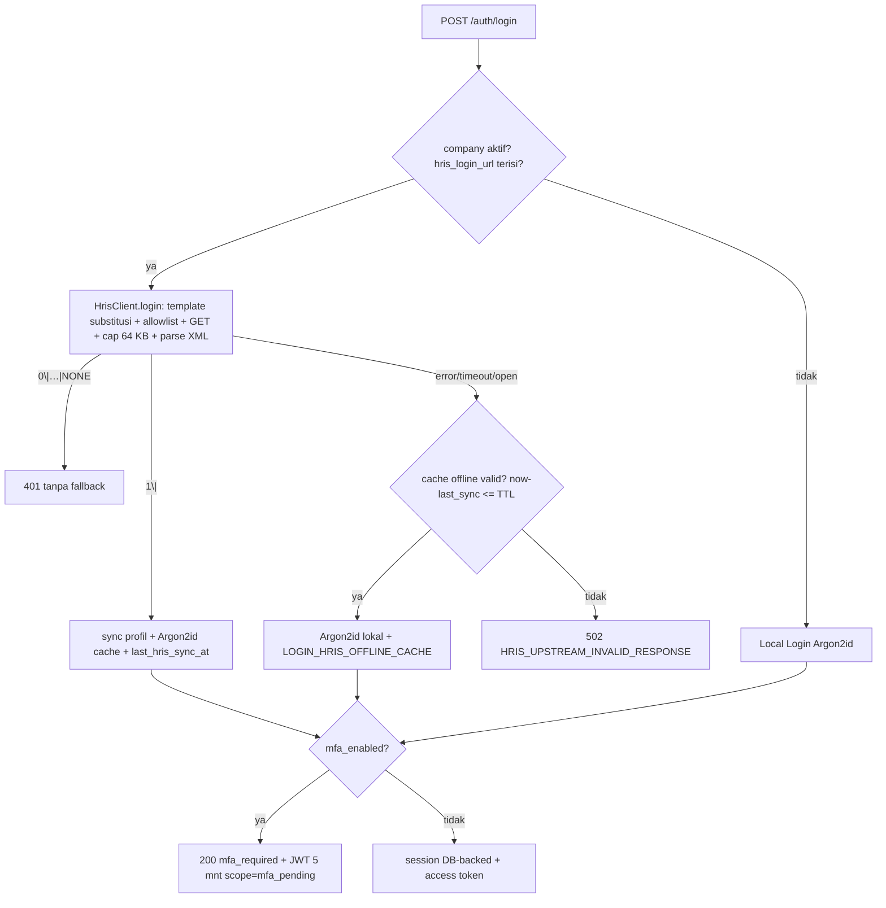

# Technical Specification: Wave 1 — Auth Dual-Mode (HRIS ASMX), TOTP MFA, Company Switcher, Studio/ITAM/DCIM/IPAM, RustFS Files & Excel

- **Date**: 2026-11-12
- **Author**: ai-rest (Rust Backend & Security Engineer)
- **Target Project**: `osc_rest`
- **Shared Contract File**: `osc_docs/rest/contracts/w1.openapi.yaml`
- **Clean Architecture Layers Touched**: `domain`, `application`, `infrastructure`, `presentation`

## 1. Overview & Architectural Flow

Wave 1 mengimplementasikan fondasi identitas & modul bisnis pertama `osc_rest` (blueprint `osc_docs/reengineering.md` bab 5.1–5.6, skema `osc_docs/base/schema-p1.md` + `schema-p2.md`):

```
presentation/http
  ├── handlers/auth     → POST /login (dual-mode), GET /companies, POST /switch-company
  ├── handlers/mfa      → setup/enable/verify/disable + reset-request/reset-confirm + admin reset
  ├── handlers/me       → GET /me/navigation (companies + pohon MenuModule)
  ├── handlers/studio   → /collections, /fields, /items/{collection} (filter AST)
  ├── handlers/itam     → /assets (+checkout/checkin), /licenses, /tickets
  ├── handlers/net      → /dcim/racks, /ipam/prefixes, /ipam/addresses
  ├── handlers/files    → upload multipart → RustFS + registry file_assets, presigned GET
  ├── handlers/excel    → /assets/import (calamine), /assets/export (rust_xlsxwriter)
  └── middleware: correlation_id (X-Correlation-ID) → request_context (JWT + sesi DB-backed + tenant guard)
application/
  ├── auth.rs  → usecase login dual-mode (generik atas port domain)
  ├── mfa.rs   → usecase TOTP MFA + safe recovery
  └── excel.rs → validasi baris + sanitasi formula injection (murni)
domain/
  ├── filter.rs → Filter AST → SQL terparameterisasi (QueryBuilder push_bind)
  ├── model.rs  → entitas murni (Company, User, AuthClaims, dst.)
  └── ports.rs  → HrisGateway, TokenIssuer, PasswordCrypto, EnvelopeCrypto, MfaCrypto, AuthStore
infrastructure/
  ├── hris.rs        → reqwest + circuit breaker + anti-SSRF + quick-xml non-DTD
  ├── crypto.rs      → Argon2id + JWT HS256 + Envelope AES-256-GCM + totp-rs
  ├── store/*        → sqlx runtime queries (companies/users/sessions/mfa/activity, studio, itam, netbox, files)
  ├── ratelimit.rs   → limiter in-memory (login & MFA)
  └── storage.rs     → RustFS put/get/presign
```

Alur login (bab 5.1–5.2):



## 2. REST API & Real-Time (WS/SSE) Contract

Semua respons dibungkus `{"status": "...", "data": {...}}` (sukses) atau `{"status":"error","error":{"code","message"},"correlation_id"}` (gagal). Header `X-Correlation-ID` selalu di-echo/di-generate (UUIDv7).

### `GET /api/v1/auth/companies`
- **Auth & Permissions**: `Public`
- **Rate Limit**: global (reverse proxy BFF)
- **Headers**: `X-Correlation-ID`

#### Response
```json
{
  "status": "success",
  "data": {
    "companies": [
      { "id": "uuid", "name": "PT Contoh", "code": "CONTOH", "hris_enabled": true }
    ],
    "count": 1
  }
}
```
> `hris_login_url` dan secret TIDAK PERNAH diekspos — hanya flag boolean.

### `POST /api/v1/auth/login`
- **Auth & Permissions**: `Public`
- **Rate Limit**: 10 kegagalan / 15 menit per username → lockout 15 menit (`RATE_LIMITED`)
- **Headers**: `X-Correlation-ID`

#### Request Schema
```json
{
  "company_id": "uuid | \"\" (kosong = default access / Local Login)",
  "username": "string (required, 1..=100)",
  "password": "string (required, 1..=200)"
}
```

#### Response — sukses langsung (tanpa MFA)
```json
{
  "status": "success",
  "data": {
    "mfa_required": false,
    "access_token": "jwt.hs256",
    "token_type": "bearer",
    "session_id": "uuid",
    "offline_cache": false,
    "user": { "id": "uuid", "username": "budi", "email": "budi@corp.id", "display_name": "Budi", "mfa_enabled": false, "is_super_admin": false, "last_hris_sync_at": "2026-11-12T00:00:00Z" },
    "active_company_id": "uuid | null",
    "active_role_id": "uuid | null"
  }
}
```

#### Response — MFA aktif
```json
{ "status": "success", "data": { "mfa_required": true, "mfa_challenge_token": "jwt(5m, scope=mfa_pending)" } }
```

#### Error Responses

| HTTP Status | Error Code | Trigger Condition |
| :--- | :--- | :--- |
| `400` | `VALIDATION_ERROR` | Input tidak valid / company_id bukan UUID / company tidak aktif |
| `401` | `UNAUTHORIZED` | Kredensial salah lokal; HRIS `0|…|NONE` (**tanpa fallback**); cache offline gagal verifikasi |
| `403` | `FORBIDDEN` | User tanpa `UserCompanyAccess` ke company yang diminta |
| `429` | `RATE_LIMITED` | Melewati batas kegagalan login |
| `502` | `HRIS_UPSTREAM_INVALID_RESPONSE` | Upstream error/timeout/non-XML/body > 64 KB **dan** cache offline tidak tersedia/kedaluwarsa (circuit breaker: 5 gagal/30 s → OPEN 60 s) |

### `POST /api/v1/auth/mfa/setup`
- **Auth & Permissions**: `Bearer JWT (scope=access)`
- Menghasilkan secret TOTP 160-bit (Envelope AES-256-GCM ke `users.mfa_secret_encrypted`), URI `otpauth://`, dan 10 backup code (hash Argon2id; plaintext hanya pada respons ini). `mfa_enabled` tetap `false` sampai `/enable`.

### `POST /api/v1/auth/mfa/enable`
- **Auth & Permissions**: `Bearer JWT (scope=access)` — Request: `{"otp": "123456"}` → `mfa_enabled = true` + step anti-replay disimpan.

### `POST /api/v1/auth/mfa/verify`
- **Auth & Permissions**: `Bearer JWT (scope=mfa_pending` untuk login step-2, `access` untuk step-up)
- **Rate Limit**: 5 kegagalan / 15 menit per user → lockout 15 menit + ActivityLog.
- Request: `{"otp": "123456"}` atau `{"backup_code": "XXXX-XXXX"}`.
- Toleransi ±1 step (30 s); **anti-replay** `mfa_last_verified_step` (step ≤ tersimpan ditolak).
- Backup code sekali pakai: dipakai di login → MFA **auto-reset** (`mfa_enabled=false`, hash tercairkan dihapus) + ActivityLog `MFA_RESET_SELF_BACKUP`.
- Respons: access token + sesi baru.

### `POST /api/v1/auth/mfa/disable`
- Request: `{"password": "…", "otp": "……"}` — `doubleCheckPassword` + OTP aktif.

### `POST /api/v1/auth/mfa/reset-request` *(publik)*
- Request: `{"username": "…", "email": "…"}` — token sekali pakai (TTL 10 menit) untuk akun yang cocok; **respons identik** untuk akun asing (anti user-enumeration). Pengiriman email via `flow_worker_agent` (W2).

### `POST /api/v1/auth/mfa/reset-confirm` *(publik)*
- Request: `{"username": "…", "token": "…"}` → reset MFA + **pencabutan seluruh sesi aktif** + ActivityLog `MFA_RESET_SELF_EMAIL`.

### `POST /api/v1/users/{id}/mfa/reset` *(admin-assisted)*
- **Auth & Permissions**: `Bearer JWT` — pemanggil wajib `is_super_admin` **dan** `mfa_enabled == true` (step-up enforce, bab 5.3).
- Request: `{"reason": "string (1..=500)"}` → reset MFA target + revoke semua sesi + audit `MFA_RESET` (actor, target, reason).

### `POST /api/v1/auth/switch-company`
- **Auth & Permissions**: `Bearer JWT (scope=access)`
- Request: `{"company_id": "uuid"}` — validasi baris `UserCompanyAccess` aktif → update `user_sessions.active_company_id` → terbitkan ulang JWT dengan klaim `active_company_id` + `role`. Semua request berikut otomatis beroperasi dalam konteks baru (tanpa query lintas company via parameter).

### `GET /api/v1/me/navigation`
- **Auth & Permissions**: `Bearer JWT`
- Respons: `companies` (daftar akses + flag `is_active_company`) dan `menus` — pohon `MenuModule` hasil merge `CompanyMenuPrivilege` (company aktif + role aktif); item `can_view=false` **tidak dikirim** (server-side filtering). Node punya `can_create/can_update/can_delete` untuk tombol aksi UI.

### `GET|POST /api/v1/collections`, `GET|POST /api/v1/collections/{collection}/fields`
- Studio metadata (3 tabel Directus-style). `POST /collections` menjalankan **DDL runtime**: `CREATE TABLE dyn_{collection}` (id uuid PK, company_id NOT NULL RESTRICT, data jsonb, audit timestamptz) + index `(company_id, created_at DESC)` — identifier tervalidasi `[a-z][a-z0-9_]{0,49}` (`valid_key`), SQL dinamis dibungkus `AssertSqlSafe` setelah audit manual.

### `GET|POST /api/v1/items/{collection}`
- Data koleksi dinamis (kolom JSONB `data`), **tenant-guarded** (`company_id` dari sesi).
- `?filter={...}` — Filter AST terparameterisasi: `{"and":[{"field":"x","op":"eq","value":1},{"status":{"in":["ACTIVE"]}}]}`; operator `eq|ne|gt|gte|lt|lte|like|in|null|not_null`; kedalaman ≤ 8, ≤ 64 node; field tak terdaftar → 400; nilai selalu `push_bind` (jsonb / text / float8 semantik per FieldKind).

### `GET|POST /api/v1/assets`, `GET /api/v1/assets/{id}`
- ITAM aset (entitas induk `Asset`/ManagedNode). `POST` validasi `asset_model_id` & `status_label_id` milik company aktif (anti IDOR), enum `node_type`/`status`.

### `POST /api/v1/assets/{id}/checkout`, `/checkin`
- Transaksi + `SELECT … FOR UPDATE` + re-check (pola Snipe-IT): checkout menolak aset ter-assign (`409 CONFLICT`) atau label non-DEPLOYABLE (`400`); checkin menolak aset bebas. Keduanya menulis `asset_checkout_logs`.

### `GET /api/v1/licenses`, `GET|POST /api/v1/tickets`
- Lisensi (kunci TIDAK diekspos — hanya `has_key`; seat usage terhitung) dan tiket ITIL (kode per-company `TK-NNNNNN` app-generated, `UNIQUE(company_id, code)`).

### `GET /api/v1/dcim/racks`, `GET|POST /api/v1/ipam/prefixes`, `GET|POST /api/v1/ipam/addresses`
- Racks + okupansi unit. Prefix: validasi CIDR IPv4 + **overlap check app-level** (containment dua arah → 409). Addresses: validasi IP + tenant-match interface (anti IDOR) + unique per tenant.

### `GET|POST /api/v1/files`, `GET /api/v1/files/{id}`
- Upload multipart `file` ≤ 25 MB, MIME allowlist, object key acak `{company_id}/{uuidv7}{ext}` (anti path traversal), SHA-256 tercatat → RustFS + registry `file_assets`.
- GET `{id}` mengembalikan metadata + **presigned URL TTL 300 detik** (tidak ada URL publik permanen).

### `POST /api/v1/assets/import`, `GET /api/v1/assets/export`
- Import: multipart xlsx ≤ 10 MB, magic byte `50 4B 03 04`, parse via `spawn_blocking` (calamine), header wajib `asset_tag`+`name`, validasi baris → laporan `{row_number, column, code, message}` (cap 100 baris), persist baris-per-baris dengan master default get-or-create (`Generic Model`, `Deployable`).
- Export: query aset tenant (≤ 10.000 baris) → `spawn_blocking` (rust_xlsxwriter), header bold + freeze panes, **sanitasi formula injection** (prefix `'` untuk sel berawalan `= + - @ \t \r`), respons `Content-Disposition: attachment`.

## 3. Excel Schema Specification

- **Sheet**: pertama; **Limits**: 10 MB, 10.000 baris; **Processing Mode**: `spawn_blocking` + insert baris (chunk `UNNEST` menyusul di Wave 2).

| Col Index | Header Name | Data Type / Excel Format | Required | Validation & Sanitization Rules |
| :--- | :--- | :--- | :--- | :--- |
| `A` | `asset_tag` | `String (@)` | Yes | ≤ 100 char, `UNIQUE(company_id, asset_tag)` → error `DUPLICATE` |
| `B` | `name` | `String (@)` | Yes | ≤ 150 char |
| `C` | `model_name` | `String (@)` | No | Lookup `asset_models` (fallback default per-company) |
| `D` | `status_label` | `String (@)` | No | Lookup `status_labels` (fallback `Deployable`) |
| `E` | `node_type` | `String (@)` | No | `HOST\|NETWORK\|VIRTUAL\|CONTAINER\|RACK_MOUNTED\|SERVICE` (default HOST) |
| `F` | `serial_number` | `String (@)` | No | ≤ 255 char |
| `G` | `hostname` | `String (@)` | No | ≤ 255 char |
| `H` | `mgmt_ip` | `String (@)` | No | `std::net::IpAddr` valid |
| `I` | `purchase_cost` | `Number` | No | ≥ 0, < 1e13 |

## 4. Storage (RustFS), Cryptography & Database Interaction

- **PostgreSQL**: PgPool (max 10), semua query runtime + parameterized (`$n` bind); transaksi eksplisit untuk checkout/checkin, pembuatan koleksi (metadata + DDL), dan tiket (nomor sequence). Enum PostgreSQL via `CAST($n AS node_type)` dll. `INET` via `CAST($n AS inet)`.
- **RustFS**: bucket dari `RUSTFS_BUCKET`; key pattern `{company_id}/{uuidv7}.{ext}`; presigned GET TTL 300 s; upload ≤ 25 MB.
- **Enkripsi at-rest**: TOTP secret → Envelope AES-256-GCM (layout `OMS1 | nonce_dek | dek_blob(48) | nonce_data | ciphertext+tag`; DEK 256-bit acak per-secret, KEK dari `APP_MASTER_ENCRYPTION_KEY`). Password selalu Argon2id (default cost OWASP: m=19 MiB, t=2, p=1). Token sesi disimpan sebagai SHA-256 fingerprint (`user_sessions.token_hash`).

## 5. Security Controls & Threat Mitigation

- **Anti-SSRF HRIS**: target hanya dari `hris_login_url` admin; host wajib IP-literal dalam `HRIS_ALLOWLIST_CIDRS` (default private ranges) atau hostname di `HRIS_ALLOWLIST_HOSTS`; redirect **tidak** diikuti (`Policy::none`); tidak ada URL dari input user.
- **XXE/entity expansion**: quick-xml non-DTD — `Event::DocType` ditolak; referensi entitas tidak pernah di-resolve (`unescape()` gagal → error ter-tipe).
- **Body cap & timeout**: respons HRIS ≤ 64 KB (streaming `chunk()`), connect 3 s / total 8 s.
- **Circuit breaker**: 5 kegagalan/30 s → OPEN 60 s → HALF-OPEN 1 probe; `0|` bukan kegagalan. Timeout/non-200/parse gagal masuk metrik.
- **Redaksi log**: `uPaswd`/`uLogin` + pola password/token + secret teregistrasi dimask `[REDACTED]`; URL HRIS (memuat kredensial query) tidak pernah di-log — hanya host allowlisted.
- **MFA**: anti-replay step (±1 toleransi, step ≤ tersimpan ditolak), rate-limit 5 kegagalan, challenge JWT 5 menit `scope=mfa_pending` hanya berlaku di `/api/v1/auth/mfa/*` (middleware menolak path lain), backup code sekali pakai, reset = revoke seluruh sesi.
- **Tenant isolation (RequestContext)**: `active_company_id` dari baris sesi DB (bukan klaim mentah); semua query tenant wajib menyertakannya; verifikasi kepemilikan master/relasi lintas tenant (asset model/status label/interface) anti IDOR.
- **Filter AST**: identifier tervalidasi regex, peta field server-side, nilai 100% bind; field asing ditolak.
- **Excel**: ZIP magic byte, batas ukuran/baris, spawn_blocking, sanitasi formula injection.
- **Zero `.unwrap()`/`.expect()` di request path**; Mutex poisoning di-recover; error infrastruktur digeneralisasi via `AppError::internal` + redaksi.

## 6. Verification

```bash
cd osc_rest
cargo check && cargo clippy -- -D warnings   # ✅ 2026-11-12 (exit 0)
cargo test                                    # ✅ 46 passed (filter AST, XML parser, breaker, crypto, excel, limiter, netbox overlap, sanitizers)
```
