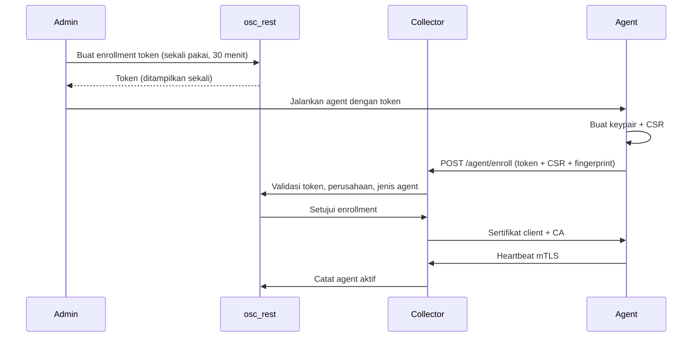

# Agent OmniSight

## 1. Tujuan

Agent adalah program Go yang berjalan di host atau jaringan klien untuk:

- Mengirim heartbeat dan metrik host/container.
- Mengambil konfigurasi terbatas.
- Menjalankan tugas yang diizinkan (deploy, backup, snapshot, apply config).
- Menjaga koneksi keluar saja; tidak membuka port masuk.

Agent **tidak** memiliki akses database dan tidak menerima perintah shell bebas.

## 2. Jenis agent

| Agent | Platform | Fungsi | Hak istimewa | Jaringan |
|---|---|---|---|---|
| `agent-host` | Ubuntu, Windows | CPU, RAM, disk, network, uptime, proses ringkas | Minim; host PID/cgroup read-only di Linux | Outbound 443 |
| `agent-container` | Ubuntu (Podman/Docker) | Status, metrik, deploy, rollback stack | Akses API container via socket proxy | Outbound 443 + socket proxy lokal |
| `agent-network` | Ubuntu | RouterOS, SNMP, SSH backup | Akun perangkat terbatas | Outbound ke perangkat + collector |
| `agent-backup` | Ubuntu | Ambil konfigurasi, kirim ke storage/API | Akun baca perangkat | Outbound 443 |
| `agent-edge` | Ubuntu (native) | Terapkan config Nginx, reload, rollback | Akses file config + reload | Outbound 443 |
| Wazuh agent | Ubuntu, Windows | Keamanan host | Sama dengan Wazuh | Outbound ke manager |

Rekomendasi:

- `agent-host` dan `agent-edge` dijalankan sebagai service native (systemd) untuk akses host yang lebih akurat dan aman.
- `agent-container`, `agent-network`, dan `agent-backup` dapat dijalankan dengan compose satuan.
- Jangan menjalankan dua agent yang mengukur fungsi sama pada host yang sama.

## 3. Arsitektur internal

```text
┌─────────────────────────────────────────────┐
│                 Agent                       │
│  ┌──────────┐  ┌──────────┐  ┌───────────┐  │
│  │ Collector│  │ Scheduler│  │ Executor  │  │
│  │ modules  │  │ heartbeat│  │ allowlist │  │
│  └────┬─────┘  └────┬─────┘  └─────┬─────┘  │
│       │             │              │        │
│  ┌────▼─────────────▼──────────────▼─────┐  │
│  │        Local secure buffer           │  │
│  └────┬──────────────────────────────────┘  │
│       │ mTLS outbound                       │
└───────┼─────────────────────────────────────┘
        ▼
   Collector osc_auto
```

Komponen:

- **Collector modules**: membaca metrik sesuai jenis agent.
- **Scheduler**: heartbeat, pull config, jitter, backoff.
- **Executor**: hanya aksi dari allowlist; input tervalidasi; timeout; output dibatasi.
- **Local buffer**: menyimpan batch sementara saat offline; terenkripsi; ukuran dibatasi.
- **Updater**: memverifikasi signature rilis dan mendukung rollback.

## 4. Enrollment



Aturan:

- Token singkat, sekali pakai, terikat perusahaan dan jenis agent.
- CSR ditandatangani setelah validasi.
- Sertifikat berumur pendek dan dirotasi otomatis.
- Agent yang dicabut tidak dapat heartbeat atau mengirim data.
- Enrollment manual untuk perubahan jenis/tenant.

## 5. Identitas dan transport

- mTLS wajib; agent memverifikasi sertifikat collector.
- Agent ID dan perusahaan tertanam dalam konteks sertifikat/token.
- Setiap batch memiliki:
  - `agent_id`
  - `message_id` (UUID)
  - `sent_at`
  - `nonce`
  - signature Ed25519 atas payload kanonik
- Collector menolak timestamp di luar jendela ±5 menit dan nonce yang berulang.
- HTTP/2 atau gRPC melalui 443; kompresi dibatasi.
- Ukuran batch dibatasi (misalnya 1 MB); batch lebih besar dipecah.
- Backpressure: jika collector penuh, agent memperlambat dan memakai buffer lokal.

## 6. Keamanan agent

### Prinsip

1. **Outbound-only**: tidak ada listener masuk.
2. **Least privilege**: user service khusus, bukan root bila memungkinkan.
3. **No arbitrary shell**: executor hanya aksi terdaftar.
4. **Signed updates**: manifest dan binary diverifikasi.
5. **Read-only filesystem**: root filesystem read-only, hanya data dir yang writable.
6. **Secrets as files**: tidak lewat argumen command line.
7. **Resource limits**: CPU, memori, PID, dan waktu eksekusi.
8. **Audit lokal**: aksi dan hasil dicatat, dikirim ke collector.

### Batasan akses host

| Agent | Akses | Tidak boleh |
|---|---|---|
| host (Linux) | `/proc`, `/sys`, cgroup read-only | Docker socket, modul kernel, ptrace |
| host (Windows) | Performance counters, WMI terbatas | Registry luas, PowerShell bebas |
| container | Socket proxy endpoint allowlist | Socket mentah, `exec`, `build`, `system` |
| network | API perangkat, SNMP, SSH read-only | Perintah bebas, akses ke host lain |
| backup | Baca config perangkat | Tulis perangkat |
| edge | File config Nginx + reload | Shell bebas, akses seluruh host |

### Hardening container

- `read_only: true`
- `cap_drop: [ALL]`
- `security_opt: [no-new-privileges:true]`
- `user: 65532:65532`
- `pids_limit`, `mem_limit`, `cpus`
- `tmpfs` kecil untuk file sementara
- Tanpa `privileged`, tanpa `network_mode: host` kecuali didokumentasikan
- Image dipin digest dan ditandatangani
- Log rotation

## 7. Protokol tugas

Collector tidak mengirim tugas secara push. Agent melakukan polling jangka panjang ke collector; collector memvalidasi dan meneruskan tugas yang sudah disetujui.

```text
Agent → Collector: GET /agent/tasks/poll (long poll, max 30 detik)
Collector → Agent: task_id, kind, payload, signature, expires_at
Agent: validasi signature, expiry, jenis, parameter
Agent: eksekusi dengan timeout
Agent → Collector: POST /agent/tasks/{id}/result
```

Jenis tugas:

- `deploy_stack`
- `rollback_stack`
- `snapshot_config`
- `apply_edge_config`
- `collect_container_metrics`
- `rotate_certificate`
- `health_check`

Setiap tugas memiliki `expires_at`, `max_runtime`, dan `idempotency_key`. Tugas kedaluwarsa ditolak.

## 8. Data yang dikirim

### Boleh

- Metrik agregat host/container.
- Status health.
- Nama container/stack yang dikelola OmniSight.
- Checksum konfigurasi.
- Ringkasan error tanpa rahasia.
- Versi agent/OS.

### Tidak boleh

- Isi file konfigurasi yang mengandung kredensial.
- Environment variable container.
- Password, token, private key.
- Isi command line proses sensitif.
- Data pribadi pengguna.
- Isi log aplikasi klien.

Konfigurasi perangkat yang di-backup dikirim terenkripsi dan disimpan sebagai objek, bukan di metrik.

## 9. Buffer offline

- Buffer lokal maksimal (misalnya 100 MB) dan retensi 24 jam.
- Data terenkripsi saat disimpan.
- Saat offline, agent tetap mencoba dengan backoff eksponensial + jitter.
- Saat buffer penuh, data tertua dihapus dengan catatan; prioritas heartbeat tetap.
- Setelah reconnect, agent mengirim batch secara berurutan.

## 10. Update agent

- Manifest rilis ditandatangani.
- Agent memverifikasi signature, hash, dan versi.
- Update bertahap (canary) per kelompok agent.
- Jika agent gagal health check setelah update, rollback ke versi sebelumnya.
- Update tidak dilakukan saat tugas kritis berjalan.
- Windows: update melalui service manager dengan rollback binary.

## 11. Observability agent

- Log lokal dengan rotasi.
- Health command lokal untuk healthcheck compose.
- Metrik agent: uptime, buffer size, last send, send errors, task failures.
- Heartbeat memuat versi, kapabilitas, dan status.
- Alert jika agent offline melewati ambang.

## 12. Deployment agent

| Agent | Ubuntu | Windows | Compose |
|---|---|---|---|
| host | systemd (disarankan) atau compose | service | `compose/agent-host.compose.yaml` |
| container | compose | Docker Desktop/WSL2 (terbatas) | `compose/agent-container.compose.yaml` |
| network | compose/systemd | tidak disarankan | `compose/agent-network.compose.yaml` |
| backup | compose/systemd | tidak disarankan | `compose/agent-backup.compose.yaml` |
| edge | systemd native | tidak didukung | tidak disediakan |

Panduan:

- [Ubuntu](ubuntu.md)
- [Windows](windows.md)
- [Compose satuan](compose/README.md)

## 13. Checklist keamanan agent

- [ ] Enrollment token sekali pakai dan singkat.
- [ ] mTLS + signature payload.
- [ ] Tidak ada port masuk.
- [ ] User non-root dan service terpisah.
- [ ] Root filesystem read-only.
- [ ] Capability drop all.
- [ ] Tanpa Docker socket mentah.
- [ ] Allowlist tugas.
- [ ] Timeout dan resource limit.
- [ ] Secrets sebagai file 0400.
- [ ] Image/versi dipin dan ditandatangani.
- [ ] Buffer lokal terenkripsi.
- [ ] Pencabutan agent berfungsi.
- [ ] Log tidak memuat rahasia.

## 14. Dokumen terkait

- [Fungsi agent](../../qaqc/function/agent/README.md)
- [Alur data agent](../../qaqc/data-flow/agent/README.md)
- [Unit test agent](../../qaqc/unit-test/agent/README.md)

