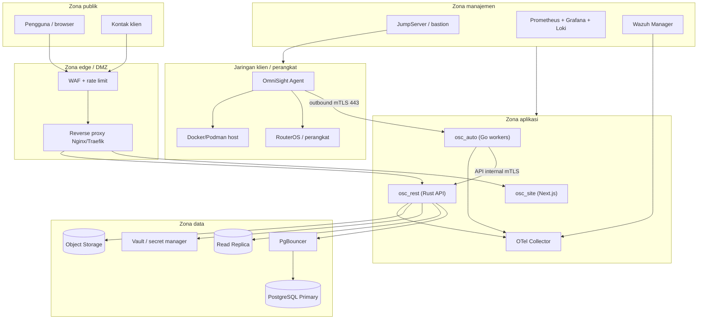
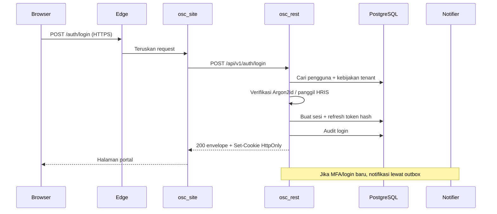
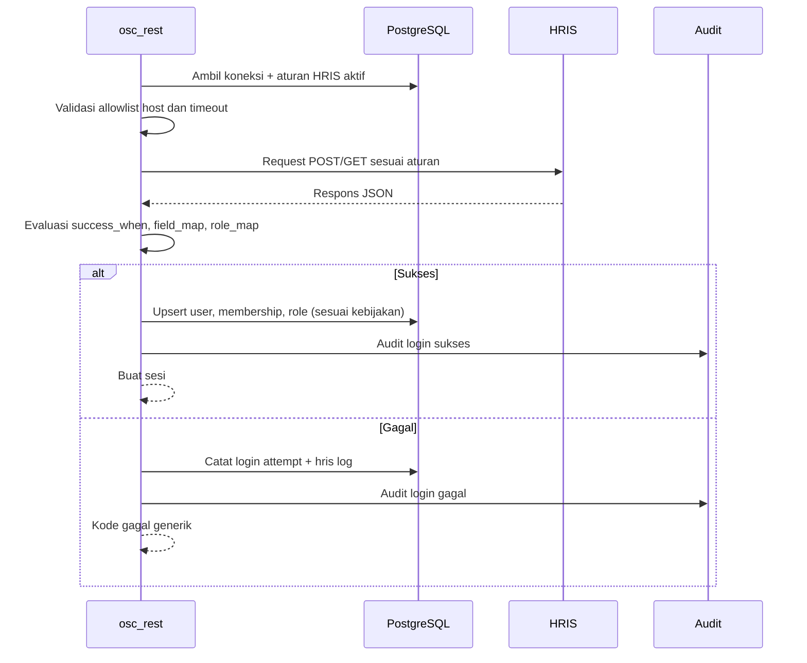
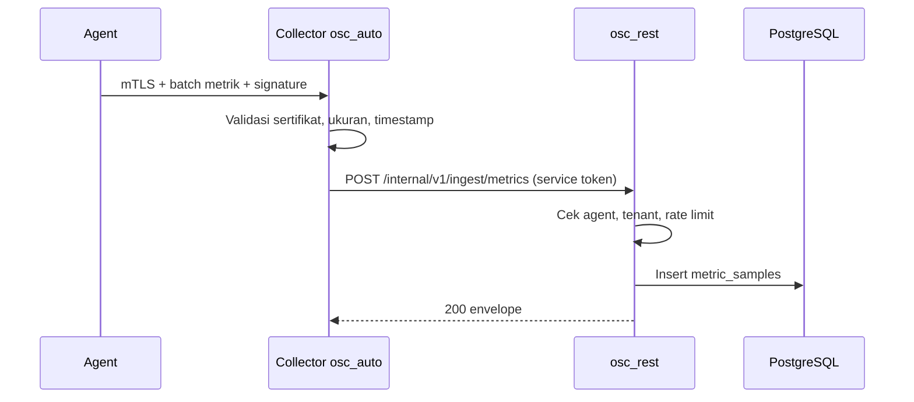
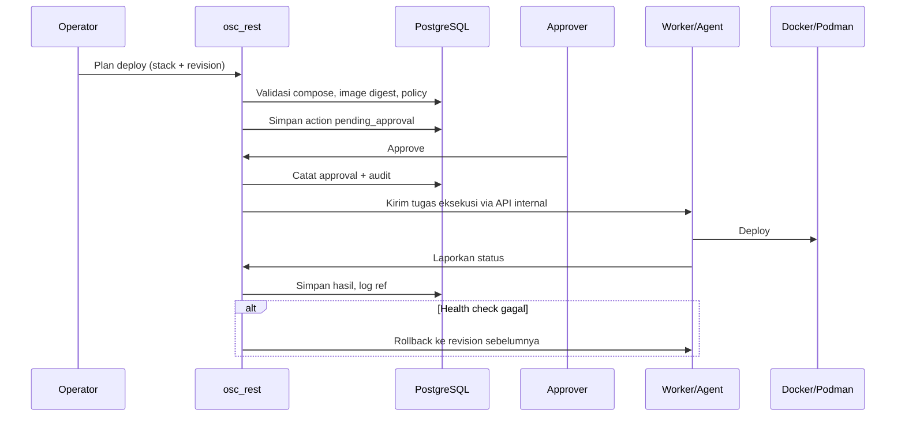
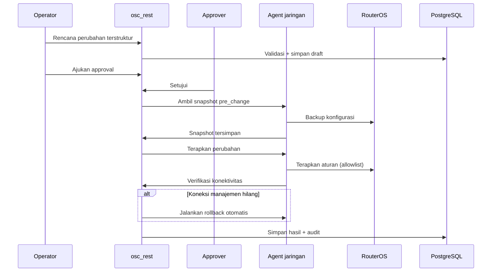
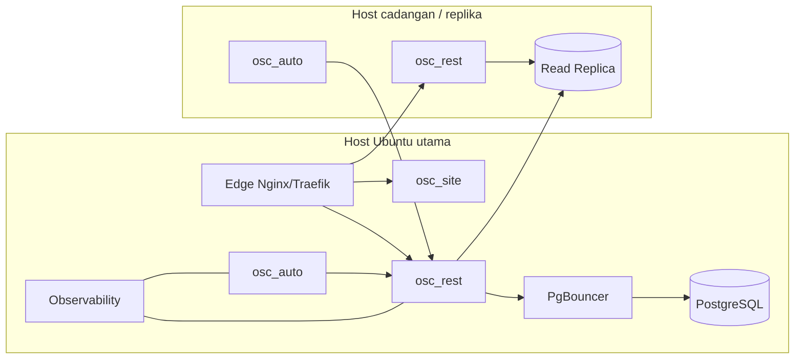

# Topologi dan Level Akses

## 1. Zona kepercayaan

## 2. Batas kepercayaan

| Batas | Aturan |
|---|---|
| Internet → edge | Hanya 443. WAF, rate limit, TLS 1.2+ (utamakan 1.3), HSTS, proteksi bot |
| Edge → aplikasi | Hanya route yang diizinkan, header keamanan, timeout, body limit |
| Aplikasi → database | Jaringan internal, TLS, user DB least privilege, RLS |
| Aplikasi → integrasi | Allowlist tujuan, TLS verify, SSRF protection, timeout, circuit breaker |
| Agent → collector | Outbound-only, mTLS, sertifikat per agent, tanda tangan payload |
| Manajemen → server | Hanya via bastion/VPN, MFA, sesi terekam |
| Aplikasi → Docker/Podman | Socket proxy dengan endpoint allowlist, bukan socket mentah |
| Aplikasi → RouterOS | Hanya lewat agent/tunnel manajemen, akun read-only untuk baca |

## 3. Data flow utama

### 3.1 Login pengguna

Aturan cookie:

- Access token dan refresh token di cookie `HttpOnly`, `Secure`, `SameSite=Lax`.
- CSRF token dikirim ke klien dan wajib pada POST.
- Rotasi refresh token; reuse memicu pencabutan sesi.
- Logout mencabut sesi dan refresh family.

### 3.2 Login HRIS

Proteksi:

- `base_url` HRIS harus HTTPS dan masuk allowlist.
- Resolusi DNS dicek ulang untuk mencegah SSRF ke IP internal.
- Redirect ke host lain ditolak.
- Respons dibatasi ukuran dan waktu.
- Password tidak pernah disimpan atau dicatat.
- Pesan ke pengguna tidak membedakan "akun tidak ada" dan "password salah".

### 3.3 Metrik agent

Agent di jaringan klien membuka koneksi keluar ke collector. Tidak ada port masuk ke agent.

### 3.4 Deploy container

### 3.5 Perubahan firewall MikroTik

## 4. Level akses

### 4.1 Peran platform

Peran platform disimpan di `core.user_platform_roles`, terpisah dari membership perusahaan. Rincian izin ada di [matriks izin](../../security/matriks-izin.md).

| Peran | Bisa | Tidak bisa |
|---|---|---|
| Platform Owner | Kelola perusahaan, integrasi platform, feature flag | Melihat data bisnis tanpa impersonasi |
| Platform Support | Baca status sistem, audit platform | Mengubah data perusahaan |
| Platform Security | Audit global, review akses | Mengubah konfigurasi bisnis |
| Billing/Admin (jika ada) | Data langganan | Data operasional |

Impersonasi:

- Wajib `AM08:post`, alasan, MFA ulang, batas waktu, dan persetujuan.
- Semua aksi selama impersonasi diaudit dan memakai `request_id` sesi impersonasi.
- Banner jelas di UI bahwa sesi impersonasi aktif.

### 4.2 Peran perusahaan

| Peran | Scope | Modul | Catatan |
|---|---|---|---|
| Company Admin | Perusahaan | Semua modul | Kelola anggota dan peran |
| Area Manager | Area + turunan | Aset, jaringan, monitoring, tiket, container | Approval di area |
| NOC Operator | Area | Monitoring, jaringan, container | Aksi destruktif perlu approval |
| Field Technician | Area | Aset, tiket | Check-out/in aset |
| Viewer | Perusahaan/area | Read | Tidak boleh melihat audit sensitif |
| Auditor | Perusahaan | Read audit, review akses | Tidak boleh mengubah data |
| Requester | Diri sendiri | Tiket, permintaan akses, artikel | Tidak melihat aset selain miliknya |

### 4.3 Matriks izin ringkas

| Modul | Company Admin | Area Manager | NOC | Technician | Viewer | Auditor | Requester |
|---|---|---|---|---|---|---|---|
| AA Dashboard | read | read | read | read | read | read | read (self) |
| AB Identitas | post | read | read | read | read | read | - |
| AC Aset | post | post | read | post | read | read | - |
| AD Jaringan | post | post | post* | read | read | read | - |
| AE Monitoring | post | post | post | read | read | read | - |
| AF Container | post | post* | post* | read | read | read | - |
| AG Edge | post | post* | read | - | read | read | - |
| AH Backup | post | read | read | - | read | read | - |
| AI Akses | post | post | read | - | - | read | post (self) |
| AJ Layanan | post | post | post | post | read | read | post (self) |
| AK Konten | post | read | read | read | read | read | read |
| AL Audit | read | read | read | - | - | read | - |
| AM Platform | post | - | - | - | - | read | - |

`post` mencakup `read`; `*` berarti aksi sensitif tetap memerlukan approval dan audit; `self` berarti hanya data sendiri. Tabel ini ringkas; sumber lengkap per submodul ada di [matriks izin](../../security/matriks-izin.md).

### 4.4 Evaluasi otorisasi

Setiap request:

1. Verifikasi JWT, sesi, status pengguna.
2. Tentukan perusahaan aktif dari header/route; validasi membership aktif.
3. Tentukan scope area; validasi area berada di perusahaan dan termasuk area yang diizinkan.
4. Cek izin `module_code:action`.
5. Cek kepemilikan resource dan scope data.
6. Jika aksi sensitif, cek approval dan kebijakan.
7. Tulis audit jika aksi mengubah data atau ditolak.
8. Kembalikan envelope.

Larangan:

- Jangan menentukan tenant dari `company_id` di body.
- Jangan mengandalkan filter frontend.
- Jangan membocorkan keberadaan data di luar scope; gunakan kode "tidak ditemukan".
- Jangan menyimpan daftar izin lengkap di JWT tanpa mekanisme pencabutan.

## 5. Autentikasi antar layanan

| Pemanggil | Tujuan | Metode |
|---|---|---|
| Frontend | osc_rest | Cookie sesi + CSRF, same-origin via edge |
| osc_auto | osc_rest | mTLS + service token, network policy |
| Agent | collector | mTLS + payload signature |
| osc_rest | integrasi eksternal | HTTPS + kredensial vault, allowlist |
| Worker | Docker/Podman | Socket proxy dengan endpoint allowlist |
| Admin | server | Bastion/VPN + MFA |

Service token:

- Umur pendek, scope sempit, diaudit.
- Disimpan di secret file, bukan environment yang tercetak.
- Dapat dicabut tanpa restart seluruh sistem.

## 6. Port dan firewall

| Layanan | Port | Akses |
|---|---|---|
| HTTPS publik | 443 | Internet |
| osc_rest | 8080 | Hanya edge dan osc_auto |
| osc_auto collector | 8443 | Hanya agent (mTLS) |
| OTLP | 4317 | Hanya aplikasi internal |
| Prometheus scrape | 9090 | Hanya monitoring |
| PostgreSQL | 5432 | Hanya PgBouncer/aplikasi |
| PgBouncer | 6432 | Hanya osc_rest |
| Docker/Podman API | 2375/2376 | Hanya localhost/socket proxy |
| RouterOS API | 8728/8729 | Hanya agent/tunnel manajemen |
| SSH | 22 | Hanya bastion/VPN |
| Wazuh agent | 1514/1515 | Hanya manager internal |

Aturan umum:

- Default deny pada firewall host dan jaringan.
- Tidak ada database, Docker API, RouterOS API, atau metrics yang terbuka ke internet.
- Agent tidak membuka port masuk.
- Egress dibatasi untuk integrasi yang diizinkan.

## 7. Deployment logis

Prinsip deployment:

- Stateless `osc_rest` dan `osc_auto` agar mudah diskalakan.
- Database stateful dengan backup dan failover.
- Edge menjadi satu-satunya titik masuk publik.
- Observability tidak diekspos publik.
- Konfigurasi melalui file/secret, bukan image.

## 8. Penanganan penolakan dan error di edge

- WAF memblokir serangan, tetapi respons ke klien tetap halaman/kode yang aman.
- Aplikasi tidak memakai 403; penolakan diwakili kode `AA00-00-0003`.
- Error infrastruktur (502/503/504) dari edge dipetakan ke halaman pemeliharaan dengan envelope kode `AA00-00-0900` untuk klien API, agar tidak terlihat seperti "bridge rusak".
- Health check internal (`/internal/healthz`) tetap memakai status HTTP nyata dan hanya dapat diakses jaringan internal.
- Semua penolakan dan error dicatat di log/metrics; menyembunyikan status HTTP bukan berarti menyembunyikan kejadian.

## 9. Checklist akses

- [ ] Tidak ada data lintas perusahaan yang bisa diakses dengan menebak ID.
- [ ] Scope area diuji untuk area anak/cabang.
- [ ] Perubahan role langsung memengaruhi request berikutnya.
- [ ] Sesi dicabut saat pengguna dinonaktifkan.
- [ ] Admin wajib MFA.
- [ ] Service token tidak dapat dipakai dari internet.
- [ ] Agent yang dicabut tidak bisa mengirim data.
- [ ] Impersonasi memiliki alasan, batas waktu, dan audit.
- [ ] Semua endpoint punya deklarasi modul/aksi sesuai [matriks izin](../../security/matriks-izin.md).
- [ ] Audit mencatat aktor, tenant, scope, dan request id.
- [ ] Self-service tidak menerima `user_id` dari klien.
- [ ] Approval tidak dapat dilakukan sendiri.
