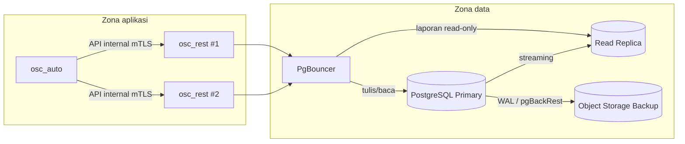
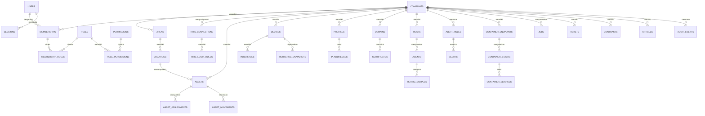

# Database OmniSight

## 1. Peran database

Database adalah sumber kebenaran untuk identitas, akses, inventaris, status operasional, dan audit. Prinsipnya:

- **PostgreSQL** menjadi database utama.
- **Prisma hanya untuk skema dan migrasi**, bukan ORM runtime.
- **Rust + SQLx** menjadi satu-satunya jalur tulis data domain.
- **osc_auto tidak mengakses database domain langsung**; semua lewat API internal `osc_rest`.
- **Agent tidak pernah mengakses database**; agent mengirim data lewat API.

Fondasi skema mesin-terbaca ada di [../contracts/schema.prisma](../contracts/schema.prisma) (draf, `core`/`audit`/`platform`). RLS, FK komposit, partisi, dan fungsi audit tetap ditulis di migrasi SQL.

## 2. Cluster dan topologi



Ketentuan:

- PostgreSQL versi stabil terbaru yang didukung, dengan TLS wajib.
- Primary menangani transaksi. Replica untuk laporan dan ekspor berat.
- PgBouncer mode transaction pooling. RLS memakai `SET LOCAL` di dalam transaksi agar aman.
- Backup memakai pgBackRest: full + incremental + WAL archiving.
- Database tidak pernah diekspos ke internet.
- Setiap layanan punya user database sendiri:

| User | Hak |
|---|---|
| `osc_migrate` | DDL migrasi Prisma, hanya saat deploy |
| `osc_rest_app` | DML pada schema domain, tunduk RLS |
| `osc_report` | SELECT pada view laporan, read-only |
| `osc_backup` | replikasi/backup, tanpa akses aplikasi |
| `osc_auto` | tidak punya akses database; hanya API internal |

## 3. Skema

Satu database `omnisight`, beberapa schema:

| Schema | Isi |
|---|---|
| `core` | Perusahaan, area, lokasi, pengguna, membership, peran, izin, sesi, HRIS, API key, vendor, file |
| `asset` | Kategori, model, aset, penugasan, mutasi, lampiran |
| `network` | Rack, perangkat, interface, IPAM, VLAN, link, circuit, MikroTik, domain, sertifikat, proxy |
| `monitor` | Host, agent, metrik, rollup, alert, insiden, tautan integrasi |
| `ops` | Endpoint container, stack, service, aksi, job, backup, bastion, maintenance |
| `service` | Tiket, kategori, komentar, SLA, kontrak, knowledge base |
| `content` | Artikel, halaman, template notifikasi, notifikasi, preferensi |
| `audit` | Audit trail, kejadian keamanan, review akses, retensi |
| `platform` | Integrasi, webhook, pengaturan, feature flag, job schedule |

Alasan memisahkan schema:

- Hak akses database bisa dibatasi per schema.
- Migrasi dan review lebih terstruktur.
- Query lintas domain tetap mungkin dengan join biasa.
- Nama tabel tidak bertabrakan.

## 4. ERD ringkas



## 5. Pola multi-tenant

### 5.1 Kunci tenant

Semua tabel data tenant memiliki `company_id uuid NOT NULL`. Tidak ada query domain yang boleh berjalan tanpa filter tenant.

### 5.2 Foreign key komposit

Untuk mencegah referensi lintas perusahaan, gunakan foreign key komposit:

```sql
-- Setiap area unik dalam perusahaan
ALTER TABLE core.areas
  ADD CONSTRAINT uq_areas_company_id UNIQUE (company_id, id);

-- Lokasi harus berada di area dan perusahaan yang sama
ALTER TABLE core.locations
  ADD CONSTRAINT fk_locations_area
  FOREIGN KEY (company_id, area_id)
  REFERENCES core.areas (company_id, id);

-- Unik agar aset bisa mereferensikan lokasi secara aman
ALTER TABLE core.locations
  ADD CONSTRAINT uq_locations_company_area_id UNIQUE (company_id, area_id, id);

-- Aset harus berada di lokasi yang sama dengan area dan perusahaannya
ALTER TABLE asset.assets
  ADD CONSTRAINT fk_assets_location
  FOREIGN KEY (company_id, area_id, location_id)
  REFERENCES core.locations (company_id, area_id, id);
```

Pola ini membuat kesalahan lintas tenant ditolak database, bukan hanya oleh kode.

### 5.3 Row Level Security

Semua tabel tenant mengaktifkan RLS:

```sql
ALTER TABLE asset.assets ENABLE ROW LEVEL SECURITY;
ALTER TABLE asset.assets FORCE ROW LEVEL SECURITY;

CREATE POLICY tenant_isolation ON asset.assets
  USING (company_id = current_setting('app.company_id', true)::uuid)
  WITH CHECK (company_id = current_setting('app.company_id', true)::uuid);
```

`osc_rest` membuka transaksi lalu:

```sql
SET LOCAL app.company_id = '...';
SET LOCAL app.user_id = '...';
SET LOCAL app.request_id = '...';
```

Aturan:

- `app.company_id` wajib diisi dari membership yang tervalidasi, bukan dari header mentah.
- Platform admin tidak otomatis melewati RLS. Impersonasi harus eksplisit, beralasan, dan diaudit.
- User migrasi/backup memiliki bypass khusus dan tidak dipakai aplikasi.

### 5.4 Scope area

- Membership menentukan perusahaan.
- `membership_roles` menentukan peran dan scope (`company` atau `area`).
- Untuk scope area, `scope_id` menunjuk `core.areas.id`.
- Area bertingkat memakai `parent_id` dan `path` (ltree). Scope area mencakup turunannya secara default.
- Lokasi bukan scope otorisasi; lokasi adalah atribut penempatan aset.

## 6. Konvensi data

| Aspek | Aturan |
|---|---|
| ID | UUIDv7 dibuat aplikasi untuk tabel panas; UUIDv4 boleh untuk tabel referensi |
| Waktu | `timestamptz`, disimpan UTC |
| Uang | `numeric(18,2)` + `char(3)` currency |
| Email | `citext`, unik global untuk pengguna |
| JSON | `jsonb`, divalidasi di aplikasi dan/atau check constraint |
| Soft delete | `deleted_at timestamptz NULL`; unique index parsial |
| Versi | `version integer NOT NULL DEFAULT 1` untuk optimistic locking |
| Nama tabel | plural snake_case |
| Nama constraint | `fk_`, `uq_`, `ck_`, `ix_` |
| Audit kolom | `created_at`, `created_by`, `updated_at`, `updated_by` |
| Rahasia | Tidak pernah disimpan sebagai teks biasa; simpan referensi vault |
| PII | Minimal, terklasifikasi, akses terbatas, retensi jelas |

## 7. Indeks dan performa

Prinsip:

- Index utama: `(company_id, status, created_at)` untuk daftar.
- Index unik parsial: `WHERE deleted_at IS NULL`.
- Pencarian nama memakai `pg_trgm` dengan GIN hanya pada kolom yang dicari.
- JSONB tidak di-index global; hanya field yang benar-benar dipakai.
- Query daftar wajib punya pagination berbasis cursor (`created_at`, `id`).
- Hindari `SELECT *`; pilih kolom yang diperlukan.
- Semua query dianalisis dengan `EXPLAIN (ANALYZE, BUFFERS)` sebelum rilis.
- `pg_stat_statements` aktif untuk menemukan query lambat.

## 8. Partitioning dan retensi

| Data | Strategi | Retensi awal |
|---|---|---|
| `monitor.metric_samples` | Partisi bulanan berdasarkan `ts` | 30 hari raw |
| `monitor.metric_rollups_1h` | Agregasi per jam | 1 tahun |
| `core.login_attempts` | Partisi bulanan; dibuat lewat `core.ensure_login_attempts_partition(date)` yang menerapkan RLS dan grant | 180 hari |
| `ops.job_runs` | Partisi bulanan | 90 hari |
| `audit.audit_events` | Append-only, evaluasi partisi jika volume tinggi | 2 tahun (kebijakan) |
| `content.notifications` | Index waktu, hapus/arsip terjadwal | 90 hari |
| `ops.container_actions` | Append-only | 1 tahun |

Penghapusan data mengikuti kebijakan retensi dan harus tercatat. Data audit tidak boleh dihapus manual dari UI.

## 9. Transaksi dan konsistensi

- Satu use case = satu transaksi database.
- Perubahan domain dan penulisan audit berada dalam transaksi yang sama bila memungkinkan.
- Event keluar (notifikasi, webhook) memakai **outbox pattern** agar tidak hilang saat transaksi berhasil tetapi pengiriman gagal.
- Operasi lintas layanan memakai idempotency key.
- Gunakan `SERIALIZABLE` hanya untuk kasus yang benar-benar butuh; default `READ COMMITTED`.
- Scheduler memakai `FOR UPDATE SKIP LOCKED` di `osc_rest` agar job tidak dieksekusi ganda.

## 10. Keamanan database

- TLS wajib untuk koneksi aplikasi.
- Enkripsi disk/volume untuk data at rest.
- Backup terenkripsi dan diuji restore.
- Tidak ada superuser aplikasi.
- Kredensial dirotasi dan disimpan di vault/secret file.
- `log_statement` tidak mencatat parameter yang mengandung rahasia.
- Ekstensi minimal: `pgcrypto`, `citext`, `ltree`, `pg_trgm`.
- Timezone server UTC; tampilan mengikuti preferensi pengguna.

## 11. Dokumen skema rinci

- [skema-inti.md](skema-inti.md): identitas, organisasi, akses, HRIS, sesi, audit inti.
- [skema-aset-jaringan.md](skema-aset-jaringan.md): aset, lokasi, jaringan, IPAM, MikroTik, domain.
- [skema-operasi-monitoring.md](skema-operasi-monitoring.md): agent, metrik, alert, container, job, backup, bastion.
- [skema-layanan-konten-audit.md](skema-layanan-konten-audit.md): tiket, kontrak, konten, notifikasi, audit, review akses.
- [prisma-dan-migrasi.md](prisma-dan-migrasi.md): aturan Prisma, migrasi, seed, dan pembagian tugas dengan SQLx.

## 12. Dokumen terkait

- [Fungsi database](../../qaqc/function/database/README.md)
- [Alur data database](../../qaqc/data-flow/database/README.md)
- [Unit test database](../../qaqc/unit-test/database/README.md)

