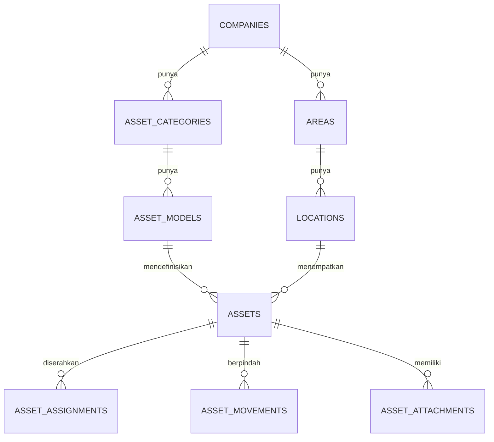

# Skema Aset dan Jaringan

Schema: `asset` dan `network`. Keduanya memakai pola tenant `company_id` dan foreign key komposit.

## 1. Aset

### `asset.asset_categories`

| Kolom | Tipe | Catatan |
|---|---|---|
| `id` | uuid pk | |
| `company_id` | uuid fk | |
| `parent_id` | uuid null | Kategori bertingkat |
| `code` | varchar(32) | Unik per perusahaan |
| `name` | varchar(120) | |
| `depreciation_months` | integer null | Untuk laporan umur aset |
| `custom_fields_schema` | jsonb | Validasi field tambahan |
| `created_at`, `updated_at`, `deleted_at` | timestamptz | |

### `asset.asset_models`

| Kolom | Tipe | Catatan |
|---|---|---|
| `id` | uuid pk | |
| `company_id` | uuid fk | |
| `category_id` | uuid fk | |
| `manufacturer` | varchar(120) | |
| `model` | varchar(120) | |
| `part_number` | varchar(120) null | |
| `specs` | jsonb | Spesifikasi terstruktur |
| `created_at`, `updated_at`, `deleted_at` | timestamptz | |

Constraint: `UNIQUE (company_id, category_id, manufacturer, model, part_number)`.

### `asset.assets`

| Kolom | Tipe | Catatan |
|---|---|---|
| `id` | uuid pk | |
| `company_id` | uuid fk | |
| `area_id` | uuid fk | Area penempatan |
| `location_id` | uuid fk | Lokasi penempatan |
| `category_id` | uuid fk | |
| `model_id` | uuid null | |
| `asset_tag` | varchar(64) | Unik per perusahaan |
| `serial_number` | varchar(128) null | Unik per perusahaan jika diisi |
| `name` | varchar(160) | |
| `status` | varchar(24) | `in_stock`, `assigned`, `in_repair`, `retired`, `lost`, `disposed` |
| `condition` | varchar(24) | `good`, `fair`, `damaged` |
| `purchase_date` | date null | |
| `warranty_end` | date null | |
| `vendor_id` | uuid null | `core.vendors` |
| `purchase_cost` | numeric(18,2) null | |
| `currency` | char(3) | |
| `qr_token` | varchar(64) | Token acak, unik global |
| `custom_fields` | jsonb | Divertifikasi skema kategori |
| `version` | integer | Optimistic locking |
| `created_by` | uuid | |
| `created_at`, `updated_at`, `deleted_at` | timestamptz | |

Constraint:

```sql
ALTER TABLE asset.assets
  ADD CONSTRAINT uq_assets_company_id UNIQUE (company_id, id);

ALTER TABLE asset.assets
  ADD CONSTRAINT fk_assets_location
  FOREIGN KEY (company_id, area_id, location_id)
  REFERENCES core.locations (company_id, area_id, id);

CREATE UNIQUE INDEX uq_assets_tag_active
  ON asset.assets (company_id, asset_tag)
  WHERE deleted_at IS NULL;

CREATE UNIQUE INDEX uq_assets_serial_active
  ON asset.assets (company_id, serial_number)
  WHERE serial_number IS NOT NULL AND deleted_at IS NULL;
```

Aturan:

- `asset_tag` tidak berurutan dan tidak boleh menjadi satu-satunya pengenal publik.
- `qr_token` acak, tidak dapat ditebak, dan dapat dicabut.
- Status `lost` dan `disposed` memerlukan izin `post` serta catatan alasan.
- Aset tidak dihapus permanen jika memiliki riwayat; gunakan `disposed` atau `deleted_at`.

### `asset.asset_assignments`

Menyimpan serah terima (check-out) dan pengembalian (check-in) sebagai riwayat terpisah.

| Kolom | Tipe | Catatan |
|---|---|---|
| `id` | uuid pk | |
| `company_id` | uuid fk | |
| `asset_id` | uuid fk | |
| `assignee_user_id` | uuid fk | Anggota perusahaan yang sama |
| `assigned_by` | uuid fk | |
| `assigned_at` | timestamptz | |
| `due_at` | timestamptz null | |
| `returned_at` | timestamptz null | |
| `condition_out` | varchar(24) | |
| `condition_in` | varchar(24) null | |
| `note_out` | text null | |
| `note_in` | text null | |
| `status` | varchar(16) | `active`, `returned`, `overdue`, `lost` |
| `created_at`, `updated_at` | timestamptz | |

Constraint:

- Hanya satu assignment `active` per aset (unique index parsial).
- Assignee harus memiliki `company_memberships` aktif di perusahaan yang sama.
- Pengembalian mengisi `returned_at`, `condition_in`, dan mengubah status.

```sql
CREATE UNIQUE INDEX uq_asset_one_active_assignment
  ON asset.asset_assignments (asset_id)
  WHERE status = 'active';
```

### `asset.asset_movements`

| Kolom | Tipe | Catatan |
|---|---|---|
| `id` | uuid pk | |
| `company_id` | uuid fk | |
| `asset_id` | uuid fk | |
| `from_area_id`, `from_location_id` | uuid null | |
| `to_area_id`, `to_location_id` | uuid fk | |
| `moved_by` | uuid | |
| `moved_at` | timestamptz | |
| `reason` | text | |
| `ref_type`, `ref_id` | varchar(32), uuid null | Tiket, kontrak, dll. |
| `created_at` | timestamptz | |

Aturan: riwayat mutasi **append-only**. Koreksi dilakukan dengan mutasi baru, bukan update/delete.

### `asset.asset_attachments`

| Kolom | Tipe | Catatan |
|---|---|---|
| `id` | uuid pk | |
| `company_id` | uuid fk | |
| `asset_id` | uuid fk | |
| `file_id` | uuid fk | `core.files` |
| `kind` | varchar(32) | `invoice`, `photo`, `document`, `handover` |
| `created_by` | uuid | |
| `created_at` | timestamptz | |

### Relasi aset



## 2. Jaringan

### `network.racks`

| Kolom | Tipe | Catatan |
|---|---|---|
| `id` | uuid pk | |
| `company_id` | uuid fk | |
| `location_id` | uuid fk | |
| `name` | varchar(80) | |
| `row_label` | varchar(16) null | |
| `unit_capacity` | integer | Default 42 |
| `power_watts` | integer null | |
| `status` | varchar(16) | `active`, `maintenance`, `retired` |
| `created_at`, `updated_at`, `deleted_at` | timestamptz | |

Constraint: `UNIQUE (company_id, location_id, name)`.

### `network.devices`

| Kolom | Tipe | Catatan |
|---|---|---|
| `id` | uuid pk | |
| `company_id` | uuid fk | |
| `location_id` | uuid fk | |
| `rack_id` | uuid null | |
| `rack_unit` | integer null | |
| `name` | varchar(120) | |
| `device_type` | varchar(32) | `router`, `switch`, `firewall`, `ap`, `server`, `other` |
| `manufacturer` | varchar(120) | |
| `model` | varchar(120) | |
| `serial_number` | varchar(128) null | |
| `status` | varchar(24) | `active`, `offline`, `maintenance`, `retired` |
| `mgmt_protocol` | varchar(24) | `routeros`, `snmp`, `ssh`, `https` |
| `mgmt_port` | integer null | |
| `mgmt_address` | inet null | |
| `credential_ref` | text null | Referensi vault, bukan rahasia |
| `os_version` | varchar(120) null | |
| `primary_ip_id` | uuid null | |
| `tags` | jsonb | Label bebas |
| `custom_fields` | jsonb | |
| `created_at`, `updated_at`, `deleted_at` | timestamptz | |

Constraint:

- `UNIQUE (company_id, id)`.
- `FOREIGN KEY (company_id, location_id) REFERENCES core.locations (company_id, id)`.
- `primary_ip_id` harus IP milik perusahaan yang sama (validasi aplikasi + FK komposit).

### `network.interfaces`

| Kolom | Tipe | Catatan |
|---|---|---|
| `id` | uuid pk | |
| `company_id` | uuid fk | |
| `device_id` | uuid fk | |
| `name` | varchar(64) | Misalnya `ether1`, `sfp-sfpplus1` |
| `type` | varchar(24) | `ethernet`, `sfp`, `wifi`, `loopback`, `vlan` |
| `mac_address` | macaddr null | |
| `speed_mbps` | integer null | |
| `status` | varchar(16) | `up`, `down`, `disabled` |
| `mode` | varchar(16) | `access`, `trunk`, `routed` |
| `description` | text null | |
| `created_at`, `updated_at` | timestamptz | |

Constraint: `UNIQUE (device_id, name)`.

### `network.vlans`

| Kolom | Tipe | Catatan |
|---|---|---|
| `id` | uuid pk | |
| `company_id` | uuid fk | |
| `location_id` | uuid fk | |
| `vid` | integer | 1–4094 |
| `name` | varchar(80) | |
| `status` | varchar(16) | `active`, `reserved`, `deprecated` |
| `description` | text null | |
| `created_at`, `updated_at` | timestamptz | |

Constraint: `UNIQUE (company_id, location_id, vid)` dan `CHECK (vid BETWEEN 1 AND 4094)`.

### `network.prefixes`

| Kolom | Tipe | Catatan |
|---|---|---|
| `id` | uuid pk | |
| `company_id` | uuid fk | |
| `location_id` | uuid null | Prefix bisa global perusahaan |
| `vlan_id` | uuid null | |
| `prefix` | cidr | Misalnya `10.10.0.0/24` |
| `status` | varchar(16) | `active`, `reserved`, `deprecated` |
| `description` | text null | |
| `created_at`, `updated_at` | timestamptz | |

Constraint: `UNIQUE (company_id, prefix)`.

### `network.ip_addresses`

| Kolom | Tipe | Catatan |
|---|---|---|
| `id` | uuid pk | |
| `company_id` | uuid fk | |
| `prefix_id` | uuid fk | |
| `address` | inet | Host address, bukan network |
| `dns_name` | varchar(255) null | |
| `status` | varchar(16) | `active`, `reserved`, `dhcp`, `deprecated` |
| `assigned_device_id` | uuid null | |
| `assigned_interface_id` | uuid null | |
| `description` | text null | |
| `created_at`, `updated_at` | timestamptz | |

Constraint:

- `UNIQUE (company_id, address)`.
- `UNIQUE (company_id, id)` untuk FK komposit.
- Alamat harus berada di dalam prefix (validasi aplikasi + trigger).
- Interface harus milik device yang sama dengan `assigned_device_id`.

### `network.device_links`

| Kolom | Tipe | Catatan |
|---|---|---|
| `id` | uuid pk | |
| `company_id` | uuid fk | |
| `a_interface_id` | uuid fk | |
| `b_interface_id` | uuid fk | |
| `cable_type` | varchar(32) null | |
| `status` | varchar(16) | `connected`, `planned`, `disconnected` |
| `description` | text null | |
| `created_at`, `updated_at` | timestamptz | |

Constraint: `CHECK (a_interface_id <> b_interface_id)`.

### `network.circuits`

| Kolom | Tipe | Catatan |
|---|---|---|
| `id` | uuid pk | |
| `company_id` | uuid fk | |
| `location_id` | uuid fk | |
| `vendor_id` | uuid null | `core.vendors` |
| `circuit_id` | varchar(80) | ID dari penyedia |
| `bandwidth_mbps` | integer | |
| `status` | varchar(16) | `active`, `suspended`, `terminated` |
| `started_at` | date null | |
| `ended_at` | date null | |
| `created_at`, `updated_at` | timestamptz | |

## 3. MikroTik dan perubahan berisiko

### `network.mikrotik_routers`

| Kolom | Tipe | Catatan |
|---|---|---|
| `id` | uuid pk | |
| `company_id` | uuid fk | |
| `device_id` | uuid fk | |
| `host` | inet/text | Hanya alamat manajemen internal |
| `api_port` | integer | Default 8728/8729; tidak diekspos publik |
| `use_tls` | boolean | Wajib untuk lintas jaringan |
| `credential_ref` | text | Referensi vault |
| `routeros_version` | varchar(64) null | |
| `last_seen_at` | timestamptz null | |
| `health` | jsonb | Hasil pemeriksaan terbatas |
| `managed_by_agent_id` | uuid null | Agent di lokasi |
| `created_at`, `updated_at` | timestamptz | |

### `network.routeros_snapshots`

| Kolom | Tipe | Catatan |
|---|---|---|
| `id` | uuid pk | |
| `company_id` | uuid fk | |
| `router_id` | uuid fk | |
| `kind` | varchar(32) | `config`, `firewall`, `addresses`, `routes` |
| `checksum` | bytea | SHA-256 |
| `storage_key` | text | Objek terenkripsi |
| `taken_at` | timestamptz | |
| `triggered_by` | varchar(16) | `schedule`, `manual`, `pre_change` |
| `created_at` | timestamptz | |

### `network.routeros_firewall_rules`

Menyimpan aturan hasil snapshot untuk diff dan tampilan. Bukan sumber kebenaran langsung; sumber kebenaran tetap router.

| Kolom | Tipe | Catatan |
|---|---|---|
| `id` | uuid pk | |
| `company_id` | uuid fk | |
| `snapshot_id` | uuid fk | |
| `chain` | varchar(32) | |
| `position` | integer | Urutan |
| `action` | varchar(32) | |
| `protocol` | varchar(16) null | |
| `src_address` | text null | |
| `dst_address` | text null | |
| `dst_port` | text null | |
| `comment` | text null | |
| `disabled` | boolean | |
| `raw_hash` | bytea | Deteksi perubahan |

### `network.network_changes`

| Kolom | Tipe | Catatan |
|---|---|---|
| `id` | uuid pk | |
| `company_id` | uuid fk | |
| `router_id` | uuid fk | |
| `change_type` | varchar(32) | `firewall`, `address`, `route`, `config` |
| `plan` | jsonb | Rencana terstruktur, bukan perintah bebas |
| `diff` | jsonb | Sebelum/sesudah |
| `status` | varchar(24) | `draft`, `pending_approval`, `approved`, `executing`, `succeeded`, `failed`, `rolled_back` |
| `requested_by` | uuid | |
| `approved_by` | uuid null | |
| `pre_snapshot_id` | uuid null | |
| `executed_at` | timestamptz null | |
| `result` | jsonb null | |
| `rollback_reason` | text null | |
| `created_at`, `updated_at` | timestamptz | |

Aturan perubahan:

1. Rencana dibuat dalam bentuk terstruktur dan divalidasi.
2. Snapshot `pre_change` diambil.
3. Persetujuan dua orang untuk produksi bila kebijakan mengaktifkan.
4. Eksekusi hanya melalui agent di jaringan manajemen.
5. Jika koneksi manajemen hilang setelah perubahan, rollback otomatis dijadwalkan.
6. Hasil dan diff dicatat di audit.

## 4. Domain, sertifikat, dan edge

### `network.domains`

| Kolom | Tipe | Catatan |
|---|---|---|
| `id` | uuid pk | |
| `company_id` | uuid fk | |
| `fqdn` | varchar(255) | Unik per perusahaan |
| `registrar_vendor_id` | uuid null | |
| `dns_provider` | varchar(64) null | |
| `expires_at` | date null | |
| `auto_renew` | boolean | |
| `status` | varchar(16) | `active`, `expired`, `pending`, `disabled` |
| `created_at`, `updated_at` | timestamptz | |

### `network.certificates`

| Kolom | Tipe | Catatan |
|---|---|---|
| `id` | uuid pk | |
| `company_id` | uuid fk | |
| `domain_id` | uuid fk | |
| `issuer` | varchar(160) | |
| `serial_number` | varchar(128) | |
| `not_before`, `not_after` | timestamptz | |
| `fingerprint_sha256` | bytea | |
| `status` | varchar(16) | `valid`, `expiring`, `expired`, `revoked` |
| `storage_ref` | text | Referensi vault untuk private key |
| `auto_renew` | boolean | |
| `last_checked_at` | timestamptz | |
| `created_at`, `updated_at` | timestamptz | |

Aturan: private key tidak pernah masuk database aplikasi; hanya referensi vault. Sertifikat kedaluwarsa memicu alert.

### `network.edge_nodes`

| Kolom | Tipe | Catatan |
|---|---|---|
| `id` | uuid pk | |
| `company_id` | uuid fk | |
| `location_id` | uuid null | |
| `name` | varchar(120) | |
| `kind` | varchar(24) | `nginx`, `traefik` |
| `api_base_url` | text | Internal |
| `credential_ref` | text | Vault |
| `agent_id` | uuid null | Agent yang menerapkan konfigurasi |
| `version` | varchar(64) null | |
| `status` | varchar(16) | `online`, `offline`, `degraded` |
| `created_at`, `updated_at` | timestamptz | |

### `network.proxy_hosts`

| Kolom | Tipe | Catatan |
|---|---|---|
| `id` | uuid pk | |
| `company_id` | uuid fk | |
| `edge_node_id` | uuid fk | |
| `domain_id` | uuid fk | |
| `upstream_url` | text | Harus lolos validasi dan tidak boleh SSRF |
| `certificate_id` | uuid null | |
| `enabled` | boolean | |
| `config` | jsonb | Opsi template: header, websocket, timeout |
| `status` | varchar(16) | `draft`, `applied`, `error` |
| `last_applied_at` | timestamptz null | |
| `created_at`, `updated_at` | timestamptz | |

Aturan:

- Upstream hanya boleh host internal yang masuk allowlist.
- Konfigurasi dihasilkan dari template; tidak ada editor bebas untuk pengguna biasa.
- Sebelum reload: validasi sintaks, cek duplikasi domain, simpan versi sebelumnya.
- Gagal reload: rollback otomatis dan alert.

## 5. Integrasi inventaris

Untuk klien yang memakai NetBox atau Snipe-IT:

- Pemetaan eksplisit antara ID lokal dan ID eksternal disimpan di `platform.integration_links`.
- Arah sinkronisasi ditentukan per entitas.
- Konflik tidak diselesaikan diam-diam; masuk antrean review.
- Data yang diimpor tetap melewati validasi tenant dan scope.
- Token integrasi read-only kecuali tulis disetujui.

## 6. Checklist keamanan modul

- [ ] Semua query memakai `company_id` dan scope area.
- [ ] FK komposit mencegah relasi lintas perusahaan.
- [ ] QR token acak dan dapat dicabut.
- [ ] Kredensial perangkat hanya referensi vault.
- [ ] RouterOS tidak diekspos ke internet.
- [ ] Perubahan firewall memakai approval dan rollback.
- [ ] Private key sertifikat tidak berada di database aplikasi.
- [ ] Upstream proxy tervalidasi terhadap SSRF.
- [ ] Riwayat aset dan perubahan jaringan tidak dapat dihapus diam-diam.
