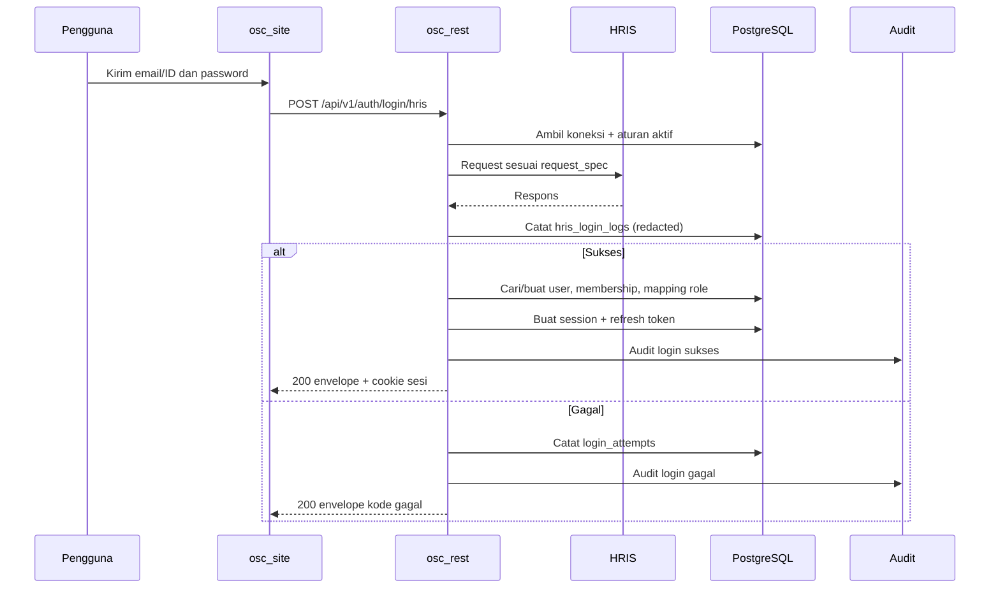

# Skema Inti: Identitas, Organisasi, dan Akses

Schema: `core`. Semua tabel tenant memiliki `company_id` kecuali yang bersifat global (`users`, `permissions`) atau lintas tenant (`user_identities`). `core.user_identities` sengaja tanpa RLS karena lookup identitas dapat terjadi sebelum tenant diketahui; kebijakan aksesnya diatur terpisah di ADR-016.

## 1. Organisasi

### `core.companies`

| Kolom | Tipe | Catatan |
|---|---|---|
| `id` | uuid pk | UUIDv7 |
| `code` | varchar(32) | Unik global, slug pendek |
| `name` | varchar(160) | Nama tampilan |
| `legal_name` | varchar(240) | Nama legal, opsional |
| `status` | varchar(16) | `active`, `suspended`, `closed` |
| `timezone` | varchar(64) | Default `Asia/Jakarta` |
| `locale` | varchar(16) | Default `en`; nilai didukung `en`, `id` |
| `settings` | jsonb | Preferensi perusahaan, divalidasi aplikasi |
| `created_at`, `updated_at` | timestamptz | UTC |
| `deleted_at` | timestamptz null | Soft delete |

Constraint: `CHECK (locale IN ('en', 'id'))`. Locale perusahaan menjadi fallback bila pengguna belum memilih bahasa.

### `core.areas`

| Kolom | Tipe | Catatan |
|---|---|---|
| `id` | uuid pk | |
| `company_id` | uuid fk | |
| `parent_id` | uuid null | Area bertingkat |
| `path` | ltree | Jalur area untuk query turunan |
| `code` | varchar(32) | Unik per perusahaan |
| `name` | varchar(160) | |
| `type` | varchar(32) | `region`, `branch`, `site`, `department` |
| `status` | varchar(16) | `active`, `inactive` |
| `created_at`, `updated_at`, `deleted_at` | timestamptz | |

Constraint:

- `UNIQUE (company_id, id)` untuk foreign key komposit.
- `UNIQUE (company_id, code) WHERE deleted_at IS NULL`.
- `CHECK (parent_id IS NULL OR parent_id <> id)`.
- `path` diperbarui saat struktur berubah.

### `core.locations`

| Kolom | Tipe | Catatan |
|---|---|---|
| `id` | uuid pk | |
| `company_id` | uuid fk | |
| `area_id` | uuid fk | |
| `parent_id` | uuid null | Lokasi bertingkat, misalnya gedung → lantai → ruang |
| `code` | varchar(32) | Unik per area |
| `name` | varchar(160) | |
| `type` | varchar(32) | `site`, `building`, `floor`, `room`, `rack_area`, `warehouse` |
| `address` | jsonb | Alamat terstruktur, minimal |
| `latitude`, `longitude` | numeric(9,6) | Opsional |
| `status` | varchar(16) | `active`, `inactive` |
| `created_at`, `updated_at`, `deleted_at` | timestamptz | |

Constraint:

- `UNIQUE (company_id, area_id, id)`.
- `FOREIGN KEY (company_id, area_id) REFERENCES core.areas (company_id, id)`.
- Lokasi anak harus berada di area yang sama.

## 2. Pengguna dan membership

### `core.users`

Satu pengguna global dapat menjadi anggota beberapa perusahaan.

| Kolom | Tipe | Catatan |
|---|---|---|
| `id` | uuid pk | |
| `email` | citext | Unik global, dinormalisasi |
| `display_name` | varchar(160) | |
| `status` | varchar(16) | `active`, `invited`, `suspended`, `disabled` |
| `password_hash` | text null | Argon2id; null jika hanya HRIS/SSO |
| `password_updated_at` | timestamptz null | |
| `mfa_enabled` | boolean | Default false; wajib untuk admin |
| `mfa_secret_ref` | text null | Referensi vault, bukan rahasia mentah |
| `locale` | varchar(16) | Default `en`; preferensi bahasa pengguna, nilai didukung `en`, `id` |
| `last_login_at` | timestamptz null | |
| `failed_login_count` | integer | Untuk kebijakan lockout |
| `locked_until` | timestamptz null | |
| `created_at`, `updated_at`, `deleted_at` | timestamptz | |

Aturan:

- Email tidak boleh dipakai dua pengguna aktif.
- Password tidak pernah dikembalikan API.
- `failed_login_count` direset setelah login berhasil.
- Pengguna tanpa `password_hash` dan tanpa identity eksternal tidak bisa login.
- `locale` wajib diisi dan dibatasi `CHECK (locale IN ('en', 'id'))`; default `en`.
- Perubahan `locale` oleh pengguna dicatat di audit dan langsung dipakai pada respons berikutnya.
- Penentuan locale respons: `Accept-Language` yang didukung, lalu `core.users.locale`, lalu `core.companies.locale`, lalu `en`.

### `core.user_identities`

| Kolom | Tipe | Catatan |
|---|---|---|
| `id` | uuid pk | |
| `user_id` | uuid fk | |
| `provider` | varchar(32) | `local`, `hris`, `oidc` |
| `provider_subject` | varchar(240) | ID unik dari provider |
| `company_id` | uuid null | Untuk HRIS per perusahaan |
| `email_at_provider` | citext null | Informasi, bukan kunci utama |
| `metadata` | jsonb | Data non-rahasia, minimal |
| `created_at`, `updated_at` | timestamptz | |

Constraint:

- `UNIQUE (provider, company_id, provider_subject)` dengan `company_id` null untuk provider global.
- Satu pengguna tidak boleh punya dua identity HRIS aktif untuk perusahaan yang sama.

Akses:

- Tabel ini tidak memakai RLS karena dipakai untuk lookup lintas tenant sebelum sesi perusahaan terbentuk.
- Hanya jalur autentikasi yang boleh membacanya; repository umum dan endpoint bisnis dilarang mengakses langsung.
- Kebijakan teknis (fungsi resolver, grant, tes negatif) ditetapkan di ADR-016 pada WP-03.

### `core.company_memberships`

| Kolom | Tipe | Catatan |
|---|---|---|
| `id` | uuid pk | |
| `company_id` | uuid fk | |
| `user_id` | uuid fk | |
| `employee_no` | varchar(64) null | Nomor karyawan dari HRIS |
| `job_title` | varchar(160) null | |
| `status` | varchar(16) | `active`, `invited`, `suspended`, `left` |
| `default_area_id` | uuid null | Area awal saat login |
| `joined_at` | timestamptz | |
| `left_at` | timestamptz null | |
| `created_at`, `updated_at` | timestamptz | |

Constraint:

- `UNIQUE (company_id, user_id)`.
- `UNIQUE (company_id, employee_no) WHERE employee_no IS NOT NULL`.
- `default_area_id` harus berada di perusahaan yang sama.

### `core.membership_roles`

| Kolom | Tipe | Catatan |
|---|---|---|
| `id` | uuid pk | |
| `membership_id` | uuid fk | |
| `role_id` | uuid fk | |
| `scope_type` | varchar(16) | `company` atau `area` |
| `scope_id` | uuid null | `areas.id` jika scope area |
| `granted_by` | uuid null | Pengguna pemberi |
| `expires_at` | timestamptz null | Untuk akses sementara |
| `created_at` | timestamptz | |

Constraint:

- `CHECK (scope_type = 'company' AND scope_id IS NULL) OR (scope_type = 'area' AND scope_id IS NOT NULL)`.
- `UNIQUE (membership_id, role_id, scope_type, scope_id)`.
- Scope area harus berada di perusahaan membership.

### `core.user_platform_roles`

Peran platform melekat pada pengguna dan terpisah dari membership perusahaan. Tabel ini menyimpan **pemberian peran**, bukan definisi peran. Definisi nama, izin, dan batas berada di `permissions.json` serta katalog locale.

| Kolom | Tipe | Catatan |
|---|---|---|
| `id` | uuid pk | |
| `user_id` | uuid fk | |
| `role_code` | varchar(32) | `platform_owner`, `platform_support`, `platform_security` |
| `granted_by` | uuid null | Pengguna pemberi |
| `expires_at` | timestamptz null | Untuk akses sementara |
| `created_at` | timestamptz | |

Constraint:

- `UNIQUE (user_id, role_code)`.
- `CHECK (role_code IN ('platform_owner', 'platform_support', 'platform_security'))`.

Aturan:

- Peran platform tidak memberi akses data bisnis perusahaan.
- Hanya `platform_owner` yang dapat memberi atau mencabut peran platform.
- Minimal satu `platform_owner` aktif harus selalu ada.
- Pemberian dan pencabutan peran dicatat di audit.
- Semua pemegang peran platform wajib MFA.

## 3. Peran dan izin

### `core.permissions`

Katalog global, tidak berisi data tenant.

| Kolom | Tipe | Catatan |
|---|---|---|
| `id` | uuid pk | |
| `module_code` | varchar(16) | `AC` |
| `action` | varchar(8) | `read` atau `post` |
| `name` | varchar(160) | Deskripsi singkat |
| `is_sensitive` | boolean | Wajib approval/audit tambahan |
| `created_at` | timestamptz | |

Constraint: `UNIQUE (module_code, action)`.

### `core.roles`

| Kolom | Tipe | Catatan |
|---|---|---|
| `id` | uuid pk | |
| `company_id` | uuid fk | Role milik perusahaan |
| `code` | varchar(48) | Unik per perusahaan |
| `name` | varchar(120) | |
| `description` | text null | |
| `is_system` | boolean | Tidak bisa dihapus |
| `created_at`, `updated_at` | timestamptz | |

### `core.role_permissions`

| Kolom | Tipe | Catatan |
|---|---|---|
| `role_id` | uuid fk | |
| `permission_id` | uuid fk | |
| `created_at` | timestamptz | |

Primary key: `(role_id, permission_id)`.

### Peran sistem awal

Setiap perusahaan baru mendapat role berikut:

| Kode | Nama | Ringkasan |
|---|---|---|
| `company_admin` | Company Admin | Semua izin perusahaan, kelola anggota |
| `area_manager` | Area Manager | Modul operasional pada area dan turunannya |
| `noc_operator` | Operator NOC | Monitoring, jaringan, container dengan approval |
| `field_technician` | Teknisi Lapangan | Aset, tiket, check-out/in |
| `viewer` | Viewer | Read sesuai scope |
| `auditor` | Auditor | Read audit dan review akses |
| `requester` | Requester | Tiket, permintaan akses, dan artikel untuk dirinya sendiri |

### Aturan pemberian izin

- Izin dicek di server pada setiap request. Menu yang disembunyikan bukan kontrol keamanan.
- Scope area mencakup area turunan kecuali kebijakan menyatakan sebaliknya.
- Sensitive POST selalu memerlukan alasan, approval, dan audit.
- Akses sementara memakai `expires_at`; scheduler mencabutnya.
- Perubahan peran dicatat di audit beserta sebelum/sesudah.

## 4. Sesi dan token

### `core.sessions`

| Kolom | Tipe | Catatan |
|---|---|---|
| `id` | uuid pk | ID sesi, masuk ke klaim JWT `sid` |
| `user_id` | uuid fk | |
| `active_company_id` | uuid null | Perusahaan terakhir |
| `device_id` | varchar(128) null | Fingerprint non-rahasia |
| `ip` | inet | |
| `user_agent` | text | Dibatasi panjangnya |
| `auth_method` | varchar(16) | `local`, `hris`, `oidc` |
| `mfa_at` | timestamptz null | Waktu MFA terakhir |
| `created_at` | timestamptz | |
| `last_seen_at` | timestamptz | |
| `expires_at` | timestamptz | |
| `revoked_at` | timestamptz null | |
| `revoke_reason` | varchar(64) null | |

### `core.refresh_tokens`

| Kolom | Tipe | Catatan |
|---|---|---|
| `id` | uuid pk | |
| `session_id` | uuid fk | |
| `token_hash` | bytea | Hash token, bukan token mentah |
| `family_id` | uuid | Deteksi reuse |
| `rotated_from` | uuid null | |
| `issued_at` | timestamptz | |
| `expires_at` | timestamptz | |
| `revoked_at` | timestamptz null | |
| `reason` | varchar(64) null | |

Aturan:

- Access token JWT berumur 10–15 menit.
- Refresh token berumur 8–12 jam, dirotasi setiap pemakaian.
- Reuse refresh token lama memicu pencabutan seluruh family dan audit.
- JWT ditandatangani EdDSA/Ed25519, memiliki `kid`, `iss`, `aud`, `sub`, `sid`, `jti`, `iat`, `exp`.
- Jangan menaruh daftar izin lengkap di JWT; izin dibaca server dengan cache pendek agar pencabutan cepat berlaku.
- Frontend memakai cookie `HttpOnly`, `Secure`, `SameSite=Lax`, dan proteksi CSRF untuk POST.

## 5. Login attempt dan lockout

### `core.login_attempts`

| Kolom | Tipe | Catatan |
|---|---|---|
| `id` | uuid pk | |
| `company_id` | uuid null | Null jika perusahaan belum diketahui |
| `identifier_hash` | bytea | Hash email/identifier, bukan teks mentah |
| `identifier_masked` | varchar(80) null | Untuk tampilan terbatas |
| `method` | varchar(16) | `local`, `hris`, `oidc` |
| `result` | varchar(16) | `success`, `failure`, `blocked` |
| `failure_code` | varchar(48) null | Kode internal stabil |
| `ip` | inet | |
| `user_agent` | text | |
| `request_id` | uuid | |
| `latency_ms` | integer | |
| `created_at` | timestamptz | |

Kebijakan:

- Pesan ke pengguna selalu generik agar tidak terjadi enumerasi akun.
- Lockout eksponensial setelah beberapa kegagalan, dengan batas waktu.
- Rate limit per IP, per identifier, dan per perusahaan.
- Login gagal dicatat dan masuk metrik keamanan.
- Jangan mencatat password, token HRIS, atau isi respons HRIS mentah.
- RLS FORCE berlaku pada tabel induk dan setiap partisi bulanan. Partisi baru
  wajib menerima kebijakan `tenant_isolation` yang sama dari job pemeliharaan;
  kebijakan tidak diwarisi otomatis oleh partisi.
- Baris pra-autentikasi dengan `company_id NULL` tidak memenuhi kebijakan tenant;
  penanganannya masih keputusan terbuka (lihat `security/README.md` 5.6).

## 6. HRIS

### `core.hris_connections`

| Kolom | Tipe | Catatan |
|---|---|---|
| `id` | uuid pk | |
| `company_id` | uuid fk | |
| `name` | varchar(120) | |
| `base_url` | text | Wajib HTTPS, masuk allowlist |
| `auth_type` | varchar(24) | `service_token`, `basic`, `api_key` |
| `credential_ref` | text | Referensi vault |
| `extra_headers` | jsonb | Header non-rahasia atau referensi |
| `tls_policy` | varchar(24) | `verify_full` wajib untuk produksi |
| `timeout_ms` | integer | Default 5000 |
| `max_retries` | integer | Default 1 |
| `status` | varchar(16) | `active`, `disabled`, `unhealthy` |
| `last_checked_at` | timestamptz null | |
| `created_at`, `updated_at` | timestamptz | |

### `core.hris_login_rules`

Aturan dinamis untuk menentukan request, respons sukses, mapping pengguna, mapping role, dan pesan gagal.

| Kolom | Tipe | Catatan |
|---|---|---|
| `id` | uuid pk | |
| `connection_id` | uuid fk | |
| `name` | varchar(120) | |
| `priority` | integer | Aturan dengan prioritas lebih kecil dievaluasi lebih dulu |
| `is_active` | boolean | |
| `match_conditions` | jsonb | Domain email, kode perusahaan, dll. |
| `request_spec` | jsonb | Method, path, query, headers, body template |
| `success_when` | jsonb | Kondisi JSONPath/status code |
| `field_map` | jsonb | Mapping respons ke data pengguna |
| `role_map` | jsonb | Mapping jabatan/role HRIS ke role OmniSight |
| `failure_map` | jsonb | Kode dan pesan gagal per kondisi |
| `fallback_policy` | jsonb | `deny` atau `local_if_mfa` |
| `version` | integer | Optimistic locking |
| `created_at`, `updated_at` | timestamptz | |

RLS FORCE aktif. Tabel ini tidak memiliki `company_id`; kebijakan tenant
mengikuti `core.hris_connections.company_id` melalui `connection_id`.

Contoh `request_spec` (placeholder, bukan data nyata):

```json
{
  "method": "POST",
  "path": "/api/v1/login",
  "headers": {
    "Content-Type": "application/json",
    "X-Client": "omnisight"
  },
  "body": {
    "username": "{{username}}",
    "password": "{{password}}"
  }
}
```

Contoh `success_when` dan `field_map`:

```json
{
  "success_when": {
    "all": [
      { "path": "$.status", "eq": "ok" },
      { "path": "$.data.user.id", "exists": true }
    ]
  },
  "field_map": {
    "subject": "$.data.user.id",
    "email": "$.data.user.email",
    "display_name": "$.data.user.name",
    "employee_no": "$.data.user.nip",
    "area_code": "$.data.user.area"
  },
  "role_map": {
    "staff": "viewer",
    "supervisor": "area_manager",
    "manager": "company_admin"
  },
  "failure_map": [
    {
      "when": { "path": "$.code", "eq": "INVALID_CREDENTIAL" },
      "code": "AB-04-1001",
      "message": "Kredensial tidak sesuai."
    },
    {
      "when": { "http_status": [500, 502, 503, 504] },
      "code": "AB-04-1002",
      "message": "Layanan HRIS sedang tidak tersedia."
    }
  ]
}
```

Dukungan GET:

```json
{
  "method": "GET",
  "path": "/api/v1/verify",
  "query": {
    "username": "{{username}}",
    "token": "{{password}}"
  }
}
```

Aturan HRIS:

- Hanya `username` dan `password` yang boleh menjadi variabel rahasia; nilai tidak pernah dicatat.
- `base_url` dan `path` harus lolos allowlist; redirect ke host lain ditolak.
- Respons HRIS diparse dengan batas ukuran; tidak disimpan mentah.
- `role_map` tidak boleh memetakan ke `platform_owner`.
- Auto-provision hanya jika diaktifkan; default role adalah `viewer`, bukan admin.
- Jika HRIS gagal, default menolak login (fail-closed). Fallback lokal hanya jika kebijakan perusahaan mengizinkan dan MFA aktif.
- Setiap perubahan aturan HRIS diaudit dan memerlukan izin `AB04:post`.

### `core.hris_login_logs`

| Kolom | Tipe | Catatan |
|---|---|---|
| `id` | uuid pk | |
| `connection_id` | uuid fk | |
| `rule_id` | uuid null | |
| `identifier_hash` | bytea | |
| `result` | varchar(16) | `success`, `failure`, `error` |
| `http_status` | integer null | Status dari HRIS |
| `failure_code` | varchar(48) null | |
| `latency_ms` | integer | |
| `response_hash` | bytea null | Untuk korelasi, bukan isi respons |
| `request_id` | uuid | |
| `created_at` | timestamptz | |

RLS FORCE aktif. Baris log mengikuti perusahaan pemilik
`core.hris_connections` melalui `connection_id`.

## 7. Alur login HRIS



## 8. Vendor, file, dan API key

### `core.vendors`

| Kolom | Tipe | Catatan |
|---|---|---|
| `id` | uuid pk | |
| `company_id` | uuid fk | |
| `name` | varchar(160) | |
| `category` | varchar(64) null | |
| `contact` | jsonb | Data kontak minimal |
| `status` | varchar(16) | `active`, `inactive` |
| `created_at`, `updated_at`, `deleted_at` | timestamptz | |

### `core.files`

| Kolom | Tipe | Catatan |
|---|---|---|
| `id` | uuid pk | |
| `company_id` | uuid fk | |
| `storage_key` | text | Objek di storage, bukan path pengguna |
| `original_name` | varchar(255) | Disanitasi |
| `mime` | varchar(128) | Hasil deteksi, bukan hanya klaim klien |
| `size_bytes` | bigint | |
| `sha256` | bytea | Integritas |
| `classification` | varchar(16) | `internal`, `confidential`, `secret` |
| `uploaded_by` | uuid | |
| `created_at` | timestamptz | |
| `deleted_at` | timestamptz null | |

Aturan: file di luar webroot, nama acak, tidak dieksekusi, lampiran diunduh dengan `Content-Disposition: attachment`, dan dipindai bila melewati batas ukuran/jenis tertentu.

### `core.api_keys`

| Kolom | Tipe | Catatan |
|---|---|---|
| `id` | uuid pk | |
| `company_id` | uuid fk | |
| `name` | varchar(120) | |
| `key_prefix` | varchar(16) | Untuk identifikasi |
| `key_hash` | bytea | Hash, bukan kunci mentah |
| `scopes` | jsonb | Daftar izin dan scope area |
| `expires_at` | timestamptz null | |
| `last_used_at` | timestamptz null | |
| `revoked_at` | timestamptz null | |
| `created_by` | uuid | |
| `created_at` | timestamptz | |

API key hanya untuk integrasi mesin, bukan untuk login manusia. Kunci ditampilkan sekali saat dibuat.

## 9. Aturan query tenant

Semua repository wajib:

1. Menetapkan `app.company_id` dari membership yang tervalidasi.
2. Menyertakan `company_id` pada query tulis.
3. Memvalidasi `area_id` termasuk area yang diizinkan.
4. Tidak mempercayai `company_id` dari body/header tanpa pengecekan membership.
5. Mengembalikan not found yang seragam untuk data di luar scope, tanpa membocorkan keberadaan data.
