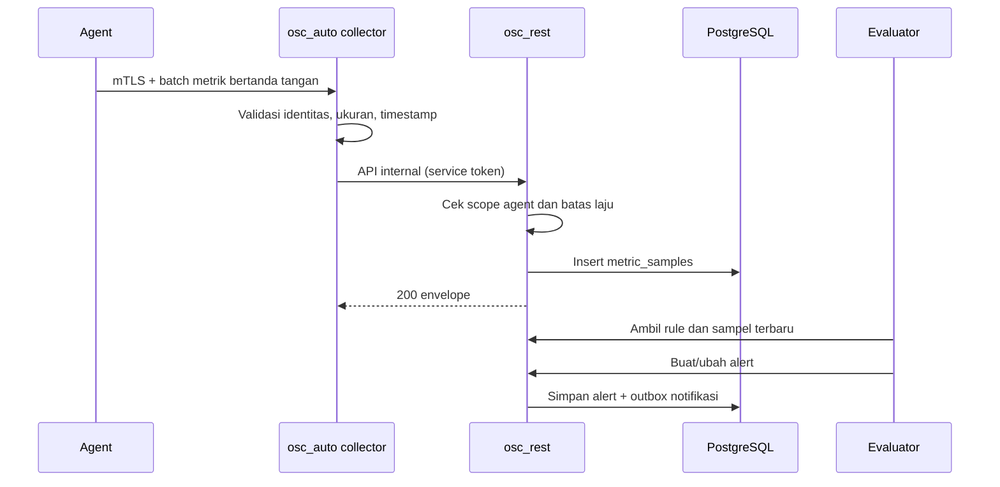

# Skema Operasi dan Monitoring

Schema: `monitor` dan `ops`. Tabel metrik dan job run memakai partisi bulanan.

## 1. Host dan agent

### `monitor.hosts`

| Kolom | Tipe | Catatan |
|---|---|---|
| `id` | uuid pk | |
| `company_id` | uuid fk | |
| `area_id` | uuid fk | |
| `location_id` | uuid fk | |
| `name` | varchar(160) | |
| `hostname` | varchar(255) | |
| `os_family` | varchar(24) | `ubuntu`, `windows`, `other` |
| `os_version` | varchar(80) null | |
| `primary_ip` | inet null | |
| `status` | varchar(16) | `online`, `offline`, `maintenance`, `unknown` |
| `tags` | jsonb | |
| `created_at`, `updated_at`, `deleted_at` | timestamptz | |

Constraint: `FOREIGN KEY (company_id, area_id, location_id)` ke lokasi; host tidak boleh lintas tenant.

### `monitor.agents`

| Kolom | Tipe | Catatan |
|---|---|---|
| `id` | uuid pk | |
| `company_id` | uuid fk | |
| `host_id` | uuid null | Null untuk agent jaringan/backup |
| `kind` | varchar(24) | `host`, `container`, `network`, `backup`, `edge` |
| `version` | varchar(32) | |
| `fingerprint` | varchar(128) | Identitas perangkat |
| `cert_serial` | varchar(128) | Serial sertifikat mTLS |
| `capabilities` | jsonb | Fitur yang didukung |
| `status` | varchar(16) | `enrolled`, `online`, `offline`, `revoked` |
| `last_heartbeat_at` | timestamptz null | |
| `enrolled_at` | timestamptz | |
| `revoked_at` | timestamptz null | |
| `revoke_reason` | varchar(160) null | |
| `created_at`, `updated_at` | timestamptz | |

### `monitor.agent_enrollment_tokens`

| Kolom | Tipe | Catatan |
|---|---|---|
| `id` | uuid pk | |
| `company_id` | uuid fk | |
| `kind` | varchar(24) | |
| `token_hash` | bytea | Hash, bukan token mentah |
| `expires_at` | timestamptz | Pendek, misalnya 30 menit |
| `used_at` | timestamptz null | Sekali pakai |
| `created_by` | uuid | |
| `created_at` | timestamptz | |

Aturan enrollment:

- Token dibuat admin, berlaku singkat, sekali pakai.
- Agent mengirim CSR; `osc_auto`/`osc_rest` memvalidasi dan menandatangani sertifikat.
- Agent menerima sertifikat client + CA, lalu memakai mTLS untuk semua panggilan.
- Agent yang dicabut tidak bisa heartbeat atau mengirim metrik.

## 2. Metrik

### `monitor.metric_definitions`

Katalog global.

| Kolom | Tipe | Catatan |
|---|---|---|
| `code` | varchar(64) pk | Misalnya `host.cpu.usage_pct` |
| `name` | varchar(120) | |
| `unit` | varchar(16) | `%`, `bytes`, `count`, `ms` |
| `value_type` | varchar(16) | `gauge`, `counter` |
| `description` | text null | |

### `monitor.metric_samples`

| Kolom | Tipe | Catatan |
|---|---|---|
| `agent_id` | uuid | |
| `company_id` | uuid | |
| `metric_code` | varchar(64) | |
| `ts` | timestamptz | Waktu sampel |
| `value` | double precision | |
| `labels` | jsonb | Kardinalitas dibatasi |
| `ingested_at` | timestamptz | Waktu diterima |

Partisi:

```sql
CREATE TABLE monitor.metric_samples (
  agent_id uuid NOT NULL,
  company_id uuid NOT NULL,
  metric_code varchar(64) NOT NULL,
  ts timestamptz NOT NULL,
  value double precision NOT NULL,
  labels jsonb NOT NULL DEFAULT '{}'::jsonb,
  ingested_at timestamptz NOT NULL DEFAULT now(),
  PRIMARY KEY (agent_id, metric_code, ts, company_id)
) PARTITION BY RANGE (ts);

CREATE TABLE monitor.metric_samples_2026_10
  PARTITION OF monitor.metric_samples
  FOR VALUES FROM ('2026-10-01') TO ('2026-11-01');
```

Aturan:

- Sampel dikirim batch, ditandatangani, dan memiliki timestamp.
- Timestamp di luar jendela ±5 menit ditolak atau ditandai `late`.
- Duplikat ditolak dengan `ON CONFLICT DO NOTHING`.
- Label dilarang memuat ID pengguna, path file, environment variable, atau data pribadi.
- Retensi raw 30 hari; partisi lama di-drop setelah rollup selesai.
- Jangan membuat index berlebihan pada tabel sampel.

### `monitor.metric_rollups_1h`

| Kolom | Tipe | Catatan |
|---|---|---|
| `agent_id` | uuid | |
| `company_id` | uuid | |
| `metric_code` | varchar(64) | |
| `bucket_start` | timestamptz | Awal jam |
| `min_value`, `max_value`, `avg_value` | double precision | |
| `sample_count` | integer | |
| `updated_at` | timestamptz | |

Primary key: `(agent_id, metric_code, bucket_start)`.

Agregasi dijalankan job terjadwal, idempotent, dan hanya membaca partisi yang relevan.

## 3. Alert dan insiden

### `monitor.alert_rules`

| Kolom | Tipe | Catatan |
|---|---|---|
| `id` | uuid pk | |
| `company_id` | uuid fk | |
| `code` | varchar(48) | Unik per perusahaan |
| `name` | varchar(160) | |
| `target_kind` | varchar(24) | `host`, `container`, `network`, `certificate` |
| `metric_code` | varchar(64) null | |
| `operator` | varchar(8) | `gt`, `gte`, `lt`, `lte`, `eq`, `neq` |
| `threshold` | double precision | |
| `for_seconds` | integer | Durasi sebelum firing |
| `severity` | varchar(16) | `info`, `warning`, `critical` |
| `channels` | jsonb | Kanal notifikasi |
| `enabled` | boolean | |
| `created_by` | uuid | |
| `created_at`, `updated_at` | timestamptz | |

### `monitor.alerts`

| Kolom | Tipe | Catatan |
|---|---|---|
| `id` | uuid pk | |
| `company_id` | uuid fk | |
| `rule_id` | uuid fk | |
| `host_id` | uuid null | |
| `fingerprint` | varchar(128) | Untuk deduplikasi |
| `status` | varchar(16) | `firing`, `acknowledged`, `resolved`, `silenced` |
| `severity` | varchar(16) | |
| `value` | double precision null | |
| `labels` | jsonb | |
| `annotations` | jsonb | |
| `started_at` | timestamptz | |
| `acknowledged_at`, `acknowledged_by` | timestamptz, uuid null | |
| `resolved_at` | timestamptz null | |
| `incident_id` | uuid null | |
| `created_at`, `updated_at` | timestamptz | |

Constraint: satu alert `firing` per fingerprint.

### `monitor.incidents`

| Kolom | Tipe | Catatan |
|---|---|---|
| `id` | uuid pk | |
| `company_id` | uuid fk | |
| `area_id` | uuid null | |
| `title` | varchar(200) | |
| `severity` | varchar(16) | |
| `status` | varchar(24) | `open`, `investigating`, `mitigated`, `resolved`, `closed` |
| `owner_user_id` | uuid null | |
| `opened_at` | timestamptz | |
| `mitigated_at`, `resolved_at`, `closed_at` | timestamptz null | |
| `root_cause` | text null | |
| `postmortem_file_id` | uuid null | |
| `created_at`, `updated_at` | timestamptz | |

Aturan:

- Alert dapat digabung ke satu insiden.
- Maintenance window menekan alert yang sesuai, tetapi tetap dicatat.
- Penyelesaian insiden memerlukan catatan tindakan.

## 4. Endpoint dan stack container

### `ops.container_endpoints`

| Kolom | Tipe | Catatan |
|---|---|---|
| `id` | uuid pk | |
| `company_id` | uuid fk | |
| `host_id` | uuid fk | |
| `name` | varchar(120) | |
| `engine` | varchar(16) | `docker`, `podman` |
| `api_base_url` | text | Hanya jaringan internal/agent |
| `credential_ref` | text null | Vault |
| `tls_verify` | boolean | Wajib true untuk produksi |
| `status` | varchar(16) | `online`, `offline`, `degraded` |
| `engine_version` | varchar(64) null | |
| `last_seen_at` | timestamptz null | |
| `created_at`, `updated_at` | timestamptz | |

### `ops.container_stacks`

| Kolom | Tipe | Catatan |
|---|---|---|
| `id` | uuid pk | |
| `company_id` | uuid fk | |
| `endpoint_id` | uuid fk | |
| `name` | varchar(120) | |
| `source_kind` | varchar(16) | `git`, `upload`, `template` |
| `source_ref` | text null | Repo/commit atau file |
| `compose_hash` | bytea | SHA-256 |
| `status` | varchar(24) | `draft`, `deployed`, `failed`, `stopped`, `drifted` |
| `current_revision_id` | uuid null | |
| `previous_revision_id` | uuid null | |
| `last_deployed_at` | timestamptz null | |
| `deployed_by` | uuid null | |
| `created_at`, `updated_at` | timestamptz | |

Constraint: `UNIQUE (endpoint_id, name)`.

### `ops.container_revisions`

Menyimpan snapshot compose dan digest image untuk rollback.

| Kolom | Tipe | Catatan |
|---|---|---|
| `id` | uuid pk | |
| `company_id` | uuid fk | |
| `stack_id` | uuid fk | |
| `compose_content` | text | Terenkripsi/objek storage bila mengandung rahasia |
| `compose_hash` | bytea | |
| `image_digests` | jsonb | |
| `created_by` | uuid | |
| `created_at` | timestamptz | |

### `ops.container_services`

| Kolom | Tipe | Catatan |
|---|---|---|
| `id` | uuid pk | |
| `company_id` | uuid fk | |
| `stack_id` | uuid fk | |
| `name` | varchar(120) | |
| `image` | varchar(255) | |
| `image_digest` | varchar(128) | |
| `replicas` | integer | |
| `status` | varchar(16) | `running`, `stopped`, `error`, `unknown` |
| `health` | varchar(16) | `healthy`, `unhealthy`, `none` |
| `ports` | jsonb | |
| `resources` | jsonb | Limit CPU/memori |
| `updated_at` | timestamptz | |

### `ops.container_actions`

| Kolom | Tipe | Catatan |
|---|---|---|
| `id` | uuid pk | |
| `company_id` | uuid fk | |
| `endpoint_id` | uuid fk | |
| `stack_id` | uuid null | |
| `service_id` | uuid null | |
| `action` | varchar(32) | `deploy`, `rollback`, `start`, `stop`, `restart`, `pull` |
| `params` | jsonb | |
| `idempotency_key` | varchar(128) | |
| `requested_by` | uuid | |
| `approved_by` | uuid null | |
| `status` | varchar(24) | `pending_approval`, `approved`, `running`, `succeeded`, `failed`, `cancelled` |
| `started_at`, `finished_at` | timestamptz null | |
| `result` | jsonb null | |
| `log_ref` | text null | |
| `created_at` | timestamptz | |

Aturan:

- Deploy/rollback produksi memerlukan approval.
- Image dipin ke digest.
- Compose divalidasi sebelum eksekusi.
- Jika health check gagal, rollback ke revisi sebelumnya.
- Log tidak boleh memuat secret.

## 5. Job dan scheduler

### `ops.jobs`

| Kolom | Tipe | Catatan |
|---|---|---|
| `id` | uuid pk | |
| `company_id` | uuid fk | |
| `name` | varchar(160) | |
| `kind` | varchar(48) | `metric_rollup`, `backup`, `sync`, `notification`, `cert_check` |
| `cron` | varchar(64) | |
| `timezone` | varchar(64) | |
| `payload` | jsonb | |
| `enabled` | boolean | |
| `max_attempts` | integer | |
| `timeout_seconds` | integer | |
| `next_run_at` | timestamptz | |
| `lease_owner` | varchar(120) null | Worker yang mengambil |
| `lease_until` | timestamptz null | |
| `last_run_at` | timestamptz null | |
| `created_by` | uuid | |
| `created_at`, `updated_at` | timestamptz | |

### `ops.job_runs`

| Kolom | Tipe | Catatan |
|---|---|---|
| `id` | uuid pk | |
| `company_id` | uuid fk | |
| `job_id` | uuid fk | |
| `scheduled_for` | timestamptz | |
| `started_at`, `finished_at` | timestamptz null | |
| `status` | varchar(16) | `queued`, `running`, `succeeded`, `failed`, `timeout`, `skipped` |
| `attempt` | integer | |
| `worker_id` | varchar(120) null | |
| `exit_code` | integer null | |
| `output_ref` | text null | |
| `error_code` | varchar(48) null | |
| `idempotency_key` | varchar(128) | |
| `created_at` | timestamptz | |

Aturan:

- `osc_auto` mengambil job dari `osc_rest` lewat API internal.
- `osc_rest` memakai `SELECT ... FOR UPDATE SKIP LOCKED` untuk lease, sehingga tidak ada eksekusi ganda.
- Job harus idempotent dan memiliki timeout.
- Job run dipartisi bulanan dan retensi 90 hari.
- Kegagalan berulang memicu alert.

## 6. Backup konfigurasi

### `ops.config_sources`

| Kolom | Tipe | Catatan |
|---|---|---|
| `id` | uuid pk | |
| `company_id` | uuid fk | |
| `name` | varchar(120) | |
| `kind` | varchar(24) | `routeros`, `nginx`, `device`, `custom` |
| `target_ref` | uuid | Device/edge/router |
| `schedule` | varchar(64) | Cron |
| `credential_ref` | text | Vault |
| `enabled` | boolean | |
| `last_run_at` | timestamptz null | |
| `created_at`, `updated_at` | timestamptz | |

### `ops.config_backups`

| Kolom | Tipe | Catatan |
|---|---|---|
| `id` | uuid pk | |
| `company_id` | uuid fk | |
| `source_id` | uuid fk | |
| `taken_at` | timestamptz | |
| `checksum` | bytea | |
| `storage_key` | text | Terenkripsi |
| `size_bytes` | bigint | |
| `diff_from_previous` | jsonb null | Ringkasan diff |
| `status` | varchar(16) | `success`, `failed`, `corrupt` |
| `error_code` | varchar(48) null | |
| `created_at` | timestamptz | |

Aturan:

- Snapshot bersifat append-only.
- Backfill tidak menimpa snapshot lama.
- Diff besar dipotong agar aman ditampilkan.
- Konfigurasi yang mengandung secret disimpan terenkripsi dan akses dibatasi.

### `ops.backup_restores`

| Kolom | Tipe | Catatan |
|---|---|---|
| `id` | uuid pk | |
| `company_id` | uuid fk | |
| `backup_id` | uuid fk | |
| `requested_by` | uuid | |
| `reason` | text | |
| `approved_by` | uuid null | |
| `status` | varchar(24) | `pending_approval`, `approved`, `running`, `succeeded`, `failed`, `cancelled` |
| `executed_at` | timestamptz null | |
| `pre_restore_backup_id` | uuid null | Snapshot sebelum restore |
| `result` | jsonb null | |
| `created_at`, `updated_at` | timestamptz | |

Restore selalu memerlukan approval dan membuat snapshot sebelum eksekusi.

## 7. Akses aman (bastion)

### `ops.bastion_targets`

| Kolom | Tipe | Catatan |
|---|---|---|
| `id` | uuid pk | |
| `company_id` | uuid fk | |
| `name` | varchar(120) | |
| `protocol` | varchar(16) | `ssh`, `rdp`, `sftp`, `ftp` |
| `host` | text | Host internal |
| `port` | integer | |
| `credential_ref` | text | Vault/JumpServer asset ref |
| `allowed_roles` | jsonb | Role yang boleh meminta |
| `approval_required` | boolean | Wajib true untuk produksi |
| `max_session_minutes` | integer | |
| `status` | varchar(16) | `active`, `disabled` |
| `created_at`, `updated_at` | timestamptz | |

### `ops.bastion_access_requests`

| Kolom | Tipe | Catatan |
|---|---|---|
| `id` | uuid pk | |
| `company_id` | uuid fk | |
| `target_id` | uuid fk | |
| `requester_user_id` | uuid | |
| `reason` | text | |
| `start_at`, `end_at` | timestamptz | |
| `approver_user_id` | uuid null | |
| `status` | varchar(24) | `pending`, `approved`, `rejected`, `expired`, `cancelled` |
| `created_at`, `updated_at` | timestamptz | |

### `ops.bastion_sessions`

| Kolom | Tipe | Catatan |
|---|---|---|
| `id` | uuid pk | |
| `company_id` | uuid fk | |
| `request_id` | uuid fk | |
| `target_id` | uuid fk | |
| `user_id` | uuid | |
| `external_session_id` | varchar(128) null | ID dari JumpServer |
| `started_at` | timestamptz | |
| `ended_at` | timestamptz null | |
| `source_ip` | inet | |
| `recording_ref` | text null | Referensi rekaman terenkripsi |
| `bytes_in`, `bytes_out` | bigint | |
| `status` | varchar(16) | `active`, `ended`, `terminated` |
| `created_at` | timestamptz | |

Aturan:

- MFA wajib.
- Sesi berakhir otomatis sesuai durasi.
- Admin dapat menghentikan sesi aktif; aksi dicatat.
- Rekaman hanya dapat diakses izin `AI:read` dan diaudit saat ditonton.

## 8. Maintenance window

### `ops.maintenance_windows`

| Kolom | Tipe | Catatan |
|---|---|---|
| `id` | uuid pk | |
| `company_id` | uuid fk | |
| `scope_type` | varchar(16) | `company`, `area`, `host`, `stack` |
| `scope_id` | uuid null | |
| `start_at`, `end_at` | timestamptz | |
| `reason` | text | |
| `status` | varchar(16) | `scheduled`, `active`, `finished`, `cancelled` |
| `created_by` | uuid | |
| `created_at`, `updated_at` | timestamptz | |

Maintenance window menekan alert, tetapi data metrik tetap direkam dan insiden tetap dapat dibuat manual.

## 9. Alur ingest metrik



Jika collector tidak tersedia, agent menyimpan buffer lokal terbatas dan mencoba ulang dengan backoff. Data terlambat lebih dari batas retensi ditolak.
