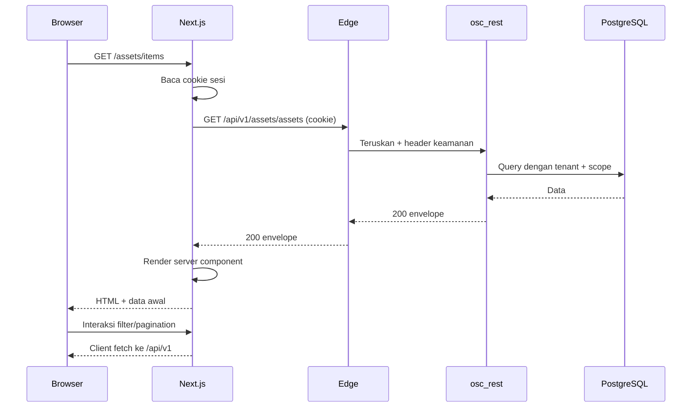
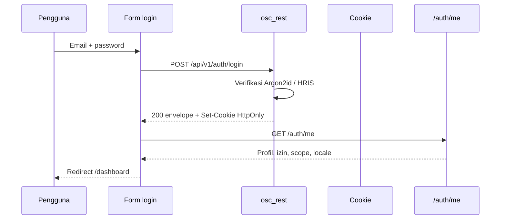
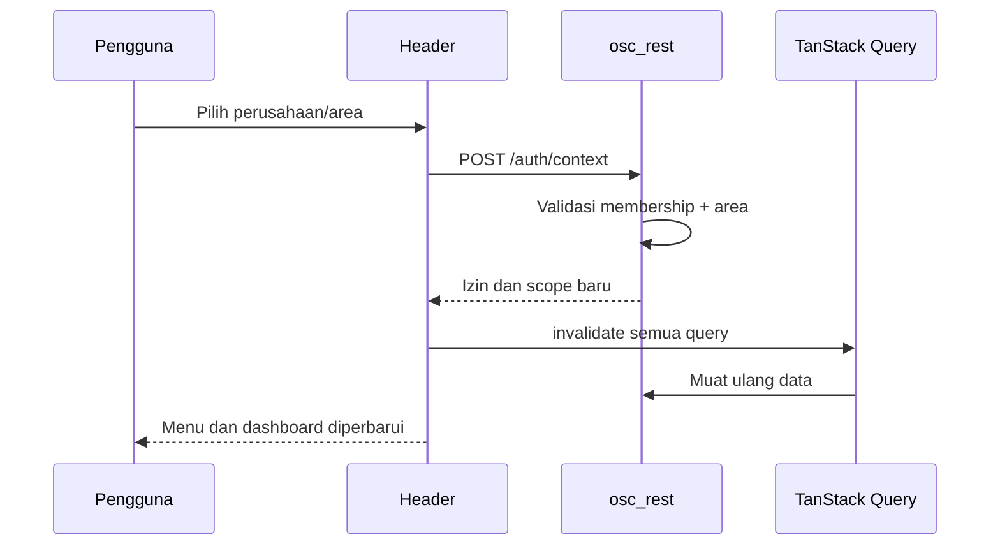
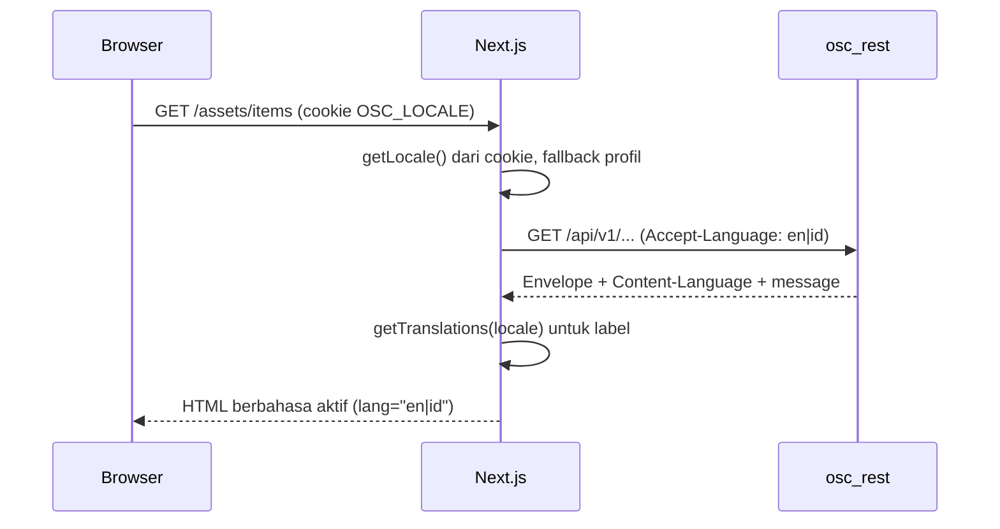

# Alur dan Arsitektur Frontend

## 1. Lapisan frontend

```text
app/ (route, layout, server component)
   │
widgets/ (sidebar, header, dashboard grid)
   │
features/ (login, checkout, deploy, approval)
   │
entities/ (asset card, user badge, ticket row)
   │
shared/ (api client, auth helper, i18n, ui primitives, utils)
```

Aturan:

- Server Component mengambil data awal.
- Client Component hanya untuk interaksi.
- Tidak ada fetch langsung ke integrasi eksternal.
- Semua request melewati `shared/api`.

## 2. Siklus request



## 3. Login



Aturan:

- Jika `mfa_required`, arahkan ke `/mfa`.
- Jika membership lebih dari satu, arahkan ke `/select-company`.
- Setelah `/auth/me`, set cookie `OSC_LOCALE` dari locale pengguna agar request berikutnya memakai bahasa yang sama.
- Jika login gagal, tampilkan pesan dari `message` (generik).
- Jangan menyimpan password di state setelah submit.
- Jangan menampilkan perbedaan antara akun tidak ada dan password salah.

## 4. Ganti perusahaan/area



- Perubahan konteks tidak boleh memakai data lama.
- Jika area tidak valid, kembali ke area default.
- Semua query key memuat `company_id` dan `area_id`.

## 5. Permission gating

```ts
export function can(
  session: Session,
  permission: string,
  scope?: { companyId?: string; areaId?: string },
): boolean {
  if (!session.permissions.includes(permission)) return false;
  if (scope?.companyId && session.scope.company_id !== scope.companyId) return false;
  if (scope?.areaId && !isAreaInScope(session, scope.areaId)) return false;
  return true;
}
```

Aturan:

- Hanya untuk UX (sembunyikan/disable).
- Server tetap memeriksa.
- Route layout memanggil `requirePermission` untuk mencegah akses URL langsung.
- Jika server menolak, tampilkan `/access-denied` atau toast, bukan halaman 403.

## 6. API client

```ts
export type ApiEnvelope<T> = {
  ok: boolean;
  code: string;
  message: string;
  data: T | null;
  meta: {
    request_id: string;
    timestamp: string;
    next_cursor?: string | null;
    has_more?: boolean;
    retry_after_seconds?: number;
  };
  errors?: Array<{ field?: string; code?: string; reason: string }>;
};

export class ApiError extends Error {
  constructor(
    public code: string,
    message: string,
    public requestId: string,
    public status: number,
    public retryAfterSeconds?: number,
  ) {
    super(message);
  }
}

export async function apiFetch<T>(
  path: string,
  init: RequestInit = {},
): Promise<ApiEnvelope<T>> {
  const csrf = readCookie("osc_csrf");
  const locale = readCookie("OSC_LOCALE") || "en";
  const res = await fetch(`/api/v1${path}`, {
    ...init,
    credentials: "include",
    headers: {
      Accept: "application/json",
      "Content-Type": "application/json",
      "Accept-Language": locale,
      ...(csrf ? { "X-CSRF-Token": csrf } : {}),
      ...init.headers,
    },
  });

  let body: ApiEnvelope<T>;
  try {
    body = (await res.json()) as ApiEnvelope<T>;
  } catch {
    throw new ApiError(
      "AA00-00-0900",
      "Service temporarily unavailable.",
      crypto.randomUUID(),
      res.status,
    );
  }

  if (!body.ok) {
    throw new ApiError(
      body.code,
      body.message,
      body.meta.request_id,
      res.status,
      body.meta.retry_after_seconds,
    );
  }

  return body;
}
```

Aturan:

- `credentials: "include"` untuk cookie.
- CSRF token dibaca dari cookie non-HttpOnly yang khusus; bukan dari localStorage.
- Jangan retry `post` tanpa idempotency.
- Tampilkan `request_id` pada error yang tidak dikenal.

## 7. Pesan, kode error, dan lokalisasi

| Kode | Aksi UI |
|---|---|
| `AA00-00-0001` | Tampilkan error field |
| `AA00-00-0002` | Redirect `/login` dan bersihkan cache |
| `AA00-00-0003` | Toast/halaman akses ditolak + request id |
| `AA00-00-0004` | Halaman tidak ditemukan |
| `AA00-00-0005` | Minta reload data |
| `AA00-00-0006` | Countdown `retry_after_seconds` |
| `AA00-00-0100` | Pesan generik + request id |
| `AA00-00-0900` | Pesan layanan sementara |
| `AB-*` | Pesan HRIS dari template sesuai locale |

Aturan:

- Jangan menampilkan kode mentah sebagai satu-satunya pesan.
- Simpan pemetaan kode ke kunci terjemahan di `shared/api/messages.ts`, bukan teks literal.
- Untuk error yang tidak dikenal, tampilkan pesan umum + request id.

### 7.1 Lokalisasi

Bahasa aktif diselesaikan sekali di layout server, lalu dipakai ulang oleh komponen klien.



Urutan penentuan locale:

1. Cookie `OSC_LOCALE` yang nilainya ada di allowlist (`en`, `id`).
2. Locale dari `/auth/me` (`core.users.locale`).
3. Default `en`.

Aturan:

- Default bahasa Inggris; pengguna dapat memilih Indonesia.
- Ganti bahasa: `PATCH /auth/me` dengan `{ "locale": "id" }`, lalu perbarui cookie `OSC_LOCALE`, invalidasi query yang memuat pesan dari backend (misalnya notifikasi dan riwayat audit), dan render ulang.
- Server Component memakai `getLocale()` dan `getTranslations()`; Client Component memakai `useTranslations()`.
- Atribut `<html lang>` mengikuti locale untuk aksesibilitas.
- Label UI, pesan validasi, dan nama status diambil dari katalog `messages/en.json` dan `messages/id.json`.
- Kode error, kode modul, dan kode status tidak diterjemahkan.
- Data pengguna (nama entitas, tag aset, alamat) tidak diterjemahkan; API mengirim nilai mentah dan frontend hanya memformat tanggal/angka dengan `Intl`.
- `message` dari backend dipakai bila ada; bila kosong, frontend memetakan `code` ke kunci terjemahan lokal.
- Kunci yang hilang jatuh ke `en`, bukan halaman error atau label kosong.
- Halaman terautentikasi tidak boleh di-cache bersama antar pengguna karena bahasa berasal dari cookie; gunakan `Cache-Control: private, no-store`.

## 8. Data fetching

### Server Component

```tsx
export default async function AssetsPage() {
  const session = await getSession();
  requirePermission(session, "AC:read");

  const initial = await apiServer<AssetPage>("/assets/assets?limit=25");

  return <AssetTable initialData={initial} />;
}
```

### Client Component

```tsx
const query = useQuery({
  queryKey: ["assets", companyId, areaId, filters],
  queryFn: () => apiFetch<AssetPage>(`/assets/assets?${toQuery(filters)}`),
  placeholderData: (prev) => prev,
});
```

Aturan:

- Server Component untuk render awal.
- Client hanya untuk filter, pagination, dan aksi.
- Query key stabil dan memuat tenant.
- `staleTime` disesuaikan: dashboard 30 detik, audit 0, master data 5 menit.
- Jangan menyimpan data server besar di Zustand.

## 9. Form dan aksi

- React Hook Form + Zod untuk validasi UX.
- Validasi akhir tetap di server.
- Tombol submit memiliki state loading dan disabled.
- Aksi sensitif memakai dialog konfirmasi dengan ringkasan dampak dan alasan.
- Aksi destruktif tidak boleh menjadi tombol utama.
- Setelah sukses, invalidasi query terkait dan tampilkan toast.

## 10. Approval

Halaman approval menampilkan:

- Ringkasan permintaan.
- Pemohon, perusahaan, area, dan waktu.
- Diff sebelum/sesudah.
- Risiko dan rollback plan.
- Riwayat approval.
- Tombol setuju/tolak dengan alasan.

Aturan:

- Approver tidak boleh menyetujui permintaannya sendiri jika kebijakan melarang.
- Aksi approval memakai `Idempotency-Key`.
- Setelah approval, status diperbarui dan audit ditampilkan.

## 11. Tabel dan pagination

- TanStack Table dengan server-side pagination.
- State filter disimpan di URL search params agar bisa dibagikan.
- Cursor opaque, bukan offset.
- Kolom sensitif disembunyikan sesuai izin.
- Export memakai endpoint khusus dengan approval.
- Empty state menjelaskan langkah berikutnya.
- Loading memakai skeleton, bukan spinner global.

## 12. Grafik metrik

- Ringkasan memakai Recharts.
- Metrik padat memakai uPlot.
- Server mengirim titik yang sudah di-downsample sesuai rentang.
- Rentang waktu memakai zona waktu pengguna.
- Jangan memuat jutaan titik ke browser.
- Sertakan legenda, tooltip, dan akses keyboard.

## 13. Audit viewer

- Filter: waktu, aktor, modul, aksi, entity, request id.
- Diff before/after dengan field merahasiakan ditandai `[redacted]`.
- Tautan ke entitas terkait jika masih ada.
- Ekspor memerlukan izin dan alasan.
- Tidak ada tombol hapus.
- Hash chain status ditampilkan untuk auditor.

## 14. File upload dan download

Upload:

- Form multipart ke `osc_rest`.
- Batas ukuran dan jenis di klien dan server.
- Server memindai dan menyimpan metadata.
- Jangan memberi kredensial storage ke browser.

Download:

- Melalui endpoint API.
- `Content-Disposition: attachment`.
- Tidak membuka file di tab yang sama untuk jenis berisiko.
- Audit akses file sensitif.

## 15. Notifikasi

- In-app: polling 30 detik atau SSE bila tersedia.
- Email/webhook dikirim `osc_auto` lewat outbox.
- Preferensi pengguna di `AK05`.
- Jangan menampilkan isi sensitif di preview notifikasi.
- Deduplikasi berdasarkan `dedup_key`.

## 16. Keamanan frontend

- CSP dengan nonce dan `strict-dynamic` bila memungkinkan.
- `X-Frame-Options: DENY` atau CSP `frame-ancestors 'none'`.
- `Referrer-Policy: strict-origin-when-cross-origin`.
- Sanitasi markdown di server dan klien.
- Tidak ada `dangerouslySetInnerHTML` untuk input pengguna tanpa sanitasi.
- Redirect hanya ke path internal yang diizinkan.
- Tidak ada token di `localStorage`.
- Tidak ada secret di `NEXT_PUBLIC_*`.
- Dependency scanning dan lockfile.
- Validasi URL gambar.
- Nilai `Accept-Language` dan cookie locale divalidasi terhadap allowlist; nilai asing jatuh ke `en`.
- Teks terjemahan dirender sebagai teks biasa; tidak ada `dangerouslySetInnerHTML` dari katalog.
- Terjemahan tidak dipakai untuk keputusan izin atau redirect ke halaman istimewa; izin tetap dari sesi.
- Pesan keamanan tetap generik di kedua bahasa agar tidak membocorkan detail.

## 17. Testing

- Playwright: login, ganti perusahaan, akses ditolak, checkout aset, deploy approval, audit.
- Playwright: ganti bahasa ke `id`, muat ulang halaman, pastikan pilihan bertahan dan pesan backend ikut berbahasa Indonesia.
- Vitest: helper izin, mapping error, formatter, resolusi locale, dan fallback kunci yang hilang.
- Testing Library: form dan dialog pada dua bahasa.
- axe: halaman utama pada `en` dan `id`.
- Mock Service Worker untuk komponen.
- Uji dengan dua perusahaan dan dua area untuk memastikan tidak ada kebocoran.
- CI memeriksa paritas kunci `en.json` dan `id.json` serta tidak ada teks UI hardcoded.

## 18. Deployment

- Next.js standalone.
- Env:
  - `NEXT_PUBLIC_API_BASE=/api/v1`
  - `NEXT_PUBLIC_DEFAULT_LOCALE=en`
  - `NEXT_PUBLIC_SUPPORTED_LOCALES=en,id`
  - `OSC_INTERNAL_API_URL=http://osc-rest:8080`
  - `OSC_PUBLIC_SITE_URL=https://portal.example.com`
- Katalog bahasa dibundel saat build; tidak ada unduhan katalog dari layanan eksternal.
- Tidak ada akses database.
- Health endpoint internal.
- Log ke stdout.
- Container read-only dengan cache/tmp yang sesuai.

## 19. Checklist frontend

- [ ] Tidak ada token di localStorage.
- [ ] Semua menu punya cek izin.
- [ ] Server tetap memeriksa izin.
- [ ] Query key memuat tenant/area.
- [ ] Error envelope ditangani.
- [ ] Approval memakai idempotency.
- [ ] Markdown disanitasi.
- [ ] CSP dan header keamanan.
- [ ] E2E dua tenant lulus.
- [ ] Aksesibilitas dasar lulus.
- [ ] Default bahasa `en`, dapat diganti ke `id` per pengguna.
- [ ] Tidak ada teks UI hardcoded; semua dari katalog.
- [ ] Kunci `en` dan `id` paritas.
- [ ] `Accept-Language` dikirim sesuai bahasa aktif.
- [ ] Kunci hilang jatuh ke `en`.
- [ ] Tanggal dan angka mengikuti locale pengguna.
